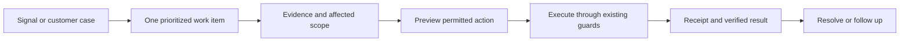

# Taco Mission Control — founder brainstorm

Status: discussion and local review only, September 27, 2026. No admin implementation or backend changes are authorized by this document. The user wants full administrative coverage, operated by the founder alone while the startup is at inception, and explicitly requested brainstorming first.

This opens the admin redesign as its own workstream. It supersedes the decision to defer discussing admin in `internal-product-blueprint.md`; the customer-workspace implementation remains separate. All work stays in the independent Taco-upgrade clone.

## Product premise

Mission Control should let one person understand the business, find the next consequential task, and complete it with a clear result. It should be useful before launch and with the first five customers. A large collection of charts is not sufficient evidence that the business is under control.

The daily questions are:

- Can customers complete the core experience today?
- Is anyone stuck, and what can I do for them?
- Are the matches and drafts useful and grounded in their source?
- What are we earning, spending and committing to spend?
- What changed, and what should I work on next?

## Existing admin: what the review found

Reviewed local source, existing architecture/runbooks, and the development-only overview fixture in the browser, including its incident drawer. Fixture customer counts, revenue and service metrics are synthetic and are not evidence about the startup. No authenticated production admin session, provider checks, account changes or live financial data were used.

| Area | Existing capability | Consequence for a rebuild |
|---|---|---|
| Navigation | Ten sections: Overview, Users, Access, Finance, Support, Operations, Email, Calibration, Observability and Audit | Full domain coverage already exists; reorganize it around the founder's work |
| Overview | System lanes, selected signal, priority queue, event stream | The same current signals recur in four places. Give each surface a distinct purpose |
| Operations | Configuration/readiness evidence, provider verification workflows, platform controls | Routine overview is not live telemetry. Throughput, p95 and error rates are currently null in the real ops response |
| History | Current snapshots and administrative audit | The overview's Event Stream repeats snapshots; true incident history and trend comparisons require additional data |
| Search | Permission-filtered module navigation | Account, case, run and action search need new scoped lookup capabilities |
| Customers | Exact lookups, a bounded owner directory, account detail and usage caps | A connected customer workspace and indexed directory would reduce repeated searches |
| Product evidence | Recommendation calibration and privacy-suppressed observability | Define activation and useful outcomes; current active-today/week counts use last Firebase sign-in |
| Money | Verified recurring MRR, estimated workload costs and billing reconciliation | MRR, cash receipts, cost estimates, actual expenses and runway must remain distinct |
| Access/actions | Six roles, server checks, MFA/recovery gates, idempotency, execution leases and audit | Preserve and test these foundations under the new experience |

Specific weaknesses to correct: unavailable operations can currently produce an apparent zero-alert count; audit copy says immutable while the foundation is application append-only; 6H/24H/7D overview controls are disabled because historical telemetry is absent. The browser layout also devotes its left rail to customer-workspace tools while admin sections occupy a long horizontal row. Admin should have its own primary navigation, with a simple link back to the customer app.

## Seven possible directions

These are alternatives explored before selecting a hybrid, not seven new top-level menus.

| Direction | Central idea | Main uncertainty |
|---|---|---|
| Founder Brief | A short evidence-linked explanation of what changed across customers, quality, money and reliability | Requires real comparisons and useful prioritization |
| Mission Queue | Begin with work items; open evidence, act, receive a result. Make the dashboard secondary | Needs durable item identity, deduplication, snooze/resolution and recurrence rules |
| Customer Journey Desk | Find an account once and connect its operational, billing, support and authorized diagnostic context | Must respect diagnostic grants and avoid unrestricted content access |
| Taco Quality Lab | Inspect bad matches, missing evidence, provider failures and evaluation results | Sparse early samples cannot establish quality trends |
| Money and Runway Room | Connect revenue evidence, expenses, spend exposure and explicit forecasts | Cash, fixed expenses and actual provider invoices are additional inputs |
| Launch and Reliability Console | Prove critical journeys before launch, then detect and recover failures | Needs persistent test receipts, measurements and operational history |
| Five-room simplification | Remove repeated panels and group all capabilities into Today, Customers, Product, Money and Platform | Deeper actions still need good search and contextual links |

## Recommended hybrid

Use the five-room structure with a Founder Brief and Mission Queue on Today. All domains remain accessible from day one; prioritization changes as the startup gains customers.

| Area | Proposed contents |
|---|---|
| **Today** | Launch readiness, urgent work, meaningful changes, small business pulse, pinned founder actions |
| **Customers** | Directory, account workspace, onboarding state, support cases, billing context, authorized diagnostics, communication history |
| **Product** | Experience → matches → drafts funnel, usefulness feedback, recommendation quality, evaluations, job-source quality, acquisition/conversion evidence when available |
| **Money** | Subscriptions, payment evidence, reconciliation, actual and estimated expenses, spend budgets, unit economics, assumption-based forecasts |
| **Platform** | AI/job/email providers, scheduled jobs, delivery, incidents, releases, feature settings, access, security and recovery posture |

Audit and access remain globally reachable. Global search should eventually find permitted accounts, cases, runs and actions. Marketing acquisition, attribution and campaign tooling should be scoped explicitly if needed; an admin rebuild does not automatically create a CRM or content-management system.

### The Today screen

Start with a persistent environment label, search and the operator identity. Then show a brief explanation of the current situation, followed by an ordered work queue. Each item states its impact, evidence, age and next action. A compact business strip shows only metrics that are actually available. Recent changes are recorded events, not a replay of the same health snapshot.

An explicit Launch / Operate view changes emphasis without hiding capabilities. Launch emphasizes outstanding setup, critical-journey verification and recovery readiness. Operate emphasizes customer blockers, failures, costs and useful outcomes. Do not switch modes based on an arbitrary customer-count threshold.

Suggested workflow:

Marking a work item resolved must not turn a failing system green. A recurring unresolved condition should reopen or update the same item using defined rules. Prefer simple snooze, resolve and follow-up controls while there is one operator; team assignment machinery can wait.

### Ideas worth pushing further

1. **Taco explains Taco.** An optional operations assistant answers questions using permitted evidence and links to its sources. Begin with explanations and proposed actions. Any future execution goes through the same action registry, permissions and audit as a button.
2. **Follow one failed customer journey.** Open a report and see the relevant stage, system result, permitted diagnostics, cost estimate and recovery option together. Start with one narrowly defined scenario rather than trying to reconstruct every user session.
3. **A trustworthy cost-per-success view.** Connect measured work and provider usage to a defined successful scout or reviewed packet. Show what is estimated, omitted or still collecting. Do not present that as total business profit.
4. **A launch rehearsal.** Use synthetic accounts and an isolated environment to exercise signup, source confirmation, match retrieval, draft review, payment recovery and email delivery. Store receipts and expiry so “passed last month” cannot imply “ready now.”

## Visual direction

Propose a dedicated, compact Taco workspace: clear type, one primary admin sidebar, a strong table system, restrained borders and a persistent context/detail pane. Offer dark and light modes. Reuse the Taco identity while giving dense operational work its own layout. Reserve coral for selected emphasis and meaningful attention; use explicit labels alongside health colors.

Use short transitions to explain opening a case, changing scope and completing an action. Keep tables, numbers and reading surfaces steady. No decorative counters, perpetual animated maps or fabricated trend lines. A quiet screen should look intentional when there are no customers or transactions yet.

## Data and operating decisions before implementation

- Every metric needs a definition, source, observation window, collection time, completeness and freshness. Distinguish zero, unknown, stale, restricted and not configured. A missing provider result must not read as “healthy.”
- Existing aggregates cap reads at 1,000 auth users, 2,000 subscriptions, 1,000 usage records and 1,000 economics events. Add incremental history when required; do not hide the caps or claim unlimited analytics.
- Customer support metadata and consented diagnostics remain separate authorization domains even when they share a screen. No default browsing of resumes, private chat or application documents; no generic impersonation shortcut.
- Protected mutations currently require MFA and verified recovery-owner readiness. The founder is the sole daily operator, so recovery ownership needs an explicit policy decision. This is not two-person approval of every action. Do not silently remove the existing gate.
- A reusable action contract should cover preview, affected scope, operator reason, required confirmation, idempotency, execution receipt, audit reference, and reconciliation/retry after ambiguous outcomes. Only offer reversal where an actual reversal exists.
- Growth, retention and activation require meaningful product events; sign-in counts are insufficient. Reuse consent and suppression rules and keep private source content out of analytics.
- Forecasts need declared assumptions and actual inputs. Existing MRR and estimated provider costs cannot establish cash runway or net profit.

## Proposed sequence after the brainstorm converges

| Stage | Outcome | Acceptance question |
|---|---|---|
| 1. Scenario prototype | Five rooms and Today, using clearly labeled fixtures and empty states | Can one founder identify and investigate the next task without duplicated searching? |
| 2. Read-only foundation | New shell, evidence contracts, directory, connected customer view and real data adapters | Are unknown, stale, restricted and measured values distinguishable and correctly scoped? |
| 3. Work and actions | Durable queue, shared action framework, receipts and recovery | Do duplicate clicks, concurrent edits, expired sessions and provider failures leave a truthful result? |
| 4. Product and economics | Activation events, quality evaluations, provider/job telemetry, cost and history rollups | Can every displayed insight be traced to a definition and sufficient data? |
| 5. Assistance and delegation | Evidence-grounded brief/copilot and future team roles | Does assistance preserve permissions and require appropriate review of consequential actions? |

Before implementation, walk through: no customers yet; first customer stuck; poor match; billing mismatch; provider outage; stale data; and duplicate action retry. Compare the number of steps and the clarity of the answer with the current admin. Use isolated request/transaction tests beyond the existing source-contract tests. No production writes or migration are part of this brainstorm.

## Source references

- `components/admin/shell/admin-navigation.ts`, `AdminSearch.tsx`, `AdminTopbar.tsx`, `AdminWorkspaceRail.tsx`: navigation and shell.
- `components/admin/overview/AdminOverview.tsx`: signal reuse, unavailable history controls, zero-alert state and evidence drawer.
- `components/admin/visual-review/AdminVisualReviewContext.tsx`: synthetic browser review data, not business facts.
- `app/api/admin/ops/route.ts`: actual operational evidence and uninstrumented metrics.
- `app/api/admin/users/route.ts`, `app/api/admin/users/[uid]/route.ts`: bounded lookup and account summary.
- `lib/admin/read-models.ts`, `aggregate-materializer.ts`, `aggregate-contracts.ts`: limits, sign-in activity basis, finance and freshness.
- `lib/admin-auth.ts`, `lib/admin-permissions.ts`, `lib/admin-accounts.ts`, `lib/admin/mutation-claims.ts`: existing security and action foundations.
- `app/api/admin/diagnostic-cases/[caseId]/activity/route.ts`: case-bound diagnostic access.
- `docs/admin-command-grid-implementation-plan.md`, `docs/admin-command-grid-operations.md`: existing architecture and operating limits.

Open discussion: how prominent should the operations assistant be; which first real founder scenario best tests the prototype; and what recovery setup is appropriate before enabling privileged controls? These are design/policy questions, not requests to execute changes now.
