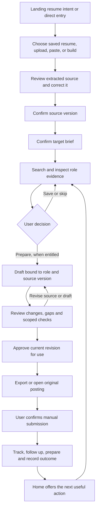

# Taco internal product blueprint

Blueprint and implementation record · September 27–28, 2026; product exploration updated October 8 · independent Taco-upgrade workspace

**Purpose:** turn the completed landing direction into a coherent product: confirmed experience → a useful role decision → an application the person can review and use → a clear next action when they return.

**Tool-experience build, October 9:** [Guided tool experience DNA](tool-upgrade-plan.md#guided-tool-experience-dna--9-october-2026) uses one working brief, one current task and one honest outcome, with optional guidance highlighting actual controls sequentially. The shared controller and tool-family adapters are implemented locally; browser acceptance remains pending. See [implementation and verification](tool-upgrade-implementation.md#guided-tool-experience-dna--9-october-2026). Navigation and tools remain intact; the modest Find roles cleanup is separately bounded.

**Execution sequence, October 9:** the [agentic implementation plan](taco-agentic-implementation-plan.md) defines the next P0–P6 milestones, including the data-backed Daily focus integration. It preserves existing workspace behavior and records the production-design prerequisite conflict; it does not authorize a palette change or claim new runtime implementation.

**Status:** the core internal workspace is implemented for local review. Start with `docs/internal-workspace-review.md` for the review path, commands, validation and remaining release checks. The design uses the recommended workflow-first and existing-resume defaults. The research proposals and rollout gates below remain planning material, not completed studies.

**Latest direction:** section 15 captures the founder's October 8 request for curated job subscriptions, reminders, status reports, learning progress and an inclusive dashboard, with job-seeker freedom central. It extends the existing workspace; it is exploration and a recommended sequence, not a claim that the additions are implemented. Use the current original-blue Taco / paper / ink / coral palette, with lavender reserved for decorative shadows; older lime/teal prescriptions below are historical.

This plan extends `docs/upgrade-plan.md` and its M5–M6 activation/repeat-use work. It does not restart the completed landing. It is the proposed internal information architecture and visual direction; existing authentication, entitlement, evidence and export guarantees remain constraints. Historical teal/rounded-card design prescriptions are not the target visual direction for the new scoped workspace.

## 1. Decisions, assumptions and evidence

### Settled in this conversation

- Internal structure precedes screen polish.
- Carry over warm paper, ink, coral actions, square frames and restrained lime/lavender accents.
- Organize a complete journey before migrating the full tool catalogue.
- Continue in `/home/xwingace/Documents/Projects/Taco-upgrade`. The original checkout remains untouched.
- The landing entry remains resume-first. Its current destination is `/suite/agent?intent=resume-upload`.
- Keep applications under user control: drafting, approving, exporting and actually submitting are distinct actions.

### Working recommendations awaiting user preference

| Decision | Recommended default | What an alternative changes |
|---|---|---|
| Primary interaction | Explicit workflow screens with contextual Ask Taco | A conversation-first choice would move intake and progression into chat, while documents and review still need persistent surfaces |
| First audience | Active job seekers who have a resume | New graduates need a richer experience-building start; career changers need earlier transferable-evidence guidance |
| Search scope | One visibly selected target brief at a time | Preserve existing multi-role preferences; do not introduce multiple new search-project containers in the first release |
| Existing features | Keep routes and capabilities; reorganize their prominence | Removing a navigation shortcut does not delete its tool or data |
| Theme rollout | Paper workspace as the first visual reference | Preserve an existing explicit theme choice; validate both supported modes before enabling redesigned routes for everyone |

These are product hypotheses, not validated user-research findings. No claim is made that the proposed hierarchy will improve conversion until measured.

### Source findings at planning time

| Observed in source | Implication |
|---|---|
| Home contains greeting/profile context, quick actions, Today, a command center and other tool/content sections | Consolidate competing calls to action and duplicate summaries |
| Desktop sidebar, mobile tools and dashboard groups each describe navigation | Define a shared navigation model, then adapt its presentation by surface |
| `WorkspaceFrame` already hosts auth recovery, navigation and assistant surfaces | Extend the current shell rather than replace authentication or invent a parallel app |
| Job Search already uses a role list and selected-role detail panel | Keep this productive structure and improve evidence, continuity and visual treatment |
| Resume Studio has source/review machinery; Ask Taco and the onboarding modal have their own intake paths | Establish one intake contract and reuse it across entry points |
| The onboarding modal advances after parsing and writes a profile separately | Parsing is not source confirmation; resume-intent arrival must not compete with a second setup flow |
| Queue records and application records have different status vocabularies | A single Applications destination needs an explicit adapter, not a database status rename |
| Today already distinguishes a partial fetch from an empty inbox | Preserve failure/unknown states when simplifying the dashboard |
| The local clone uses copied service configuration | Localhost and demo login alone do not establish an isolated integration environment |

Evidence in this document is based on source inspection. Authenticated product behavior and external-service behavior have not been exercised for this planning task.

## 2. Brainstorm: possible product structures

| Approach | Strength | Main weakness | Decision |
|---|---|---|---|
| Refresh the existing tool directory | Small navigation disruption | People still have to assemble their own workflow | Keep searchable access to tools, not as the primary experience |
| Conversation first | Easy to express an uncertain goal | Progress, versions and approvals can become buried in messages | Keep full Ask Taco, with persistent artifacts outside the transcript |
| One linear setup wizard | Clear first-time sequence | Returning users and direct links become awkward | Use a short resumable intake, not a mandatory tour of the entire product |
| Action inbox first | Makes return visits useful | Does not explain the first session by itself | Adopt for Home after setup |
| A workspace around each opportunity | Keeps the job, evidence and application connected | Can overproduce containers before a role is worth pursuing | Adopt once a role is saved or a draft is requested |
| Document first | Strong fit for resume truth and review | Can bury discovery and future actions | Adopt for Experience and application review |
| Adaptive journey with a few stable destinations | Supports setup, active work and return visits | Requires shared state and careful prioritization | Recommended organizing structure |

**Proposed combination:** a short source-confirmation journey for new users; an action-led Home for returning users; document-led Experience and review; a consistent role detail surface that carries context into Applications. Ask Taco can help throughout.

An important subtraction: remove repeated health/completeness summaries, feature catalogues and upgrade prompts from the main working area when they compete with the user's next action. Keep their useful details accessible in the appropriate destination.

## 3. Product boundary and first success

Primary job: “I have experience and a direction, but I need to decide which roles deserve effort and produce an application I can stand behind.”

The first success is **confirmed source material plus an informed role decision**. A generated paragraph alone is not activation. The paid extension is a prepared, reviewable application packet. This respects the existing Free/Standard/Max boundaries rather than assuming every new account receives a full packet.

The initial journey must support:

1. A new user arriving through the landing resume button.
2. A returning user with a saved resume and a current target.
3. A returning user with a draft or time-sensitive application action.
4. A person who arrives at a job or tool directly, without visiting Home first.
5. A person with no file who can paste experience or enter the existing resume-building route.

Keep exploration available. Missing source material should explain why a source-dependent action cannot run; it should not make every destination inaccessible.

## 4. Information architecture

Five main destinations, plus a consistent assistant entry and secondary tools:

```text
TACO
├── Home                 next action, review queue, recent work
├── Your experience      source resume, versions, facts, stories
├── Find roles           target brief, search, saved roles, fit
├── Applications         drafts to review, tracked applications, outcomes
└── Interview prep       practice, linked stories, debriefs

Always available: Ask Taco · search/command menu
Secondary: More tools · Settings · Plan and usage · Help
Permission-specific: Admin workspace
```

Names are proposed user-facing labels. Existing route URLs are retained during the migration. A visible destination can contain several existing routes and contextual actions without creating another data silo.

### Keep / combine / contextualize

| Current capability | Proposed home | Treatment in first migration |
|---|---|---|
| Dashboard `/suite` | Home | Rework hierarchy; reuse Today and source-grounded next actions |
| Resume Studio `/suite/resume` | Your experience | Primary source/document destination; keep editing and export machinery |
| ATS Analyzer, ATS score and preview | Your experience → Check; role-specific checks from Find roles | Contextualize overlapping entry points; retain scoped heuristic labels and old links |
| Story Bank `/suite/agent/stories` | Your experience → Stories; linked from Interview prep | One saved story record, multiple relevant entry points |
| Vault `/suite/vault` | Interview prep → learning / More tools | Preserve its current redirect to `/suite/skill-bridge?view=memory`; study memory is not a resume-fact store |
| Job Search `/suite/job-search` | Find roles | Preserve list/detail layout, filters, saved preferences and recovery |
| Market Oracle `/suite/market-oracle` | Find roles → deeper analysis | Contextual entry for a selected job/JD; preserve standalone access |
| Agent Queue `/suite/agent/queue` | Applications → Needs review | Present together with tracking; keep queue endpoints and legacy deep links |
| Application tracker `/suite/applications` | Applications → Tracking | Preserve user-reported submission/outcome distinctions |
| Cover letter `/suite/cover-letter` | Applications → selected role → Documents | Prefill known role/source context; standalone writing remains accessible |
| Interview Studio `/suite/interview-sim` | Interview prep | Primary practice surface; accept role/application/story context |
| Debrief `/suite/interview-debrief` | Interview prep; linked from Applications | Preserve the `interview-sim?mode=debrief_review` destination and application context |
| Flashcards `/suite/flashcards` | Interview prep / More tools | Preserve the `interview-sim?mode=study_cards` destination |
| Negotiation `/suite/negotiate` | Applications → offer | Offer work already lives in Applications; retain the compatibility entry page |
| Network CRM `/suite/network` | More tools; contextual from roles/applications | Keep records and follow-ups; no automatic outreach |
| Skill Bridge `/suite/skill-bridge` | Find roles → gap → learning; More tools | A gap means evidence not shown, not a confirmed absence of ability |
| Writing Toolkit, Humanize, LinkedIn | More tools; relevant document actions | Retain `gallery`, `writing-tools`, and `linkedin` routes without duplicate primary navigation |
| JD generator `/suite/jd-generator` | More tools | Secondary; not part of the job-seeker activation sequence |
| Career Intelligence, analytics, Pulse | Home contextual summaries / More → Insights | Intelligence already embeds these views; preserve Analytics' redirect and Pulse access |
| Ask Taco `/suite/agent` | Persistent assistant entry | Keep full conversations; use one clear contextual launcher in other screens |
| Agent quality `/suite/agent/quality` | Applications → results / More → Insights | Application and pipeline metrics; do not present it as model-certification evidence |
| Feedback, settings, upgrade | Utility navigation | Keep privacy, account, plan and support discoverable |
| Gallery Taco/Sona aliases and admin preview | Existing specialist/development access | Keep compatibility; exclude from the core job-seeker menu |
| Admin routes | Existing permission-specific admin workspace | Retain authorization and density; no first-release admin redesign |

Desktop and mobile use the same destinations and active-route ownership. On mobile, keep the existing top navigation/drawer approach and reserve a sticky bottom area for the current workflow action when needed. Browser Back, direct links, query parameters and focus restoration remain part of the contract.

Inventory check: 43 suite page routes exist, including 11 admin/preview routes; the shared registry describes only 14 destinations. The migration manifest must cover redirects and contextual pages as well as primary tools. Keep the gallery's grammar, word count, citations, summaries, tone, paraphrasing, email composition and thesis tools accessible under More. Preserve existing ATS aliases and development-only proof fixtures without putting them in customer navigation.

Extend the current registry with canonical destination, navigation parent, aliases, contextual placements and guest behavior. Keep quick actions separate from full destinations: CommandPalette currently chooses `mobileHref` even on desktop, so a tool command can unexpectedly open a filtered/mobile subview. A shortcut labeled “Follow-ups” may open that view; “Applications” should reliably open the full destination.

## 5. Core flow and screen contracts



Review corrections must explicitly choose whether to revise the source or revise a draft. The arrow back to preparation must never silently edit a confirmed source.

### Home

- Answer “What should I do next?” before displaying broad metrics.
- Order: one next-action panel; a short actionable inbox; active source/target context; recent work. Plan/usage is a compact utility, not the opening message.
- New account: add or choose experience. Source ready but target missing: set target. Target ready: find roles. Draft awaiting review: open that exact draft. Time-sensitive interview/offer actions may outrank routine setup/search work.
- Derive priorities once, reusing `buildDashboardActionInbox` and its real deadlines. Deduplicate the primary action from the visible inbox; expose further items through a clear link.
- Preserve partial-data warnings and retries. “Caught up” requires successful checks, not an empty response from a failed source.
- No fake health score or percent-complete decoration. Show an actual unresolved task instead.

### Resume arrival and Your experience

- Arrival choices: choose an existing version, upload a supported document, paste text, or build from entered experience.
- Stages: select → parse → review extraction → confirm save → target. Parsing itself never approves extracted content.
- Show extracted text and available structured sections. Let people correct a name, date, bullet or missing passage. User confirmation means “this is my source,” not independent verification of every claim.
- Preserve the original extraction separately from user corrections where the existing provenance contract allows it. Save a new version rather than mutate a truth-locked record.
- Present file name, selected version, confirmation state and save result. Resume versions used by existing applications remain identifiable.
- Cancel parsing and ignore late results. A rejected file leaves the previous good source intact. Failed saving leaves an editable review state and a safe retry action.
- Resume-intent entry bypasses a competing onboarding modal. General setup and Resume Studio must use the same confirmation contract, even if their layouts differ.
- Target setup asks only for what makes the next search useful: role and location/work preference. Salary, seniority, industries and other refinements stay optional and are not saved as user choices merely because the UI supplies defaults.

### Find roles

- Show the selected source and target beside the search controls. Let the user change them explicitly.
- Keep compact role rows/cards and a stable selected-role detail panel. On narrow screens, detail becomes a focused view with a clear return to the same list/filter/scroll position.
- Every detail view separates job facts, source-backed fit, interpretation and evidence not shown. Link the source excerpt behind an important claim.
- Show provider/source and freshness information when supplied. Omitted salary, posting date or employer details stay unknown.
- Actions: save, skip with optional feedback, inspect source posting, and prepare when entitled. Explain an entitlement boundary before consuming a paid operation.
- Preserve zero-results recovery, provider failure and partial results as different states. Keep the query and filters during retry.
- Pasted job descriptions should use the existing supported analysis path. Do not invent a new import/provider pipeline as a hidden dependency of the first release.

### Applications: one destination, two working views

- **Needs review:** pending draft packets, missing documents, stale source bindings and review blockers.
- **Tracking:** actual application records, submission state, interviews, follow-ups, offers and outcomes.
- The detail surface retains role identity, selected source version, prepared artifacts, review decisions and the next action. This is a joined presentation of existing records before it is any new database entity.
- Open the exact packet/application from Home or Find roles. Keep its identifier through refresh and navigation.
- A duplicate click or retry must not create duplicate packets, consume usage twice or create repeated application trackers.
- Legacy links still open the correct content. A legacy queue value called `applied` must not be displayed as proof that the person submitted an application.

### Draft review

- A readable document is the main surface. Source passages and changes are accessible alongside it; on mobile, use source/draft tabs and a focused change list.
- Show accepted/reverted changes and unresolved factual issues. Reuse existing review and export guards; a new visual “Approve” control cannot bypass them.
- Distinguish source preservation, heuristic keyword analysis and export validation. Each result shows its scope and whether it actually ran.
- Drafts can be prepared while some role requirements lack evidence, but unsupported claims cannot be inserted to fill those gaps. Apply the existing artifact-specific blocker rules.
- Approval binds to the reviewed revision and its source/job snapshot. A changed source, changed job or edited draft causes a clear re-review requirement where the approval scope is affected.
- Exporting or opening the job posting does not mark the application submitted. The user records manual submission explicitly.

### Interview prep and return visits

- Enter from a role/application or choose a general practice mode.
- Reuse source-backed stories; generated suggestions remain suggestions until corrected/confirmed.
- Preserve application context when moving from practice to debrief and back to tracking.
- Return Home after meaningful completion with the next real action. Do not force the user back through onboarding or regenerate completed artifacts.

### Ask Taco

- Context includes the current role/application identifier, explicitly selected source version and relevant document—not only a free-text prompt.
- Show what context is active and let the person clear/switch it. Avoid silently carrying one employer's details into another application.
- Generated artifacts save through the same services and appear in the same screens as artifacts created by buttons.
- Suggestions, user confirmations, server-validated checks and external actions remain distinguishable.
- Keep full conversation history, keyboard access and existing voice preferences. Consolidate competing launchers into one predictable entry per surface.
- Streaming appears for new generation. Existing documents do not retype on every visit. Meaningful progress, cancellation and error feedback remain visible.

## 6. State and data contracts

These are proposed UI/service contracts. They do not authorize a blanket rename of persisted fields or a second parallel storage model.

| Object | Identity and ownership | Required behavior |
|---|---|---|
| Confirmed source | User + immutable resume version ID + existing provenance metadata | New corrections create a new version when locked; active selection does not rewrite older packets |
| Target brief | Existing user preferences/profile, with explicit selected values | Suggestions are not saved as confirmed choices; optional unanswered fields remain absent |
| Opportunity | Existing stable job identity plus canonical URL/provider where supplied | Deduplicate provider results using current helpers; preserve the selected job snapshot |
| Fit analysis | Specific source version + job/requirements snapshot | Changes to either invalidate the displayed currentness; score remains a labeled heuristic |
| Draft/packet | Existing queue/packet identity + linked artifacts | Bind source, job and draft revision; distinguish generating, reviewable, blocked and stale |
| Review decision | Exact reviewed artifact/revision and permitted decision | Editing after review must not inherit a stale approval |
| Tracked application | Existing application ID, linked packet/source when available | Manual application records still work without a generated packet |
| Assistant context | Selected object references + explicit provenance | No independent assistant copy becomes the authoritative resume or application |

### Separate state dimensions

Avoid one oversized status enum that conflates technical work, review and real-world outcomes:

- **Source intake:** empty, selected, parsing, reviewable, saving, confirmed, failed/cancelled.
- **Operation:** idle, running, failed, cancelled, completed.
- **Artifact review:** unreviewed, blocked, reviewed; plus freshness/currentness tied to its inputs.
- **Application:** existing not-applied, applied, screening, interview, offer and terminal outcome states.
- **Access:** permitted, requires sign-in, allowance exhausted, plan required, or service unavailable.

Adapters map these UI concepts onto current storage/API values. Missing provenance remains unknown. A server/API failure is not a plan restriction, and a plan restriction is not a missing document.

### Integrity and recovery

1. Reads are scoped to the authenticated owner; the UI does not confer write authority.
2. Idempotency is scoped to one logical attempt and its inputs; a deliberate new version is a new operation.
3. Account changes, unmounts, cancellation and newer selections invalidate late async responses.
4. Save failures keep recoverable in-memory input. Any durable draft recovery must use a reviewed, user-scoped persistence path; no new unscoped localStorage cache of resume text.
5. Conflicting revisions across tabs produce an explicit refresh/review step rather than silent overwrite.
6. Protected packet proof and truth-locked resume fields retain their current server/rules enforcement.
7. A projection/read adapter should normalize legacy records before any migration is considered. Missing bindings are shown and repaired through an explicit flow.
8. If a schema extension is required, document its owner, compatibility, backfill behavior, rules and rollback before writes begin.

## 7. Design system implementation

| Layer | Proposed treatment |
|---|---|
| Canvas | Warm paper; faint grid only in non-reading areas |
| Navigation | TACO wordmark, compact labels, clear ink active state, one contextual assistant entry |
| Typography | Existing font infrastructure; 28–36px desktop titles, smaller mobile titles, 14–16px working copy, 16px form input text |
| Spacing | 16–24px panel interiors; 24–32px section gaps; compact rows with comfortable touch targets |
| Geometry | Square or minimally rounded product surfaces; strong outer frames and lighter internal rules |
| Shadows | Small hard offsets for selected or priority surfaces; avoid shadowing every nested row |
| Action | Coral with readable ink; one primary action in a working area; ink/outline secondary controls |
| Evidence | Lime highlights labeled “In your source”; no implication that source text is independently verified |
| Draft/suggestion | Lavender with a text label; separate from confirmed facts |
| Error/risk | Explicit messages and semantic status treatment; do not reuse coral branding as the only error signal |
| Motion | Brief response to state changes, generation progress and a newly reviewable draft stamp; reduced-motion equivalent |

Use scoped workspace tokens and shared primitives in the existing `SuiteToolShell`, `SuiteToolHeader`, `SuitePanel`, review components and shell. Token changes alone are insufficient because many routes include their own shape/layout classes. Migrate components deliberately; do not run a global color/radius replacement.

The document templates exported for employers retain their own designs. Admin retains its permission-specific workspace and operational density. Neither becomes a decorative landing-page composition.

Every component specifies default, hover, focus, selected, disabled, loading, empty and error states where applicable. Text and icons accompany status colors. Focus order, escape handling, selection and reading position are part of design acceptance.

## 8. Commercial and operational boundaries

- Reuse the plan catalogue and server checks. Free's first scout is up to three roles; Standard supports on-demand scouting and core tools; Max includes recurring scouting and prepared packets. Exact current allowances and operation gates are verified from code before implementation; see the implementation evidence appendix.
- Do not present a full Max packet as a free onboarding promise. A valid first-session outcome can be a confirmed resume and an evidence-based role decision.
- Do not introduce pricing constants, change subscriptions or expand server entitlements as part of navigation or styling.
- Preserve unknown/failed usage fetches; do not display zero remaining or force an upgrade based on an unavailable response.
- No email, application submission or outreach is triggered merely by organizing a workflow or checking a status. Existing external-action controls remain explicit.
- Authentication remains Firebase token based; Firestore ownership, Storage access and server-only proof writes remain authoritative. No new backend stack is proposed.

## 9. Build milestones and dependencies

Progress by complete, testable slices. Relative size is planning guidance, not a date commitment. I0 resolves service-isolation and contract questions before mutating integration tests.

| Milestone | Scope / output | Acceptance | Dependency / size |
|---|---|---|---|
| I0 — Contracts and reproducible fixtures | Route ownership map, shared navigation schema, intake/review/state adapters, entitlement reconciliation, fixture personas, isolated test strategy, scoped design tokens proposal | Every primary destination and legacy link mapped; Standard/Max packet boundary resolved and tested; no ambiguous applied/approved semantics; backend test paths either isolated or explicitly unavailable | First / medium |
| I1 — Shared shell and Home reference | Desktop/mobile shell, navigation, common controls, three Home states and resume-arrival visual reference | One navigation model; next action is clear; partial data is not empty; six-width and keyboard checks; landing preserved | I0 / medium |
| I2 — Confirmed resume intake | Shared choose/upload/paste → parse → review → save flow; integrate Ask Taco, onboarding and Resume Studio; explicit target handoff | No save-as-confirmed before review; cancel ignores late results; retry saves once; auth intent survives; no duplicate onboarding | I0; use I1 components / large |
| I3 — Target and role decision | Selected source/target context, search, role detail, evidence/gaps, save/skip and entitled preparation handoff | First scout/Standard/Max gates accurate; stable job identity; empty/partial/error recovery; role and source persist through navigation | I2 / large |
| I4 — Packet review and Applications integration | Combined review/tracking navigation; source/draft review; current revision approval; scoped proof and export | No stale approval; no invented claims; legacy queue states display honestly; tracker is not submission; duplicates prevented | I3 + isolated API/rules validation / large |
| I5 — Return loop and interview context | Home prioritization over real applications, follow-ups, practice/debrief links, contextual Ask Taco continuity | Existing record resumes after refresh; urgent actions are prioritized; role context survives prep/debrief; failures retain useful work | I4 / medium–large |
| I6 — Supporting tool migration | Writing, network, learning, deeper analysis and utility pages adopt shared shell and contextual entries | Retained routes reachable; entitlements unchanged; no isolated theme/navigation forks; all supported modes verified | I1; core proof from I4–I5 / incremental |
| I7 — Release verification | Integrated scenario matrix, accessibility, performance checks, rollback rehearsal and usability walkthroughs | Core journey and regression gates pass; old-shell/new-record compatibility verified; integrity checks survive rollback; unknowns documented; release artifact reviewable | I2–I6 as scoped for release / medium |

**First coherent review point:** after I1–I3, a person can enter, confirm a source, set a target and make a role decision in the new workspace. **First complete application loop:** after I4–I5. Supporting-tool migration can continue in bounded batches; the core flow is not gated on restyling every legacy screen.

### File boundaries for implementation

| Work area | Existing integration points |
|---|---|
| Shell/navigation | `components/workspace/WorkspaceFrame.tsx`, `components/SuiteSidebar.tsx`, `components/mobile/MobileWorkbench.tsx`, `components/CommandPalette.tsx`, `lib/suite-tool-registry.ts`, `lib/sidebar-navigation.ts` |
| Shared visual primitives | `components/suite/SuiteToolChrome.tsx`, `components/suite/ReviewFirstWorkflow.tsx`, scoped workspace stylesheet/tokens to be introduced |
| Home priorities | `app/suite/page.tsx`, `components/dashboard/DashboardActionInbox.tsx`, `components/dashboard/PhaseOneCommandCenter.tsx`, `lib/dashboard-action-inbox.ts` |
| Intake | `app/suite/agent/page.tsx`, `app/suite/resume/page.tsx`, `components/modals/OnboardingModal.tsx`, `lib/resume-upload.ts`, existing upload/provenance/recovery modules |
| Roles | `app/suite/job-search/page.tsx`, existing recommendation/search/packet services and identity helpers |
| Review/tracking | `app/suite/agent/queue/page.tsx`, `app/suite/applications/page.tsx`, `lib/resume-review-ledger.ts`, existing packet/rewrite/export guards |
| Assistant continuity | Existing assistant context components, store, activation receipts and service contracts; preserve compatibility aliases |

The coordinator owns shared contracts, plan and checkpoint. Delegate bounded implementation slices to builders only after interfaces are explicit. Parallel edits must have disjoint ownership. Integration review checks the user-visible flow, not just isolated component completion.

### First implementation tickets

1. **I0.1 — Route manifest:** enumerate all 43 pages, redirects and query modes; establish canonical parents and distinguish full destinations from shortcuts. Add parity checks before changing visible navigation.
2. **I0.2 — Commercial contract:** resolve the packet entitlement mismatch described below. Default recommendation is to align packet generation with the agreed Max-only policy while preserving Standard's separately entitled resume/writing tools. Confirm whether any endpoint intentionally represents a different product operation before changing access. Test all public tiers at the server boundary.
3. **I0.3 — State adapters:** specify source confirmation, packet readiness/review, actual submission and unknown/partial-fetch states using current records. Cover stale source/hash, legacy queue and old-shell/new-record fixtures. Integrity enforcement must not depend on presentation flags.
4. **I0.4 — Safe development harness:** provide clearly labeled new/active/review-needed fixture states with external calls blocked. Add emulator rules coverage for guarded resumes/applications and a mocked-provider apply-pipeline integration. Live service isolation can run in parallel with shell work, but is required before claiming authenticated end-to-end completion.
5. **I1.1 — Component reference:** build one scoped shell, shared controls, a Home state switcher in a test-only surface and a source-confirmation reference. Verify the hierarchy with realistic long content and missing/failed data.
6. **I2.1 — First functional change:** stage parsed source in Ask Taco, render review/correction, save only on explicit confirmation, then reuse the current target/preflight flow. Wire the existing cancellable upload controller; cancellation/retry are acceptance requirements for this slice.
7. **I2.2 — Entry convergence:** use the same intake contract for onboarding, paste/existing-source selection and Resume Studio. Preserve direct guest/tool paths and the existing landing auth redirect. Avoid adding a new landing file picker as an unrelated prerequisite.

Do not estimate calendar dates before I0 identifies the size of entitlement reconciliation and safe integration setup. The relative sizes above describe complexity, not staffing or delivery promises.

## 10. Verification and measurement

### Deterministic local scenarios

Use visibly labeled fixtures only in an explicit development/test surface; never render fictional records as a user's saved data. Prevent that surface from making production network calls.

| Scenario | Must prove |
|---|---|
| New Free user | Resume intent survives auth; source review precedes confirmation; first scout limit is honored; packet restriction is explained accurately |
| Standard with an existing resume | On-demand role discovery and permitted tools work; Max-only packet path remains gated |
| Max with a draft | Exact packet opens; evidence, changes and blockers are visible; approval/export/track are distinct |
| Returning user with no urgent work | Home offers a valid next step and retained context, without invented activity |
| Mixed healthy/failed sources | Partial inbox/results remain useful; failed checks never become “nothing to do” |
| Interrupted upload/save/generation | Cancellation and retry retain the right input, ignore stale responses and avoid duplicate writes/charges |
| Changed source/job/draft | Affected fit or approval becomes stale; the user sees what needs renewed review |
| Direct link and legacy record | Correct destination, selected object and active navigation; missing provenance displayed honestly |
| Account switch / two tabs | Previous user's async results cannot land in the new session; conflicting revisions do not silently overwrite |
| Presentation rollback | New record semantics remain safe under the old shell; unsupported editing is disabled and compatible review remains reachable; entitlement and integrity guards stay active |
| Mobile and keyboard | Six widths, readable complete documents, sensible focus/Back behavior and accessible current actions |

Integration needs deliberate Firebase Auth/Firestore/Storage isolation and controlled AI/job-provider/email/rate-limit/Stripe substitutes or test resources. Existing demo data is useful for presentation but is not proof of rules enforcement or service isolation. No copied credential is used to exercise production writes during the build.

Run focused tests per milestone, then integrated gates: TypeScript, changed-file lint, production build, design audit, navigation parity, auth/handoff, source-confirmation/provenance, resume review/export, packet/tracker, entitlement and analytics-privacy tests. Add behavior tests for new boundaries and failure cases; avoid redundant tests that merely mirror CSS. Browser verification covers 320, 390, 430, 768, 1024 and 1440px, with full result states, no horizontal overflow and a clean error log. Reduced motion and zoom must be tested in a supported environment or explicitly recorded as unverified.

### Success measures

Start with an observed baseline rather than invented targets. Track the funnel from arrival → source confirmed → target confirmed → results loaded → role inspected/saved → permitted draft started → review completed → export/manual submission recorded. Examine abandonment and failure reasons at each boundary.

Measure time to first useful role decision, recoverable failure rate, repeat resume uploads, duplicate artifacts, and return visits that end in a meaningful action. Plan gates segment these measures; do not treat Free users who cannot prepare a Max packet as activation failures.

Reuse consent-gated analytics and the existing parameter sanitizer. Any new events need an explicit allowlist and privacy test. Analytics should contain coarse states/counts and reason categories, not resume text, job descriptions, chat content, email, tokens or raw user identifiers. Record submission as user-reported when that is the only evidence.

Conduct a small usability walkthrough before broad rollout: can representative users identify their next action, explain why a role fits, find a missing fact, understand what approval means and resume unfinished work? Visual preference alone is not proof that the structure works.

### Assumptions to test before expanding scope

| Hypothesis | Cheapest useful check | Evidence that would change the plan |
|---|---|---|
| Workflow screens plus contextual Taco are easy to understand | Ask a small set of representative users to find a role and explain how they would prepare | Users repeatedly search for chat or cannot locate the next action; promote a guided conversational entry |
| Reviewing extraction builds confidence without excessive effort | Walk through a good resume, a badly parsed resume and a long resume | People must reread everything to fix one field; add focused extraction issues and optional full-text inspection |
| Five destinations improve findability | Simple task-based tree test using current tools and the proposed menu | Common tasks disappear into More; improve labels/contextual links before adding top-level destinations |
| Evidence makes a role decision clearer | Compare a role summary with and without linked source/gap details | People mistake heuristic fit for hiring likelihood or “not shown” for “unqualified”; revise labels and ranking explanation |
| One active target is sufficient initially | Walk through a search switch using two real target intentions | Switching loses meaningful ongoing work; prioritize an explicit search-workspace model before adding global-state shortcuts |
| Source/job revision bindings can support trustworthy review | Contract tests with changed source, changed job, edited draft and old records | Existing metadata cannot establish which revision was approved; implement an additive review binding before I4 completion |

These checks are planned activities, not completed research. The initial prototype should include both efficient returning-user paths and the slower, confidence-building first visit.

## 11. Rollout, rollback and decisions to revisit

Use a scoped opt-in/feature boundary for the new workspace presentation and additive read adapters. Keep old deep links and record schemas working during migration. If a milestone fails, disable its presentation without losing newly saved legitimate artifacts. No destructive migration is bundled into a visual switch.

Source-confirmation semantics, corrected entitlement checks and revision-bound review are shared service/data guarantees, independent of the visual flag. Rolling back the shell must not restore parse-as-confirmed behavior or accept stale approval. The old shell must either understand new records or offer safe read-only access and a route to the compatible flow. Verify this explicitly in I0 fixtures and I7 rollback rehearsal; an unsafe legacy editor cannot become the fallback.

Before each milestone, record the exact expected route/data changes and verification command set. After it, record actual results, unresolved issues and the next unfinished slice in `.codex/long-horizon/taco-upgrade.md`.

Revisit only when evidence warrants it:

- If people primarily need guided conversation, promote Ask Taco while preserving durable artifact/review surfaces.
- If new users lack resumes, expand experience building before adding more search features.
- If multiple simultaneous searches are common, introduce explicit search workspaces with a migration plan; do not approximate them with conflicting global preferences.
- If existing packet bindings are insufficient, add version metadata and freshness checks before making approval simpler in the UI.
- If supporting tools are hard to find, improve contextual entries and search before restoring a crowded primary menu.

Deferred scope: a new backend stack, a pricing redesign, automatic external applications/outreach, employer/team products, a full admin redesign, and new document-template aesthetics. These are separate decisions, not prerequisites of this internal reorganization.

## 12. Source reference index

- `TALENT_SUITE_ARCHITECTURE.md`: existing service ownership and security boundaries; verify specific implementations when touching them.
- `components/workspace/WorkspaceFrame.tsx`: auth/bootstrap, onboarding and assistant surfaces.
- `components/SuiteSidebar.tsx`, `lib/suite-tool-registry.ts`: active desktop navigation and tool catalogue.
- `app/suite/page.tsx`, `components/dashboard/*`, `lib/dashboard-action-inbox.ts`: current Home, next actions and partial-data behavior.
- `app/suite/agent/page.tsx`, `components/modals/OnboardingModal.tsx`, `app/suite/resume/page.tsx`: competing intake/confirmation entry points.
- `app/suite/job-search/page.tsx`: existing list/detail search and selected-source handoffs.
- `app/suite/agent/queue/page.tsx`, `app/suite/applications/page.tsx`, `lib/database-suite.ts`: queue/application records and legacy semantics.
- `lib/resume-review-ledger.ts`: review decisions and source-preservation constraints.
- `lib/analytics.ts`, `lib/analytics/ga4-privacy.ts`: consent-gated, allowlisted telemetry.
- `docs/upgrade-plan.md`, `docs/upgrade-verification.md`: completed landing direction and earlier activation boundaries.

## 13. Historical source evidence before implementation

### Intake findings that affect the first slice

Ask Taco's `processExtractedResume` currently parses/normalizes, calls `saveResumeVersion`, activates the returned ID and may immediately run target preflight. It lacks an extracted-source confirmation step. Its upload path uses `lib/resume-upload.ts`'s promise wrapper and the older dropzone; the underlying `lib/upload/useFileUpload.ts` and `lib/upload/upload-transport.ts` already support richer cancellation/retry behavior through `components/upload/FileDropzone.tsx` and `UploadCard.tsx`.

Resume Studio stages an imported source and shows a confirmation card before continuing to a full job-description target. It does not save the source at parsing/confirmation, though it separately auto-saves a morphed candidate later. Its `ResumeReviewWorkbench` is for source-versus-candidate change decisions, not a complete substitute for reviewing extraction. The new contract therefore needs both an intake review boundary and the existing later rewrite review boundary.

Resume Studio persists an unfinished draft in sessionStorage. Evaluate account scoping and cleanup before reusing it across entries; do not extend this into an unreviewed durable resume cache.

The current landing only preserves a route intent; it does not upload a file. `pending-resume-handoff` has a consumer and integrity/expiry checks but no current landing producer. This is not a broken promise of the current CTA. Preserve compatible consumers without making a new pre-auth landing upload part of this plan.

Ask Taco's target brief, harness preflight, receipt validation and top-pick/result rendering already exist. Reuse them after explicit source confirmation. Do not claim that merely staging extraction is a saved resume or that a generated result has passed a check that never ran.

### Entitlement evidence and unresolved inconsistency

The following is the current assistant-workload policy from `lib/assistant/workload-policy.ts`, not a new pricing proposal or a guarantee that every route already enforces it:

| Public plan | Internal tier | Assistant scouting | Prepared packets in this policy |
|---|---|---|---|
| Free | `free` | One preview of up to 3 ranked roles | No generated application assets from the scout |
| Standard | `pro` | Up to 10 user-started runs/day, up to 3 ranked roles/run | 0 prepared packets |
| Max | `studio` | Up to 3 workloads/day, up to 5 ranked roles/run; recurring/proactive supported | Up to 5/run and 15/day |

The Free one-time preview is separate from the daily workload budget. Specialist tools have their own entitlements; zero scout-generated packets does not mean every writing tool is unavailable. The `god` commercial override is not a public fourth plan and never authorizes admin access.

**I0 decision gate:** `app/api/agent/apply-pipeline/route.ts` currently rejects only `free`, then checks the `morphs` allowance, while the workload policy makes prepared packets Max-only. This source-level disagreement must be reconciled before a new UI consistently promises or denies Standard packet access. Determine whether the route is intended as a separately entitled manual operation or a policy leak. The recommendation remains the conversation's Max-only prepared-packet packaging, with Standard's existing core tools retained. No entitlement or price has been changed by this document.

### Existing packet integrity to preserve

`lib/job-packet-identity.ts` derives stable identity from normalized company/title and job URL or source ID, with a description-hash fallback. The apply pipeline binds output to a verified source resume ID/hash, saves the generated resume as a distinct guarded version, and checks linked resume and cover-letter report bindings before returning ready-for-review. It returns an existing matching valid packet idempotently; changed source inputs require regeneration/reconciliation.

Retain these checks. General UI freshness/review semantics are proposed additions around current bindings, not evidence that every current record already has a `stale` or approval-revision field. In particular, an old application used for follow-up prioritization is a different kind of staleness from a draft generated against an outdated source.

`firestore.rules` prevents client forgery of protected application proof fields and locks guarded resume versions. New tracker entries begin as `not_applied`; outcomes and their timing have their own API rules. The new Applications surface must respect those transition rules rather than introducing arbitrary status editing.

### Test evidence and gaps

Existing workload, packet recovery, identity and guardrail tests provide useful pure/source-contract coverage. Outcome route tests use mocked services and an in-memory transaction. Auth recovery tests mock client SDKs. The existing real Firebase emulator coverage is primarily observability-specific.

The core journey still needs dedicated application/resume rules tests, server entitlement tests, and a deterministic packet pipeline integration covering provider response, lease/idempotency, version write, readiness transaction and subsequent review. A presentation fixture cannot establish those guarantees. Add them to I0/I2/I4 as relevant; reserve real staging provider checks for release validation with an isolated environment.


## 14. Implemented local review milestone — September 28

| Slice | Implementation evidence | Boundary |
|---|---|---|
| I0 | Shared 43-route manifest; Max packet server gate; revision-bound review API; isolated preview; controlled endpoint tests and local Auth/Firestore rules | No live provider or production backend exercise |
| I1 | Five primary destinations, contextual Ask Taco, More tools, mobile/command navigation; Home next action and partial-data recovery; paper/ink/coral light and dark shell | Admin and employer document themes remain separate |
| I2 | Shared editable source review across Ask Taco, onboarding and Resume Studio; confirmation, cancellation, retry identity, skip behavior and account/request ownership guards | Browser source fixture and lifecycle/contract tests; live upload service staging remains |
| I3 | Selected eligible source, target context, honest unmeasured fit, role review and application handoff | Discovery provider quality remains a live staging check |
| I4 | Tracking/Needs review integration; complete source and draft review; transactional current-revision approval; idempotent manual tracker creation; protected proof fields | Approval is not external submission; existing export truth guards remain, exports are not a new universal submission gate |
| I5 | Resume exact application links after reload, clear them on close, carry role/JD/resume into interview preparation, retain useful Home work during partial failures | Live generation and interview providers are blocked in the review preview |
| I6 | Existing route families remain reachable; shared shell migrates supporting tools, including Writing | Every specialized tool mode has not been exercised end-to-end |
| I7 | Local regression, TypeScript, design audit, rules emulator and responsive/keyboard browser checks; production compilation and durable handoff | User review, isolated live staging, usability research, full accessibility/zoom and performance validation remain release activities |

The pre-implementation entitlement mismatch in section 13 is resolved: packet preparation now follows the existing Max workload policy. Source confirmation and current-revision review are independent of the visual rollback flag. The flag switches the paper skin only; it does not resurrect the previous navigation or weaken data checks. No destructive migration or deployment was performed.

## 15. Career workspace: curated opportunities, progress and agency — October 8

### The product we are exploring

Taco follows a person's career search over time: **choose a direction → discover opportunities → prepare and pursue → follow up → learn and improve → choose the next move**. Email brings relevant developments back to the person; the dashboard holds the work and its history. The user can bring an outside job, application or course into that workspace at any point.

Founder requirements: job seekers choose specific jobs or subscribe to opportunities matching their preferences; receive useful emails and follow-up reminders; monitor applications, training and account information in an intuitive, attractive dashboard. Freedom over career direction and presentation remains central. Taco must not invent schools, certificates or other factual accomplishments. These are product decisions; conversion, relevance and retention benefits remain hypotheses.

The broad vision is an ongoing career workspace. The proposed single-application paid pilot in the competitive strategy is one way to validate its first useful outcome, not a permanent limit on the product or an approved price change.

Return visits should follow real needs, not engagement pressure. When someone accepts a job, offer to pause discovery and application reminders and optionally switch to learning or onboarding goals. Keep access to their career records according to the account's stated retention terms. A person needing fewer job-search emails after success is not automatically a product failure. The commercial promise is less repeated work and clearer progress; evaluate it through paid use and delivery cost before adding more subscriptions or course offers.

### Six approaches considered

| Approach | What it emphasizes | Tradeoff |
| --- | --- | --- |
| Opportunity desk | Curated roles alongside active work | Good for discovery; can bury urgent interviews if jobs always lead. |
| Role-first queue | Compare and pursue selected jobs | Strong for application decisions; weaker for account and learning visibility. |
| Application cockpit | Pipeline, deadlines, next contact | Useful once applications exist; new users need a different opening state. |
| Career journey timeline | Connections between experience, applications and development | Coherent story; risks imposing a rigid sequence on a nonlinear career. |
| Email first | Digests and reminders, with exact dashboard deep links | Low effort to return; quality and cadence become critical. |
| No overview | Open the last-used task directly | Removes dashboard noise; loses a cross-workspace view. Offer resume-last-task without discarding Home. |

**Recommendation:** a calm Today/Home view with one current priority, plus persistent workspaces for deeper work. Allow lower-priority modules to be collapsed; user-controlled ordering can follow if research supports it. Email and Home derive from the same recorded events so they do not tell conflicting stories. An interview tomorrow can outrank a new job; the user can change their focus.

### First session and curated subscriptions

1. Ask for the direction: target role(s), location/remote preference, and current focus (exploring, actively applying, interviewing or developing skills). Keep salary, seniority and exclusions editable and optional unless needed for a stated constraint.
2. Offer resume import for better personalization, but support role-preference discovery without a resume. Use existing account sign-up first; an email-only subscriber flow is a separate acquisition experiment, not an existing capability.
3. Distinguish **must-haves** from **preferences**. Never silently broaden the user's hard constraints. Let the user explicitly pursue a stretch role or override their own search preference for a selected opportunity.
4. Let users select email topics and cadence; account creation alone is not consent to every category. Preview the sort of message they will receive and provide a direct route to change it.
5. Deliver a small useful set of fresh opportunities when the provider can supply them. Each role explains why it appeared, which constraints it meets, important unknowns, source and last check. If none fit, show that result honestly and offer search refinement or a pasted job.

Proposed role controls: Save, Prepare, Not interested, Already applied, and optional feedback such as wrong seniority or location. “Hide this company” is explicit. Avoid interpreting every skip as a permanent career preference. Preserve duplicate detection across providers and applications so the digest does not repeatedly surface a role the user already handled. Never use an unexplained match percentage as a gate on ambition.

### Dashboard and navigation

Recommended main destinations: **Home, Find roles, Applications, Resumes, Learning, Interview prep**. Promote the existing Learning plan from More tools; keep its route compatible. Ask Taco is contextual and always reachable. An Account entry contains profile, job/email preferences, connected services, security/privacy, plan/usage/billing and help; existing utility deep links remain usable.

Home should answer five questions in order:

| Area | Question it answers | Example, explicitly fictional |
| --- | --- | --- |
| Today's focus | What deserves my attention now? | Prepare for tomorrow's AsterWorks interview. |
| Action inbox | What needs my decision? | Review one draft; choose whether to follow up on an application. |
| Curated roles | What is worth exploring? | A Northline role matches the user's location preference; management experience is not yet shown. |
| Application movement | What changed, and how do we know? | “You marked this submitted Tuesday”; “Interview invitation imported from an email—confirm.” |
| Learning | What did I choose to work on? | Two of four practice tasks checked off; continue the next exercise. |

Account information remains one click away, with Home showing an actionable account issue only when needed. Do not turn subscription usage or profile completeness into a dominant score. Empty accounts get a useful first step; paused searches stay paused; partial provider failure retains useful saved work and reports what could not be checked. “No update recorded” differs from “Everything checked; no changes.”

The visual direction is a clear hierarchy, spacious typography, compact readable rows and one primary action per working area. Retain the blue identity, paper/ink surfaces, coral actions and both themes. Use motion to explain a state change or help locate updated work, with reduced-motion support. On mobile, stack the current priority and due actions first, use the existing top navigation/drawer, and open application detail as a focused screen. Account and notification settings remain reachable. Avoid dense grids of unrelated cards, animated document text and decorative progress percentages.

### Each application has one history

An opportunity's detail brings together the job snapshot, documents and versions, submission information, upcoming actions, contacts, interview practice and related learning. Existing records should be joined through stable identifiers, not copied into another disconnected dashboard store.

Keep three concepts separate:

- **Taco work:** researching, preparing, needs input, ready for review, paused, failed or complete.
- **Application journey:** saved, drafting, ready, submitted, interviewing, offer or closed, with actual transition evidence. Not every record goes through every step.
- **Information source:** user-reported, provider/submission receipt, imported message requiring confirmation, confirmed imported update, or unknown; show the date and relevant source.

Exporting a resume does not prove submission. Email delivery does not prove an employer reviewed an application. Silence is not rejection. A reminder becoming due does not change the application's stage. Clicking a company link is not an application. Conflicting or ambiguous imported updates should ask for confirmation while retaining prior history. Editing an internal tracker to “withdrawn” must not imply an external withdrawal was sent.

Start with manual updates and clear timestamps. A later opt-in email-forwarding or inbox integration can propose updates for the correct employer/role and show the supporting message; supported ATS integrations can add their own receipts. Do not promise universal employer-status visibility. Gmail mailbox-reading scopes require additional verification, so choose the actual integration and access scope deliberately rather than treating sign-in as inbox access. [Gmail scopes](https://developers.google.com/workspace/gmail/api/auth/scopes)

### Emails that earn a return visit

Unify preferences across existing Career Picks, prepared-packet digests and reminder categories. These messages are to the user. Employer outreach and external applications are separate actions with separate authorization.

| Message | Useful trigger and contents | User control |
| --- | --- | --- |
| Curated jobs | New relevant roles, concise reasons, source/freshness and an action link | Daily or weekly, desired volume, pause, exclusions. Do not fill an arbitrary quota with weak results. |
| Application reminder | A user-chosen follow-up date or an agreed reminder rule; latest recorded context | Done, snooze, dismiss, edit date; cancel when an outcome makes it obsolete. |
| Interview preparation | A recorded upcoming interview and a relevant practice link | Timing, timezone and opt-in; do not invent an interview from a vague recruiter message. |
| Learning reminder | A due task in a plan the user chose | Selected days, available time and pause. Applying need not wait for training. |
| Weekly review | New applications recorded, sourced stage changes, learning progress and next choices | Separate cadence preference; suppress an empty review unless the user wants a check-in. |

Recommended initial cadence choice is weekly, with daily available for active seekers; do not pre-enable sending. An opted-in user can change cadence, set quiet times or pause optional emails without losing account access. Combine overlapping routine updates and make immediate deadline notices a separate chosen behavior. Apply timezone and daylight-saving rules at dispatch, cap frequency, and recheck current preferences before sending queued messages.

Each email should take the user to the exact job, application or learning task after sign-in. Email-link scanners must not trigger application actions, status changes or employer messages merely by opening a URL. Routine digest output should use deterministic counts and existing events; an LLM may improve phrasing, but must not invent new state. Reuse an event's stable dedupe identity on retries, and distinguish queued, provider-accepted, delivered and failed email. Resend defines delivered as arrival at the recipient mail server, which is not an application-status signal. [Resend event definitions](https://resend.com/docs/webhooks/event-types)

### Learning connects to ambition

Working assumption pending the founder's preference: combine tracking of external courses with focused Taco practice and study plans. Start from the existing Skill Bridge and Interview Studio, rather than a new full course marketplace.

Users can add a course themselves or choose a recommendation linked to a goal. Show provider, link, estimated time when known, cost when verified, and whether a recommendation is sponsored. Offer free alternatives where available; course revenue must not secretly influence job matching. A detected gap should offer “I already have this experience,” “Practice it,” “Find learning,” or “Continue with my application.”

Keep these records distinct:

- Plan tasks: user-selected goals, versioned activities, due dates, manual completion and linked applications.
- Courses: saved/enrolled/in progress/completed; progress is self-reported unless a specific provider integration supplies it.
- Practice: exercises and AI feedback; an assessment result is not a credential or independent proof of mastery.
- Credentials: issuer, title, issue/expiry dates and supplied reference; distinguish a user-uploaded document from a verified issuer record. Course completion never silently creates a certification or changes a resume.

The useful loop is job interest → optional development → genuine work example → user-confirmed experience → stronger application/interview preparation. Show modest, interpretable progress such as completed tasks. Avoid a universal career-readiness score or pressure to finish a course before pursuing a stretch role.

### Agent behavior behind the experience

Reuse the proposed persistent mission coordinator. Bounded specialists discover roles, prepare applications, help practice or draft a weekly summary. Ordinary services own reminders, event history, notification eligibility, account state and billing. A new agent is not needed for every dashboard module.

Use an event history to derive Home, application timelines and email summaries. A user action records what happened once; dependent work subscribes to that event. Source/profile changes mark affected drafts for review without overwriting accepted work. The user can see what Taco is doing, stop a run, change direction and recover work after closing a tab. A central pause should clearly state whether it pauses job discovery, email, preparation or all optional activity.

Cost discipline: reuse normalized public job data where licensing permits, apply hard constraints before expensive analysis, evaluate in bounded batches and regenerate only when inputs change. Separate shared job facts from private candidate material. Route routine work to a model that passes the task's evaluations, escalating ambiguity rather than running premium specialists continuously. Track cost per useful shortlist, reviewed application and completed practice session, not raw agent activity.

### Current foundations and concrete gaps

October 8 read-only code audit; no production behavior was exercised:

| Foundation | Evidence | Needed for the proposed experience |
| --- | --- | --- |
| Role and alert preferences; discovery cron | `app/api/jobs/preferences/route.ts`, `app/suite/job-search/JobPreferencesPanel.tsx`, `app/api/cron/weekly-suggestions/route.ts` | Consolidated preferences, reliable cadence and fresh/deduplicated selection; actual deployment schedule and delivery verification. No anonymous email-only signup was established. |
| Email categories, suppression, outbox retries and provider receipts | `lib/email/contracts.ts`, `lib/email/outbox.ts`, `lib/job-notification-receipt-contract.ts` | One coherent user-facing notification policy across legacy Career Picks and newer outbox flows. |
| Manual application tracking and outcome APIs | `app/api/applications/manual/route.ts`, `app/api/applications/outcome/route.ts` | Clear per-transition sources, optional status import and user-configurable reminder dates/snooze. |
| Ten-day outcome check-in | `app/api/cron/outcome-check/route.ts` | This asks users to update an old application; it is not employer-status monitoring or a comprehensive follow-up scheduler. |
| Learning plans, check-off progress and applied challenges | `app/api/skill-bridge/plans/route.ts`, `app/api/skill-bridge/verify/route.ts`, `lib/learning-plan.ts` | Home visibility, course enrollment/completion records and explicit evidence labels. No course-provider completion integration was found. |
| Application-linked interview sessions and practice | `app/api/interview/sessions/route.ts`, `app/suite/interview-sim/page.tsx` | Upcoming-interview actions and a unified view of chosen practice/learning work. |
| Home, shared navigation and account screens | `app/suite/page.tsx`, `lib/workspace-navigation.ts`, `app/suite/settings/page.tsx`, `app/settings/page.tsx` | Promote learning, reconcile the two account entry points, and connect real events into the overview. |

Existing plan restrictions remain: saved learning progress currently requires Standard; automated prepared packets follow Max policy. This exploration does not set new prices or grant capabilities to every tier. Owner must decide commercial packaging separately from the navigation design.

### Sequence and tests of the idea

1. **Prototype and observe:** compare Today-first and Weekly-board concepts. Ask representative seekers to find a chosen role, identify the source of an application status, snooze a follow-up, resume learning and change email cadence without guidance. Prototype data is fictional and sends nothing.
2. **Connect existing work:** one overview based on current saved data; visible learning progress, coherent Account access, manual application updates and a unified preferences UI. Verify the complete signed-in path before enabling a new workflow.
3. **Make the return loop dependable:** curated digest, configurable reminders and weekly review from the same events; cancellation/snooze, timezone, deduplication, preference changes and delivery failures must behave correctly. Validate in an isolated delivery environment before production enablement.
4. **Add supported integrations:** consented status import, course-provider progress where feasible, and then supported application execution. Keep manual paths usable when connections expire or coverage is incomplete.
5. **Expand autonomy based on use:** introduce precisely scoped delegation only after preparation, receipts and recovery are reliable. Email subscription does not authorize employer outreach or auto-application.

Measure relevant-job acceptance, time to first useful saved action, reviewed/exported application completion, follow-ups acted on, chosen learning tasks completed, repeat use, unsubscribe rate and cost per useful result. Use completed actions rather than email opens as the primary measure. Observe whether users feel in control and understand what is known versus unconfirmed. Hiring outcomes are longer-term observations, not causal claims from a small pilot.

The largest assumptions are whether one overview reduces effort, whether the selected jobs feel meaningfully curated, and whether reminders help instead of becoming noise. Test those with task walkthroughs, user ranking of a small shortlist and a consented pilot of the proposed email cadence. No new schedules, real emails, external applications, production data changes or implementation were authorized or performed by this brainstorming pass.
