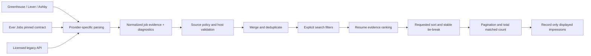

# Taco job-site parsing implementation plan

Created October 7, 2026. Basis: `job-site-parsing-research-2026-10-07.md` and the current source. The first delivery is the existing search supply pipeline, from provider response to ranked API result. Employer expansion, distributed indexing, and the browser extension have separate milestones after this delivery.

## Outcomes

Users receive job descriptions with the actual requirements intact, accurate employment/workplace/pay metadata when supplied, and honest empty/outage states. Search filters and sort order operate on a merged candidate set before pagination. A later employer's best match must remain eligible for ranking. Existing source trust, resume ownership, packet approval, and preparation gates remain authoritative.

## Architecture and data contract

`lib/job-ingestion.ts` owns shared evidence and provider outcomes. Additive optional fields preserve compatibility with saved records and existing callers. New ingestion populates them explicitly. No database migration is required: existing records can still be read, while newly created API objects carry the richer evidence.

| Field | Invariant |
|---|---|
| `description` | Complete plain text within a documented safety ceiling; never a card preview. |
| `descriptionPreview` | Separate 500-character UI preview. |
| `ingestion` | Parser version, extraction method, and whether the safety ceiling truncated text. |
| `employmentType` | Provider value normalized to a readable label; missing becomes `Not listed`. |
| `remoteMode` | Explicit workplace enum wins; boolean remote signal wins over description heuristics; missing remains unknown unless the text states it clearly. |
| `locations` | Primary and secondary locations retained; a secondary city can satisfy a location filter. |
| `salary` | Finite nonnegative numeric bounds, currency, and interval retained. No automatic hourly-to-annual or currency conversion. |
| `publishedAt`, `updatedAt`, `observedAt` | Distinct source publication, source update, and Taco observation timestamps. Observation must never masquerade as publication. |
| `postedDate` | Compatibility publication field; missing publication stays empty. |
| `sourceJobId`, `applyUrl` | Stable provider identity and application URL retained independently of the listing URL. |
| diagnostic status | `success`, `empty`, `disabled`, `timeout`, `rate_limited`, `malformed`, or `unavailable`; no secret headers, response bodies, or user data. |

Existing salary records without interval retain their historical annual interpretation for compatibility. Newly parsed unknown interval is explicit and cannot satisfy an annual salary target. Foreign currency and nonannual pay cannot be ranked as USD annual pay. Unknown salaries remain eligible for discovery but are identified as unverified rather than represented as below-market evidence.

## Milestone 1 — parsing contract and provider adapters

Files: `lib/job-ingestion.ts`, `lib/portal-scanner.ts`, `scripts/portal-scanner.test.js`.

- Greenhouse: decode encoded markup before stripping; retain late requirements and paragraph breaks; distinguish publication/update; keep board GET endpoint and bounded board token handling. Enrich individual details for publication/pay only in the later detail milestone, avoiding an immediate request per job.
- Lever: retain body, named requirements/benefit lists, closing text, commitment, workplace type, all locations, salary interval/currency, hosted/apply URLs. Include an EU host option without silently issuing both regional calls.
- Ashby: request compensation; prefer plain description; exclude `isListed === false`; retain secondary locations and structured work/employment metadata. Base salary components must not include equity or bonuses. Incompatible compensation tiers stay unknown rather than forming a misleading range.
- Validate response envelopes and row identity/title/URL types. A malformed envelope is not an empty board. Reject unusable rows; expose a rejected-row count; all rejected rows cannot become healthy empty.
- Preserve full plain text up to a bounded safety ceiling and mark truncation. Keep the preview independent.

Acceptance: fixtures prove requirements beyond 500 characters survive, Lever lists survive, encoded tags are removed, missing dates stay empty, part-time/hourly roles keep their facts, and unlisted Ashby rows are excluded.

## Milestone 2 — supply outcomes, source policy, and cache behavior

Files: `lib/job-source-policy.ts`, `lib/job-supply-health.ts`, `lib/job-search-api.ts`, `lib/job-recommendation-platform.ts`, supply regression tests.

- Treat a successful zero-job response as `empty`; treat disabled sources as `disabled`; preserve failures even when another disabled source is checked afterward.
- Count only successful/empty boards as succeeded. A partial board outage remains usable when another board answered successfully. Total outage triggers existing search recovery rather than a healthy empty state.
- Keep the existing coarse Ever Jobs status/preparation gate compatible while exposing detailed diagnostic reasons. Reject unsupported/malformed success envelopes.
- Centralize source eligibility used by both normalization and health configuration. Adzuna requires the existing explicit license switch across ingestion paths. Remotive stays disabled consistently. Unknown/restricted sources fail the current allowlist.
- Use bounded raw board caches keyed by provider/region/board, independent of query and result limit; coalesce simultaneous requests; cache only valid success/empty responses. Do not cache outages as empty boards.
- Keep API credentials confined to the configured validated service URL. No diagnostics echo raw exceptions or response bodies.

Acceptance: all-board HTTP 503 means zero succeeded; HTTP 429/timeouts/malformed payloads have distinct outcomes; valid empty boards are operational; disabled-only supply is unavailable; partial outages still return jobs; concurrent searches reuse one board fetch.

## Milestone 3 — normalization and matching evidence

Files: `lib/job-recommendation-platform.ts`, `lib/job-search-api.ts`, normalization/skill tests.

- Normalize provider variants into shared evidence, preserving explicit `isRemote`, compensation interval, multiple locations, and publication/update timestamps.
- Normalize skill aliases and use punctuation-aware token boundaries. Ambiguous words such as Go, React, and Spark require technical context; ordinary prose must not create skills.
- Keep the current deterministic scoring weights. Repair the inputs: annual USD comparison only, explicit work mode first, publication freshness only. Unknown inputs stay visible in confidence/risk notes.
- Sanitize invalid numeric/date values before scoring or serialization. Do not fabricate publication dates, salary, or employment type.
- Retain source-host checks and trusted application URL validation independently of metadata quality.

Acceptance: Ever Jobs hourly/foreign compensation survives and cannot satisfy an annual USD target; explicit remote beats an office city; missing types/dates stay unknown; C++/C#/Node.js/React/Go technical fixtures match; ordinary prose does not match Go or React.

## Milestone 4 — candidate selection and search semantics

Files: `lib/job-search-selection.ts`, `lib/job-recommendation-platform.ts`, `app/api/jobs/search/route.ts`, `app/api/jobs/portal/route.ts`, selection/route tests.

- Collect the bounded matches from every board before composite ranking. Remove the early first-60 selection from the main supply path; keep the public helper's default compatibility.
- Treat employer detection as a word-bounded hint; an incidental substring must not narrow to one employer.
- Apply explicit remote/full-time/location/country/salary filters consistently to all merged sources. Strict filters exclude known mismatches; unknown salary may remain visible, while unknown work/employment facts cannot satisfy explicit true filters.
- Location checks include secondary locations and common state/country aliases. Broad searches should not infer a country solely from a missing location.
- Apply relevance, salary, or publication-date sort after ranking and ledger suppression; stable identity tie-breaks make repeated paging deterministic for the same candidate snapshot. Put unknown/incomparable salary/date values last.
- Paginate the sorted set; `totalCount` counts matching unsuppressed candidates before pagination. Record displayed recommendation impressions and ghost statistics consistently.
- Validate numeric bounds and sort enums at the route boundary. Document that totalCount is a bounded retrieved set, not all vacancies on the internet.
- Ever Jobs remains a bounded upstream candidate batch. Do not claim remote pagination or exhaustive source coverage without verifying the pinned revision. Local merged paging is deterministic within that retrieved candidate set.

Acceptance: a strong match from the last board can rank first; filters hold across direct/service jobs; two pages do not overlap for a stable set; salary/date sorting works with unknown values; malformed query parameters return a bounded response or clear 400; impressions refer to returned jobs only.

## Milestone 5 — verification, integration review, and delivery record

- Add executable fixture tests for the reproduced failures and selection semantics; avoid relying on source-string assertions for behavior.
- Run parser, supply, recommendation, recovery, and assistant integration suites plus TypeScript and production build.
- Review actual worker diffs against the shared contract. Check existing clients retain the richer data and do not replace missing publication/type or display foreign/hourly salary as annual USD.
- If UI formatting needs a small correction, preserve existing design edits and inspect the result in a browser when available. Any unrelated baseline failure is recorded with the smallest evidence; do not silently mark a failed check as passing.
- Update `.codex/long-horizon/job-site-parsing.md` with completed milestones, checks, remaining risks, and the next action.

Completion for this delivery: Milestones 1–4 implemented, actual diffs reviewed, and verification recorded with its limitations. A green workspace TypeScript/build check remains a release gate. Deployment and production smoke are distinct operations.

## Follow-on milestones

| Milestone | Deliverable | Readiness gate |
|---|---|---|
| Individual job detail enrichment | Greenhouse publication/pay details on opening/preparation, bounded cache and retries | Adapter fixtures and supply health pass; request budget measured. |
| Employer catalogue maintenance | Verified board ownership/platform/region and periodic migration detection | Explicit operational owner, measured stale-board diagnostics. |
| Shared indexing/cache | Scheduled ingestion into a server-managed bounded catalogue, consistent snapshots/cursors | Traffic measurements justify infrastructure; retention/schema reviewed. |
| Browser job clipper | User-activated ATS/JobPosting/visible-page extraction with review and paste fallback | Stable evidence contract, existing extension privacy/permissions plan, host fixtures. |
| Source expansion | Add licensed/approved source adapters with attribution and metadata coverage | Per-source contract, source policy and availability tests. |

## Rollout and rollback

Review changes locally first. Run the existing staging canary against the pinned Ever Jobs service before a release; compare source counts, missing metadata, error/empty rates, and pagination on representative role/city/remote searches. No unverified historical counts should become release evidence. A later release can revert the parser/pipeline commit as a unit; there is no irreversible schema migration in this delivery. Do not re-enable a disabled source as a fallback during an outage.

## Progress

- [x] Research and failure reproductions
- [x] Shared contract and architecture decisions
- [x] Provider adapters and raw cache
- [x] Legacy skills and explicit source outcomes
- [x] Policy and normalized service metadata
- [x] Filters/sort/pagination integration
- [x] Integrated verification and final review, with baseline blockers below

## Implementation record — October 7, 2026

The coordinator integrated the shared contract, policy, supply normalizer, selection/routes, client evidence formatting, and salary-intelligence guard. Two bounded `gpt-6-luna` workers implemented the direct ATS adapters and the legacy adapter/skills tests. The coordinator reviewed their actual diffs and required corrections to Ashby compensation/location mapping, malformed optional Lever lists, and row-level isolation before final verification.

Concrete limits now enforced:

| Boundary | Implemented choice |
|---|---|
| Direct-board text | 100,000 characters with explicit truncation flag; 500-character independent preview. |
| Retained board jobs | Up to 2,000 per board; all 16 configured boards contribute before final ranking. |
| Raw ATS cache | 10-minute TTL, maximum 256 board entries, concurrent requests coalesced, success/empty only; callers receive isolated copies. |
| Ever Jobs retrieval | One source-balanced batch of up to 50; local page number is not forwarded as an unverified service-body control. |
| API paging | Page 1–1,000, page size 1–50; stable tie-break; counts describe the matching retrieved candidate set. |
| Source eligibility | Remotive disabled; Adzuna requires the explicit license switch across service and legacy paths. |
| Salary targets | Annual USD only; foreign, hourly, and explicit unknown intervals stay incomparable. Foreign Adzuna searches receive no USD `salary_min` threshold. |

Added executable tests: `job-ingestion`, `job-search-api`, `portal-scanner`, `job-search-selection`, `job-supply-ingestion`, `job-search-route`, and `job-display`. The route fixtures execute GET with stubbed infrastructure, checking invalid parameters, filtered counts, final sort/page selection, ledger suppression, and displayed-only impressions/statistics.

| Check | Final observed result |
|---|---|
| `npm run test:job-parsing` | **43/43 pass**. |
| Recommendation learning/score, supply health, staging-canary unit fixtures, recovery, top picks | **58/58 pass**. These are unit fixtures, not a live staging canary. |
| `npm run test:assistant-harness` | **329/329 pass**. The synthetic fresh-role fixture now uses a relative publication date and explicit annual USD pay. |
| `npm run type-check` | Blocked by existing `lib/pdf-templates.tsx:1230`: `ResumePDFDocument` receives an unsupported `pageSize` prop. No parsing-file type errors reported. |
| `npm run build` | Webpack compilation succeeds; the same PDF prop error blocks the TypeScript stage. |
| `scripts/job-search-mobile-review.test.js` | **6/7 pass**. Existing source-text assertion at line 55 expects the removed widget `sourceConfidence || 'low'` expression. This task's widget edits only replace the salary type/formatter; existing design/source-confidence edits are preserved. |
| Local browser | Controlled response fixture confirms late requirements, Part-time, unknown publication, and `GBP 30–45/hr`. DOM width checks at 320, 390, 430, 768, 1,024, and 1,440 show no outer horizontal overflow. Existing narrow-screen sidebar/offset styling is not certified as a visual pass. No local-origin console errors observed. |
| Scoped `git diff --check` | Clean. |

The browser fixture interception and viewport override were cleared, the temporary tab closed, and the task-owned development server stopped. Screenshot: `.codex/long-horizon/artifacts/job-parsing-ui.jpg`. No deployment, external application submission, authenticated production search, or live employer census was performed.

## Next implementation sequence

1. Resolve the existing PDF prop mismatch in its owning resume-export work and reconcile the mobile source-text assertion with the intended source-confidence presentation. Re-run only those checks and the release build after those fixes.
2. Validate the pinned Ever Jobs service in staging with the existing canary. Record auth, source/host agreement, successful/empty/error distinction, and metadata coverage. Compare two local pages against one stable retrieved batch; do not present the bounded total as internet-wide vacancies.
3. Add Greenhouse detail enrichment as a separately measured slice: request details on role opening/preparation, use `first_published` and opt-in pay transparency, retain distinct update/observation times, cache by board plus source job ID, coalesce requests, and preserve list evidence when detail retrieval fails. Test no pay, multiple currencies, invalid/closed job IDs, 429, and timeouts. Set a concurrency/request budget from observed latency before enabling broad enrichment.
4. Expand the employer catalogue with platform/region/ownership evidence and migration fixtures. Keep historical posting counts out of current availability decisions; report stale-board outcomes without silently inventing replacement slugs.
5. Build the user-activated clipper against this evidence contract: ATS API, structured JobPosting, visible-page adapter, then paste fallback. Include host fixtures and a review step that exposes unknown facts before saving. Measure extraction completeness before adding more hosts.
