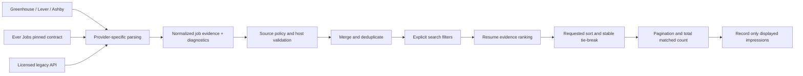
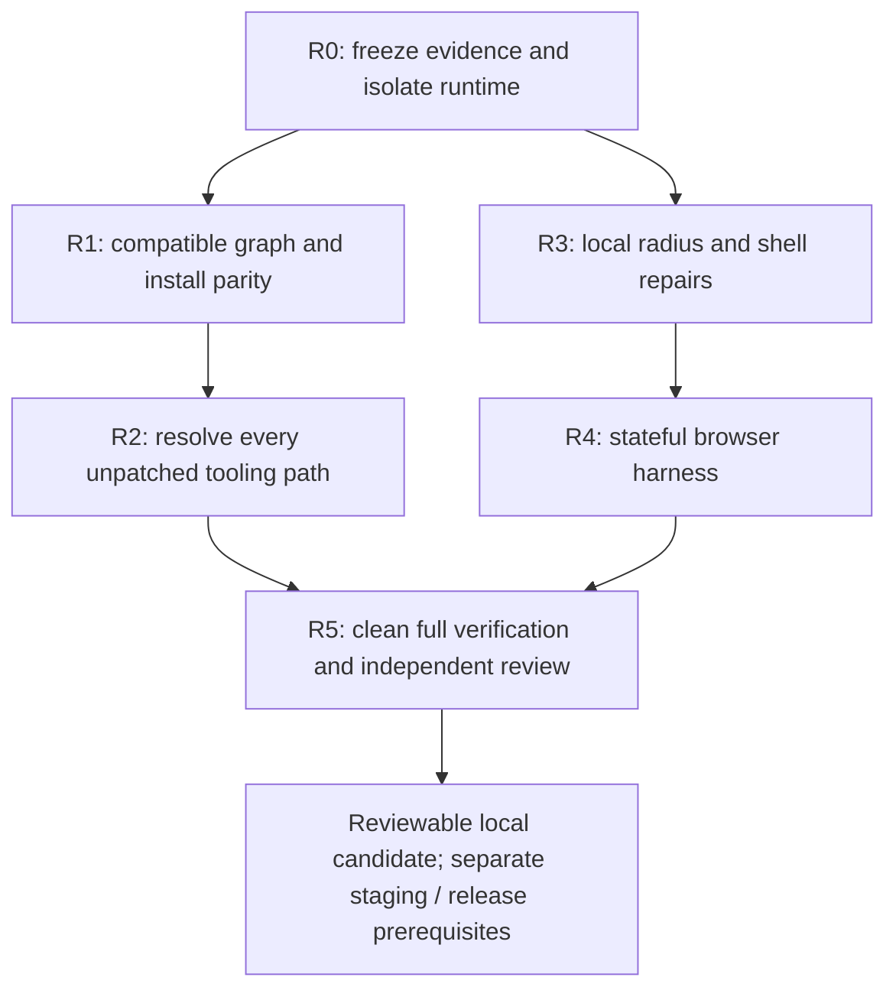

# Taco job-site parsing implementation plan

Created October 7, 2026; checkpoint updated October 9, 2026. Basis: `job-site-parsing-research-2026-10-07.md`, current source, and the independently verified historical integration checkpoint `853c7f5` on `codex/job-catalog-release`. Parsing/provider/catalog integration is committed locally. Release remains held on security, qualified toolchain and lint completion. R0 is complete; R1 remains partial/HOLD; R2 remains HOLD. R3/R4 pass bounded local review within the original executed graph; see the [UI/browser checkpoint](#15-r3r4-local-execution-checkpoint--october-9-2026) for committed source, incremental browser evidence and limits. The [execution checkpoint](#13-r0r1-execution-checkpoint--october-9-2026) and [qualification checkpoint](#14-toolchain-qualification-and-next-implementation-contract--october-9-2026) retain their dated source/research boundaries. The October 7 implementation record remains historical; its PDF/type and source-assertion blockers were resolved in the October 8 checkpoint described in [job-catalog-operations.md](job-catalog-operations.md#local-release-checkpoint--october-8-2026).

## Outcomes

Users receive job descriptions with the actual requirements intact, accurate employment/workplace/pay metadata when supplied, and honest empty/outage states. Search filters and sort order operate on a merged candidate set before pagination. A later employer's best match must remain eligible for ranking. Existing source trust, resume ownership, packet approval, and preparation gates remain authoritative.

## Architecture and data contract



`lib/job-ingestion.ts` owns shared evidence and provider outcomes. Additive optional fields preserve compatibility with saved records and existing callers. New ingestion populates them explicitly. No database migration is required: existing records can still be read, while newly created API objects carry the richer evidence.

| Field | Invariant |
|---|---|
| `description` | Complete plain text within a documented safety ceiling; never a card preview. |
| `descriptionPreview` | Separate 500-character UI preview. |
| `ingestion` | Parser version, extraction method, and whether the safety ceiling truncated text. |
| `employmentType` | Provider value normalized to a readable label; missing becomes `Not listed`. |
| `remoteMode` | Explicit workplace enum wins; boolean remote signal wins over description heuristics; missing remains unknown unless the text states it clearly. |
| `locations` | Primary and secondary locations retained; a secondary city can satisfy a location filter. |
| `salary` | Finite nonnegative numeric bounds, currency, and interval retained. No automatic hourly-to-annual or currency conversion. |
| `publishedAt`, `updatedAt`, `observedAt` | Distinct source publication, source update, and Taco observation timestamps. Observation must never masquerade as publication. |
| `postedDate` | Compatibility publication field; missing publication stays empty. |
| `sourceJobId`, `applyUrl` | Stable provider identity and application URL retained independently of the listing URL. |
| diagnostic status | `success`, `empty`, `disabled`, `timeout`, `rate_limited`, `malformed`, or `unavailable`; no secret headers, response bodies, or user data. |

Existing salary records without interval retain their historical annual interpretation for compatibility. Newly parsed unknown interval is explicit and cannot satisfy an annual salary target. Foreign currency and nonannual pay cannot be ranked as USD annual pay. Unknown salaries remain eligible for discovery but are identified as unverified rather than represented as below-market evidence.

## Milestone 1 — parsing contract and provider adapters

Files: `lib/job-ingestion.ts`, `lib/portal-scanner.ts`, `scripts/portal-scanner.test.js`.

- Greenhouse: decode encoded markup before stripping; retain late requirements and paragraph breaks; distinguish publication/update; keep board GET endpoint and bounded board token handling. Enrich individual details for publication/pay only in the later detail milestone, avoiding an immediate request per job.
- Lever: retain body, named requirements/benefit lists, closing text, commitment, workplace type, all locations, salary interval/currency, hosted/apply URLs. Include an EU host option without silently issuing both regional calls.
- Ashby: request compensation; prefer plain description; exclude `isListed === false`; retain secondary locations and structured work/employment metadata. Base salary components must not include equity or bonuses. Incompatible compensation tiers stay unknown rather than forming a misleading range.
- Validate response envelopes and row identity/title/URL types. A malformed envelope is not an empty board. Reject unusable rows; expose a rejected-row count; all rejected rows cannot become healthy empty.
- Preserve full plain text up to a bounded safety ceiling and mark truncation. Keep the preview independent.

Acceptance: fixtures prove requirements beyond 500 characters survive, Lever lists survive, encoded tags are removed, missing dates stay empty, part-time/hourly roles keep their facts, and unlisted Ashby rows are excluded.

## Milestone 2 — supply outcomes, source policy, and cache behavior

Files: `lib/job-source-policy.ts`, `lib/job-supply-health.ts`, `lib/job-search-api.ts`, `lib/job-recommendation-platform.ts`, supply regression tests.

- Treat a successful zero-job response as `empty`; treat disabled sources as `disabled`; preserve failures even when another disabled source is checked afterward.
- Count only successful/empty boards as succeeded. A partial board outage remains usable when another board answered successfully. Total outage triggers existing search recovery rather than a healthy empty state.
- Keep the existing coarse Ever Jobs status/preparation gate compatible while exposing detailed diagnostic reasons. Reject unsupported/malformed success envelopes.
- Centralize source eligibility used by both normalization and health configuration. Adzuna requires the existing explicit license switch across ingestion paths. Remotive stays disabled consistently. Unknown/restricted sources fail the current allowlist.
- Use bounded raw board caches keyed by provider/region/board, independent of query and result limit; coalesce simultaneous requests; cache only valid success/empty responses. Do not cache outages as empty boards.
- Keep API credentials confined to the configured validated service URL. No diagnostics echo raw exceptions or response bodies.

Acceptance: all-board HTTP 503 means zero succeeded; HTTP 429/timeouts/malformed payloads have distinct outcomes; valid empty boards are operational; disabled-only supply is unavailable; partial outages still return jobs; concurrent searches reuse one board fetch.

## Milestone 3 — normalization and matching evidence

Files: `lib/job-recommendation-platform.ts`, `lib/job-search-api.ts`, normalization/skill tests.

- Normalize provider variants into shared evidence, preserving explicit `isRemote`, compensation interval, multiple locations, and publication/update timestamps.
- Normalize skill aliases and use punctuation-aware token boundaries. Ambiguous words such as Go, React, and Spark require technical context; ordinary prose must not create skills.
- Keep the current deterministic scoring weights. Repair the inputs: annual USD comparison only, explicit work mode first, publication freshness only. Unknown inputs stay visible in confidence/risk notes.
- Sanitize invalid numeric/date values before scoring or serialization. Do not fabricate publication dates, salary, or employment type.
- Retain source-host checks and trusted application URL validation independently of metadata quality.

Acceptance: Ever Jobs hourly/foreign compensation survives and cannot satisfy an annual USD target; explicit remote beats an office city; missing types/dates stay unknown; C++/C#/Node.js/React/Go technical fixtures match; ordinary prose does not match Go or React.

## Milestone 4 — candidate selection and search semantics

Files: `lib/job-search-selection.ts`, `lib/job-recommendation-platform.ts`, `app/api/jobs/search/route.ts`, `app/api/jobs/portal/route.ts`, selection/route tests.

- Collect the bounded matches from every board before composite ranking. Remove the early first-60 selection from the main supply path; keep the public helper's default compatibility.
- Treat employer detection as a word-bounded hint; an incidental substring must not narrow to one employer.
- Apply explicit remote/full-time/location/country/salary filters consistently to all merged sources. Strict filters exclude known mismatches; unknown salary may remain visible, while unknown work/employment facts cannot satisfy explicit true filters.
- Location checks include secondary locations and common state/country aliases. Broad searches should not infer a country solely from a missing location.
- Apply relevance, salary, or publication-date sort after ranking and ledger suppression; stable identity tie-breaks make repeated paging deterministic for the same candidate snapshot. Put unknown/incomparable salary/date values last.
- Paginate the sorted set; `totalCount` counts matching unsuppressed candidates before pagination. Record displayed recommendation impressions and ghost statistics consistently.
- Validate numeric bounds and sort enums at the route boundary. Document that totalCount is a bounded retrieved set, not all vacancies on the internet.
- Ever Jobs remains a bounded upstream candidate batch. Do not claim remote pagination or exhaustive source coverage without verifying the pinned revision. Local merged paging is deterministic within that retrieved candidate set.

Acceptance: a strong match from the last board can rank first; filters hold across direct/service jobs; two pages do not overlap for a stable set; salary/date sorting works with unknown values; malformed query parameters return a bounded response or clear 400; impressions refer to returned jobs only.

## Milestone 5 — verification, integration review, and delivery record

- Add executable fixture tests for the reproduced failures and selection semantics; avoid relying on source-string assertions for behavior.
- Run parser, supply, recommendation, recovery, and assistant integration suites plus TypeScript and production build.
- Review actual worker diffs against the shared contract. Check existing clients retain the richer data and do not replace missing publication/type or display foreign/hourly salary as annual USD.
- If UI formatting needs a small correction, preserve existing design edits and inspect the result in a browser when available. Any unrelated baseline failure is recorded with the smallest evidence; do not silently mark a failed check as passing.
- Update `.codex/long-horizon/job-site-parsing.md` with completed milestones, checks, remaining risks, and the next action.

Completion for this delivery: Milestones 1–4 implemented, actual diffs reviewed, and verification recorded with its limitations. A green workspace TypeScript/build check remains a release gate. Deployment and production smoke are distinct operations.

## Follow-on milestones

| Milestone | Deliverable | Readiness gate |
|---|---|---|
| Individual job detail enrichment | Greenhouse publication/pay details on opening/preparation, bounded cache and retries | Adapter fixtures and supply health pass; request budget measured. |
| Employer catalogue maintenance | Verified board ownership/platform/region and periodic migration detection | Explicit operational owner, measured stale-board diagnostics. |
| Shared indexing/cache | Scheduled ingestion into a server-managed bounded catalogue, consistent snapshots/cursors | Traffic measurements justify infrastructure; retention/schema reviewed. |
| Browser job clipper | User-activated ATS/JobPosting/visible-page extraction with review and paste fallback | Stable evidence contract, existing extension privacy/permissions plan, host fixtures. |
| Source expansion | Add licensed/approved source adapters with attribution and metadata coverage | Per-source contract, source policy and availability tests. |

## Rollout and rollback

Review changes locally first. Run the existing staging canary against the pinned Ever Jobs service before a release; compare source counts, missing metadata, error/empty rates, and pagination on representative role/city/remote searches. No unverified historical counts should become release evidence. A later release can revert the parser/pipeline commit as a unit; there is no irreversible schema migration in this delivery. Do not re-enable a disabled source as a fallback during an outage.

## Progress

- [x] Research and failure reproductions
- [x] Shared contract and architecture decisions
- [x] Provider adapters and raw cache
- [x] Legacy skills and explicit source outcomes
- [x] Policy and normalized service metadata
- [x] Filters/sort/pagination integration
- [x] Integrated verification and final review, with baseline blockers below

## Implementation record — October 7, 2026

The coordinator integrated the shared contract, policy, supply normalizer, selection/routes, client evidence formatting, and salary-intelligence guard. Two bounded `gpt-6-luna` workers implemented the direct ATS adapters and the legacy adapter/skills tests. The coordinator reviewed their actual diffs and required corrections to Ashby compensation/location mapping, malformed optional Lever lists, and row-level isolation before final verification.

Concrete limits now enforced:

| Boundary | Implemented choice |
|---|---|
| Direct-board text | 100,000 characters with explicit truncation flag; 500-character independent preview. |
| Retained board jobs | Up to 2,000 per board; all 16 configured boards contribute before final ranking. |
| Raw ATS cache | 10-minute TTL, maximum 256 board entries, concurrent requests coalesced, success/empty only; callers receive isolated copies. |
| Ever Jobs retrieval | One source-balanced batch of up to 50; local page number is not forwarded as an unverified service-body control. |
| API paging | Page 1–1,000, page size 1–50; stable tie-break; counts describe the matching retrieved candidate set. |
| Source eligibility | Remotive disabled; Adzuna requires the explicit license switch across service and legacy paths. |
| Salary targets | Annual USD only; foreign, hourly, and explicit unknown intervals stay incomparable. Foreign Adzuna searches receive no USD `salary_min` threshold. |

Added executable tests: `job-ingestion`, `job-search-api`, `portal-scanner`, `job-search-selection`, `job-supply-ingestion`, `job-search-route`, and `job-display`. The route fixtures execute GET with stubbed infrastructure, checking invalid parameters, filtered counts, final sort/page selection, ledger suppression, and displayed-only impressions/statistics.

| Check | Final observed result |
|---|---|
| `npm run test:job-parsing` | **43/43 pass**. |
| Recommendation learning/score, supply health, staging-canary unit fixtures, recovery, top picks | **58/58 pass**. These are unit fixtures, not a live staging canary. |
| `npm run test:assistant-harness` | **329/329 pass**. The synthetic fresh-role fixture now uses a relative publication date and explicit annual USD pay. |
| `npm run type-check` | Blocked by existing `lib/pdf-templates.tsx:1230`: `ResumePDFDocument` receives an unsupported `pageSize` prop. No parsing-file type errors reported. |
| `npm run build` | Webpack compilation succeeds; the same PDF prop error blocks the TypeScript stage. |
| `scripts/job-search-mobile-review.test.js` | **6/7 pass**. Existing source-text assertion at line 55 expects the removed widget `sourceConfidence || 'low'` expression. This task's widget edits only replace the salary type/formatter; existing design/source-confidence edits are preserved. |
| Local browser | Controlled response fixture confirms late requirements, Part-time, unknown publication, and `GBP 30–45/hr`. DOM width checks at 320, 390, 430, 768, 1,024, and 1,440 show no outer horizontal overflow. Existing narrow-screen sidebar/offset styling is not certified as a visual pass. No local-origin console errors observed. |
| Scoped `git diff --check` | Clean. |

The browser fixture interception and viewport override were cleared, the temporary tab closed, and the task-owned development server stopped. Screenshot: `.codex/long-horizon/artifacts/job-parsing-ui.jpg`. No deployment, external application submission, authenticated production search, or live employer census was performed.

## Next implementation sequence

1. Complete the bounded release remediation below. Resolve every release gate with independent evidence; a job implementation checkpoint is not a deployable verdict. The PDF prop mismatch and mobile source-text assertion above are already resolved at `853c7f5`.
2. After local release eligibility and staging prerequisites are independently reviewed, validate the pinned Ever Jobs service in staging with the existing canary. Record auth, source/host agreement, successful/empty/error distinction, and metadata coverage. Compare two local pages against one stable retrieved batch; do not present the bounded total as internet-wide vacancies. Staging credentials, provider billing and live operations are separate prerequisites, not implicit authorization from this plan.
3. Add Greenhouse detail enrichment as a separately measured slice: request details on role opening/preparation, use `first_published` and opt-in pay transparency, retain distinct update/observation times, cache by board plus source job ID, coalesce requests, and preserve list evidence when detail retrieval fails. Test no pay, multiple currencies, invalid/closed job IDs, 429, and timeouts. Set a concurrency/request budget from observed latency before enabling broad enrichment.
4. Expand the employer catalogue with platform/region/ownership evidence and migration fixtures. Keep historical posting counts out of current availability decisions; report stale-board outcomes without silently inventing replacement slugs.
5. Build the user-activated clipper against this evidence contract: ATS API, structured JobPosting, visible-page adapter, then paste fallback. Include host fixtures and a review step that exposes unknown facts before saving. Measure extraction completeness before adding more hosts.

## Critical release remediation plan — October 9, 2026

Execution update: **R0 complete; R1 partial/HOLD; release HOLD.** The [execution checkpoint](#13-r0r1-execution-checkpoint--october-9-2026) records implemented commits, actual checks and the newly confirmed npm CLI blocker. The planning sections below retain their original decision boundaries.

**Original planning status: research complete; execution had not started when §§1–12 were written.** The intended outcome is a reviewable local release candidate with reproducible installs, zero high/critical dependency advisories, unchanged design gates and usable shared mobile controls. Current execution and qualification status is recorded in §§13–14. This plan does not certify live job quality, production auth/storage, billing or deployment readiness.

### 1. Starting evidence and boundaries

The source baseline is `853c7f5123da91c5a846d910add082762922a728` in `/home/xwingace/.codex/worktrees/job-catalog-release/Taco`. The canonical checkout `/home/xwingace/Documents/Projects/Taco` remains on `design/proof-engine-language` with unrelated changes. Work stays in the attached isolated checkout. Its current `node_modules` is a symlink to the canonical runtime: replacing that link safely is a prerequisite to installation, not permission to mutate its target.

| Evidence, observed October 8–9 | Meaning for this plan |
|---|---|
| CVE report: 38 advisory-level findings, 3 critical / 35 high, all new | Resolve the complete dependency graph, including development tools; these are not 38 distinct vulnerable packages or demonstrated production exploits. |
| Design audit: 21 undefined tokens versus baseline 20; accent contrast failures 0 | The added unresolved reference is `--radius-full`; repair its actual use without increasing the baseline. |
| Mobile: four sidebar disclosure buttons about 25px high; help trigger 28px wide | Repair actual open controls and test hidden-state probe accuracy separately. |
| Types, build, release-safety, assistant, admin, email, observability and SEO pass | These are dated baseline results to reproduce after dependency and shared-shell changes. Build produced 187 pages. |
| Focused regression run: 143 passed; provider 63, parsing 45, PDF 15 independently passed | Preserve job evidence, provider bounds, truth locks and A4/Letter dimensions. Do not add overlapping test counts as distinct coverage. |
| Job-search fixtures pass core interactions in six widths × two themes | Expand coverage to open help/drawer states and the actual dashboard widget; existing fixture evidence does not establish authenticated widget behavior. |

Evidence locations: `.security-cve/security-cve-results.json`, `.ui-verify/judge-final/result.json`, `.ui-verify/release-reports/` and the operations checkpoint. These are local ignored artifacts. Before implementation, preserve a secret-free evidence bundle with hashes and source/runtime provenance; never rely on an ignored file being present in a fresh checkout. Claims about versions/advisories below are dated October 9 and must be refreshed before selecting an install.

Scope includes compatible dependency remediation, deterministic local/CI/container installation, an explicit solution for the remaining unpatched tooling path, the single radius reference, sidebar/help repairs, and verification required by those changes. Preserve Firestore/Firebase bearer authentication, admin permission/MFA/revocation checks, database truth locks, runtime Stripe prices, packet approval and existing dashboard behavior.

Source expansion, ingestion scheduling, TTL policies, database migrations, global design unification, sidebar offset redesign, resume-template styling, new auth bypasses and production secret handling are outside this work package. Existing owner prerequisites—including credential rotation already recorded by the release work—remain external release holds. No provider keys, live paid runs, real emails/payments, application submissions, push or deployment are performed by this plan.

### 2. Completion contract

All of the following are required; partial success remains a held checkpoint:

1. A fresh full-tree audit succeeds, `summary.blocker` is absent, and `summary.totals.highCritical === 0`. The current CVE command only fails new findings; exit zero alone is insufficient. Keep `security/cve-baseline.json` unchanged and include development dependencies. An unavailable audit service is a blocker, not a clean report.
2. Local and container clean installs resolve the reviewed lockfile without modifying it. Record Node/npm versions, lock hash and immutable container base identity; both environments use the same peer-dependency policy.
3. All intended version branches are compatible with their consumers. `node-forge` is absent; ordinary glob/watch operations, auth/key handling, document parsing/export and native image processing work under the installed graph.
4. Design CI passes with no metric regression and `accentContrastFails === 0`. The unresolved-reference set gains no new names, even if a valid local repair reduces its count below 20. No scanner exemption, token allowlist or baseline update substitutes for a fix.
5. Real browser checks pass at 320 / 390 / 430 / 768 / 1024 / 1440px in dark and light themes on the surfaces/states in §8. Mobile interactive targets are at least 44 × 44 CSS pixels, inputs at least 16px, text readable, dialogs usable, console clean and horizontal overflow absent.
6. Required release suites and independent skeptical review pass. A separate judge reproduces the material gates and deliberate regression checks from a clean candidate. Test fixtures prove only the boundaries they execute.

### 3. Order and execution ownership



| Work package | Exclusive files/responsibility | Exit evidence |
|---|---|---|
| R0 coordinator | Evidence manifest, protected-file hashes, worktree/runtime preparation | Baseline/source hashes saved; isolated install destination proved. |
| R1 dependency builder | `package.json`, `package-lock.json`, overrides, dependency regression tests | Reviewed compatible graph; clean install; explicit list of remaining findings. |
| R1 install builder, coordinated with manifest owner | `Dockerfile`, `.dockerignore`, existing CI workflow and verification integration | Local/container parity, unchanged lock, native/container smoke. |
| R2 tooling builder | Manifest/lock only through the dependency owner; ESLint config; selected tooling artifacts/config | Qualified solution, all affected paths removed/remediated, actual lint coverage, zero high/critical findings. |
| R3 UI builder | `components/resume-studio/resume-review-workbench.css`, `components/SuiteSidebar.tsx`, `components/PageHelp.tsx` | Local rendering/accessibility fixes, focused regressions and no design drift. |
| R4 verification builder | `scripts/ui-verify.js`, existing related tests plus justified test-only harness files | Real state matrix, contained network, visible-defect negative controls. |
| R5 fresh skeptic and judge | Read-only review/own verification; temporary mutations restored in `finally` | Raw findings, adjudications, exact commit/hash, independent verdict. |

One owner writes the dependency manifest/lock. Builders share the checkout, preserve other agents' changes and never revert unrelated work. R3 can proceed while R1 is being reviewed because files differ, but the final browser run uses the final dependency/tooling candidate. Serialize production build and type-check: both touch generated `.next/types`, and concurrent execution previously caused a false failure. Runtime/container operations are coordinated rather than competing over one install.

### 4. R0 — freeze the baseline and make installation safe

1. Verify branch, source commit, clean scoped status, attached worktree identity and canonical-checkout protection hashes. Record the current stored evidence as historical; run fresh baseline checks when execution begins and label any changed advisory database results separately.
2. Inspect the `node_modules` link with `lstat`/`readlink`. Remove only the verified worktree-owned symlink, using an unlink operation. Never recursively remove the linked canonical runtime. Install into a new worktree-local directory and verify its resolved path before further commands.
3. Select one supported Node 22 patch and npm version after checking compatibility. The observed local baseline is Node 22.23.2 / npm 12.1.0; this is provenance, not an automatic version decision. Record the selected versions and align CI and all Docker stages. Resolve and record the container digest rather than inventing one.
4. Preserve public build configuration deliberately; do not discover configuration by printing environment files. Before any Docker build, the install owner must exclude `hermes-agent-keys.txt`, all private environment files and their backup variants (including `.env-backup`), and any other known credential paths discovered through filename inventory. Gitignore is not a Docker protection. Keep the tracked public `.env.production` out of the context under the current policy; pass only the existing reviewed `NEXT_PUBLIC_*` build inputs deliberately. Require a secret-free context-path inventory and a synthetic-sentinel rejection test against the actual context preparation/ignore behavior before container builds. Enumerate paths, never secret contents; missing protection fails closed. Server credentials stay out of the context, logs, evidence and tests. Synthetic auth tests use generated keys and an explicitly isolated demo/emulator project where needed.
5. Preserve an immutable baseline evidence bundle and manifest: source commit, protected-file hashes, manifest/lock hashes, audit timestamp/IDs, design metrics/unresolved set, browser report and screenshots. Select an existing reviewed storage location; omit response bodies, tokens, credentials and real resumes. A fresh executor must be able to distinguish baseline, candidate and fixture evidence.

Exit: installation can no longer mutate the canonical checkout; baseline evidence and recovery point are identifiable. No release claim is made.

### 5. R1 — compatible dependency changes and install parity

These are minimum candidates resolving the reported advisories, not a promise of a clean future graph. Refresh registry/advisory metadata, inspect parent ranges and select reviewed versions within those compatible branches. Use targeted updates rather than a blanket `npm update`, `npm audit fix --force` or major-version override.

| Package / observed locked version | Minimum candidate or graph change | Consumer constraint / primary evidence |
|---|---|---|
| Next 16.2.11 | 16.3.8 or a later independently checked 16.x | Keep official Next/env/SWC artifacts aligned; [advisory](https://github.com/advisories/GHSA-cjq9-62q9-8jv4). |
| Both Firebase Admin 13.9.0 copies | 13.10.0 | Canonical and npm-alias declarations accept this; release removes Forge and uses native key validation; [official release](https://github.com/firebase/firebase-admin-node/releases/tag/v13.10.0). |
| `@fastify/busboy` 3.2.0 | 3.2.1 | Both Admin manifests accept v3; [advisory](https://github.com/advisories/GHSA-xjh9-v7x6-24jw). |
| `@grpc/grpc-js` 1.14.4 override | 1.14.5 | Update existing v1 override; [advisory](https://github.com/advisories/GHSA-m9gg-hp2v-232j). |
| `@xmldom/xmldom` 0.8.13 | 0.8.15 | Preserve Mammoth's 0.8 branch; [advisory](https://github.com/advisories/GHSA-27p8-2357-5qqv). |
| `brace-expansion` 5.0.7 global override | v1 consumers → 1.1.20; v5 consumers → 5.0.11 | Restore compatible major branches; [advisory](https://github.com/advisories/GHSA-qhr7-859c-m2p7). |
| Browserslist 4.28.2 | 4.28.7 | Parent ranges accept it; [advisory](https://github.com/advisories/GHSA-c83g-rgw3-j3cx). |
| Engine.IO 6.6.9 | 6.6.10 | Existing Socket.IO `~6.6.0`; [advisory](https://github.com/advisories/GHSA-2gc4-cqfq-p2gv). |
| `fast-uri` 3.1.4 | 3.1.7 | AJV v3 branch; avoid unrelated v4; [advisory](https://github.com/advisories/GHSA-qw65-cvwx-89v3). |
| `js-yaml` 4.3.0 override | 4.3.2 | Keep v4; [advisory](https://github.com/advisories/GHSA-2883-xcg3-v3hh). |
| Nano ID 5.1.9 / 3.3.16 | 5.1.16 / 3.3.18 | DOCX and PostCSS retain their distinct majors; [v5 advisory](https://github.com/advisories/GHSA-28wg-ghj8-5hjv), [v3 advisory](https://github.com/advisories/GHSA-2v37-7h3g-55p8). |
| Sharp 0.35.3 override | 0.35.5 | Preserve branch and verify Alpine/musl binaries; [advisory](https://github.com/advisories/GHSA-wq5f-xc86-pv6w). |
| `source-map-js` 1.2.1 | 1.2.2 | Current PostCSS/css-tree ranges accept it; [advisory](https://github.com/advisories/GHSA-68fv-2mgg-jv7q). |
| `braces` 3.0.3 | R2 decision; no published patched release verified | Compatible updates alone cannot complete this work package; [advisory](https://github.com/advisories/GHSA-vfj7-8cjw-p6xm). |

**Repair override compatibility explicitly.** Installed `minimatch@3.1.5` requires callable `brace-expansion` v1 but the global v5 override supplies an object. The read-only reproduction `makeRe('a{b,c}')` throws `TypeError: expand is not a function`. Merely raising the global override to v5.0.11 preserves that defect. Prefer parent-compatible resolution; use scoped overrides only when needed, after enumerating every requester. Preserve the separate Nano ID majors too. Inspect all existing overrides for API/peer compatibility rather than judging them by advisory status alone.

Regenerate the lock with the recorded toolchain, then review package additions/removals, aliases, resolved URLs, integrity and scripts. Do not manually fabricate lock identities. Explain every changed top-level package and unexpected transitive delta. Both Firebase Admin aliases must resolve to the reviewed release; `npm explain node-forge` must show no remaining installed path.

**Installation contract:** the tracked `.npmrc` sets `legacy-peer-deps=true`; current CI uses `npm ci`, while Docker uses `npm install --legacy-peer-deps` and excludes `.npmrc`. Change Docker to `npm ci --legacy-peer-deps`, deliberately matching that existing policy. Keep `.npmrc` excluded unless a reviewed safe project configuration is intentionally copied. Pin the chosen Node/npm runtime consistently, include all required installation inputs before the install layer, and compare manifest/lock hashes before and after a fresh local and container install. A second fresh install must reproduce the reviewed graph. [npm clean-install requirements](https://docs.npmjs.com/cli/v11/commands/npm-ci/)

**Build-context contract:** R1's install owner edits `.dockerignore` and the context-verification check assigned in R0. Exercise named key files, private environment/backup filenames and credential directories with synthetic sentinels; none may appear in the effective context manifest or any copied image layer. Deliberate public inputs and any selected patch/vendor files must remain available. Prefer a context prepared from a reviewed build-input allowlist, then inventory its paths before invoking Docker; do not depend on Git tracking or ignore-file text alone. If an exclusion/test fails, do not run `COPY . .` against that context. Record the sanitized manifest/hash and rejection checks as installation evidence.

If a selected R2 artifact needs postinstall verification, copy its exact public patch/script/artifact inputs before Docker's dependency-install command. Fail on missing files, integrity mismatch or unsuccessful application; never hide the failure by disabling lifecycle scripts. Cache keys must include these inputs. Plain source patching remains insufficient for the audit requirement described below. [Patch installation guidance](https://github.com/ds300/patch-package#docker-and-ci)

Add candidate verification to the existing security workflow: PR/manual triggers for this scoped candidate, clean install, the unchanged CVE command plus an explicit zero-high/critical report assertion, and always-uploaded secret-free reports. Preserve the weekly audit. Integrate lint and the required sequential release checks without invoking any deployment/provider schedule. Use read-only workflow permissions; no production secrets. Keep expected report/schema and failure checks executable—malformed, absent, stale or blocked audit results cannot pass.

Exit: compatible changes and deterministic installs are reviewable, focused compatibility checks pass, and the exact remaining advisory paths are recorded. Do not promise that R1 clears 37 findings until a fresh report proves it.

### 6. R2 — close the unpatched tooling gap without hiding it

Verified current paths reach `braces@3.0.3` through Tailwind 3's micromatch/fast-glob/chokidar and Next ESLint plugin's fast-glob/micromatch. This is tooling exposure to content/watch/rootDir patterns; no direct application import was established. The CVE scanner's prose match is not proof of a production exploit. Tooling classification does not remove the full-tree gate.

The [reviewed braces advisory](https://github.com/advisories/GHSA-vfj7-8cjw-p6xm) lists no patched version as checked October 9. Recheck this at execution time. A bounded decision spike must produce a complete dependency-path inventory, candidate source/package provenance, security/compatibility results and an explicit recommendation before a broad tooling change starts.

| Option | Acceptance / rejection | Recommendation |
|---|---|---|
| Official patched release or supported parent replacement | Fresh audit plus all paths and real behavior verified; existing tools/rules retained | First choice if one becomes available. No such complete solution is currently established. |
| Maintained fork or transparent vendored replacement | Proven source/security diff, real package identity, independent guard tests, license, maintenance owner, pinned integrity and truthful advisory accounting | Conditional only. Research did not qualify a drop-in fork. Do not install a recently published guard package based on its name. |
| Plain `patch-package` on 3.0.3 | Can reduce executable risk but leaves the affected package/version visible in the lock; cannot satisfy the unchanged audit gate by itself | Not a release-clearing solution. [npm audit inputs](https://docs.npmjs.com/cli/v11/commands/npm-audit/) |
| Replace affected tool paths | All paths eliminated with equivalent CSS discovery/watch and lint coverage; no relocated vulnerable compiler or dropped checks | Viable fallback only after a separate implementation scope is concrete and reviewed. |
| Tailwind 4 plus lint/tool migration | Tailwind 4 alone leaves Next ESLint's path; default/browser/config/rule changes need explicit coverage | Last fallback for this release package; not an automatic design-system migration. [Tailwind upgrade guide](https://tailwindcss.com/docs/upgrade-guide) |

A fork/replacement qualifies only with: pinned source commit/release and tarball integrity; original license; transparent upstream relationship/advisory records; reproducible patch review; named ongoing maintenance responsibility; correct bounds at every affected entry point; ordinary-pattern compatibility/performance; and accurate audit/provenance reports. An unlisted new name is not security evidence. Renaming or inventing a version to escape an advisory, deleting lint coverage, moving dependencies to dev, omitting dev from audit, raising baselines, or accepting an unqualified fork is rejected.

If no option satisfies those conditions, preserve the release hold and record precisely what is missing. A time limit on research does not select a candidate. The recommended implementation starts with R0/R1 and narrowly scoped R3/R4; R2 remains a real decision boundary before any global CSS/compiler change.

**Restore an actual lint command as part of the chosen tooling solution.** `package.json` currently runs `next lint`, and no ESLint configuration was found. Next 16 removed that command and production build no longer runs lint. Use the ESLint CLI and a deliberate flat configuration, preserving Next, React, Hooks, accessibility, import and TypeScript checks; inspect effective configurations for representative JS/TS/TSX. Current rule enforcement is unverified, so preserve the intended official rules explicitly rather than claiming an existing passing lint baseline. [Official Next migration](https://nextjs.org/docs/app/guides/upgrading/version-16)

Prove coverage using isolated invalid fixtures that fail for real rule violations and a valid fixture that passes. Full app lint must run, including rules relevant to link/image/script and Hooks use. Inventory pre-existing lint errors separately; do not disable rules, ignore application folders or call new failures stale without reproduction. An unexpectedly broad error inventory is another scope decision, not permission for a bulk rewrite. A replacement for the Next plugin must preserve its material protections; latest verified plugin 16.4.0 still declares fast-glob 3.3.1. [Registry manifest](https://registry.npmjs.org/%40next%2Feslint-plugin-next/16.4.0)

If Tailwind migration is selected, write its bounded subplan before editing: PostCSS integration, configuration discovery, content sources/watch behavior, browser support, utility/default differences and generated CSS comparison. Preserve the 44px spacing step 11, mobile text rules, dark landing boundary, `.tcl` selector names/global stylesheet, `html.js`-gated hiding and theme-invariant surfaces. Do not alter accent choices or employer document templates. Any expanded design work also inherits the repository's recovered/committed/pushed prerequisite; this local planning checkpoint does not satisfy a push requirement.

Exit: the chosen graph has zero high/critical findings under truthful identity; every former path is accounted for; lint and style behavior are tested; any broader migration has a reviewed scope. An unqualified option keeps R2 incomplete.

### 7. R3 — narrow design and mobile-shell repairs

**Radius:** replace `border-radius: var(--radius-full, 999px)` in `components/resume-studio/resume-review-workbench.css` with `border-radius: 999px`. The same file already uses that radius; the browser's fallback is already 999px. Prove equivalent computed rendering and run unchanged design CI. Do not add a global token merely to lower the count, redefine sidebar offsets, or clean up the other 20 existing references as part of this repair.

**Sidebar:** change the four disclosure buttons from `min-h-7` to `min-h-11 lg:min-h-7`. Mobile root font size is 14px, which makes the current 1.75rem about 25px; spacing 11 is explicitly 44px in the existing config. Measure actual open-drawer targets at all four `<1024px` widths, including 768px. Preserve desktop density and existing `aria-hidden`/`inert` closed state, top mobile quick-tools rail, keyboard/dismissal behavior and dashboard routes. Repair any reproduced local focus defect within the same component; do not redesign the shell.

**PageHelp:** make trigger and close controls `h-11 w-11 min-w-11 shrink-0`, explicit button types and accessible names. Constrain panel insets/width to the viewport; use an existing defined surface token in both themes instead of `--bg-primary`. Add a labelled modal dialog, initial focus, Escape, Tab/Shift+Tab containment, background interaction prevention and return focus to the trigger. Reuse the local behavior pattern in `components/modals/AuthModal.tsx` without extracting a global modal system or changing auth. Clean up the panel's prohibited shadow/blur treatment locally while preserving content and theme readability. Handle exit animation/unmount cleanup and route changes so focus/inert/scroll state cannot remain stranded. Keep all help fixes inside `PageHelp.tsx` unless a demonstrated dependency requires a separately reviewed scope.

The known audit regression is the radius reference. `--bg-primary` is also used outside PageHelp, so fixing help does not establish that every existing token issue is resolved. Compare the unresolved names, not just their total. Use `min-w-0` on affected text-bearing children, retain readable ranges with currency/interval/estimate labels and avoid stacking stat numbers.

Exit: the unchanged design gate passes; open controls meet geometry/accessibility expectations; desktop and dashboard behavior remain intact; no global token or layout migration is folded in.

### 8. R4 — trustworthy browser and behavior verification

**Harden the harness before using it as proof.** Existing browser fixtures return generic success for all writable endpoints and let unknown GET requests through. Replace them with an explicit method/path/schema allowlist and named response scenarios. Unexpected API/provider requests or writes fail the run; no real database or vendor operation is allowed. Static assets and required browser resources have an explicit provenance/host policy. Reports identify synthetic responses and the boundary under test; do not add fabricated product/demo content.

Use real route renderers/components and stores. For the dashboard widget, start with a test-only browser entry and fixture boundary modules, never a production fixture route or product auth modification. Exercise the real dashboard/widget and real Zustand transitions. Separately verify authorization through normal bearer guards with mocks/emulators; a component fixture cannot certify signed-in server access. If a full signed-in route is required, use normal sign-in against explicitly isolated Auth/Firestore emulators, dedicated synthetic records and deny production hosts/projects. Verify production builds exclude fixture entries/modules. Do not enable `NEXT_PUBLIC_DISABLE_AUTH_GATE` or another demo bypass. Any emulator/harness tool version is pinned/reviewed, not silently fetched as unbounded latest.

All rows below run in both themes at **320, 390, 430, 768, 1024 and 1440px**, with screenshots of populated and open-overlay states. This means at least 36 route/width/theme combinations plus the named state transitions—not twelve screenshots of one route relabelled as complete coverage.

| Surface | Required states and assertions |
|---|---|
| `/suite/job-search` | Initial, loading, populated, legitimate empty, interrupted/retry; annual USD, foreign hourly, predicted and unknown salary/date/fit; long titles/locations/ranges; salary/date sort, structured remote filters, keyboard selection, detail open/close, top-three disclosure and collapse recovery. No invented salary conversion, freshness or fit zero. |
| Dashboard `/suite` / real widget fixture | Loading, populated top three, setup required, partial response retaining prior picks, retry recovery and empty success; long salary and unknown evidence; real store transitions, navigation/local count behavior and dashboard rule preservation. Label component-only auth limits. |
| Unchanged control `/suite/cover-letter` | Baseline shell, drawer closed/open, all four disclosures, help closed/open, keyboard traversal; proves shared-shell fixes work outside jobs. No live generation or provider call. |

Also inspect the resume review workbench's affected chip/radius in both themes and the protected landing's readable no-JavaScript boundary if compiler/CSS tooling changes. Preserve A4/Letter outputs independently of UI theme.

For every relevant state: record document/body scroll widths, visible element bounds, target sizes, input font sizes, clipping, console exceptions and failed/unexpected requests. Open drawers must have valid navigation/focus/dismissal behavior; open help stays inside the viewport, blocks background interaction, closes via Escape/backdrop/close and restores focus. Check all geometry after animations settle and inspect screenshots manually. A desktop pass cannot stand in for a 320px result.

**Correct visibility probes without hiding defects.** The closed drawer is already inert and translated out of view, but the verifier measures nonzero bounds. For interactive-target/input/text probes, skip genuinely hidden/inert ancestors and computed hidden visibility. Do not ignore a visible control merely because it is offscreen or has `aria-hidden`. Keep real document overflow and visibly oversized content failures independent of interactivity. Reopening the drawer must bring its controls back into measurement.

**Enforce the actual mobile breakpoint.** R4 changes `scripts/ui-verify.js` touch-target and input-size failure conditions from `width < 768` to `width < 1024`, matching the drawer's mobile range. The existing 768px run collects geometry but does not fail on those defects. Add executable negative controls at 768px: an open visible 24px control and a visible input below 16px must fail, while truly inert closed controls are ignored. Preserve desktop density and avoid applying this mobile target-size gate to 1024/1440px.

Required deliberate regression checks, restored after each run:

- A new unresolved token fails the identity/no-new-reference assertion and the unchanged count gate when it exceeds baseline; reverting the radius repair reproduces its regression. This still works if later valid removals reduce the total below 20.
- A visible 24px control fails; an inert closed drawer is excluded from interactive checks; reopening a drawer with an undersized control fails. A visible oversized element and injected JS exception still fail.
- Removing help Escape/focus restoration, shrinking either help control, allowing backdrop interaction or restoring the oversized panel makes the relevant open-state assertion fail.
- Removing predicted-pay labeling or annual-USD-only comparisons fails the actual display/suggestions behavior tests. Unknown salary/date/fit do not become measured zero.
- An unexpected request/write fails the fixture run; a known failure/retry scenario remains failure until the actual recovery transition succeeds. Blanket success and swallowed console errors fail harness tests.

Exit: complete, bounded state coverage and negative controls pass with final candidate dependencies; authenticated/live claims remain limited to executed boundaries.

### 9. R5 — clean candidate verification and independent decision

Run focused checks after each material change; run the full boundary checks once the integrated candidate is stable. Preserve raw commands, exit codes, counts, hashes, screenshots and failures. Tests must exercise behavior, not simply assert a source string.

| Risk surface | Meaningful evidence |
|---|---|
| Glob/tool replacement | Installed `minimatch` 3.1.5 → `brace-expansion` v1 and `minimatch` 10.2.5 → v5: execute ordinary brace patterns through both consumer APIs, refreshed from the candidate requester inventory. Also test actual content discovery, watch add/change/delete and differential ordinary-pattern results/performance. For any guard/fork: deeply nested/malformed patterns, direct and caller-created cyclic/deep ASTs across parse/compile/expand/stringify, raised-limit attempts and bounded rejection. Use child processes/workers with recorded time/memory limits so a hostile fixture cannot crash the judge. |
| Firebase/native crypto | Generated ephemeral valid/invalid private keys; mocked/emulator valid/expired/missing bearer; admin permission/revocation/MFA and user ownership rejection; Firestore rule/truth-lock cases. No production credentials/writes. A successful key parse alone is insufficient. |
| Documents/truth locks | `npm run test:resume`, `npm run test:resume-pdf`, real A4/Letter sizes, Unicode/long multipage resumes, truthful PDF/DOCX roundtrip extraction; missing evidence remains unknown and forbidden claims stay blocked at export. |
| Native images/Next | Sharp PNG/JPEG/WebP/AVIF decode/resize and malformed input rejection in Alpine/musl; local optimized-image request and standalone container startup/readiness with no real user resources. Installed binaries and runtime packaging must match the reviewed target platform. |
| Lint | Effective representative configs, invalid-rule fixtures red, valid fixture green, full application lint; no dropped security/Next/Hooks/TypeScript coverage. |
| Job pipeline | `test:job-providers`, `test:job-parsing`, recommendations, supply, recovery, mobile review, sidebar parity; actual suggestions-route regressions and catalog replay/bounds remain protected. |
| Release baseline | Types, build, release-safety, assistant harness, admin-command-grid, email-system, observability, auth, zero-high/critical CVE, design and SEO. Synthetic billing/email tests never send or charge. |

Execute `node scripts/verify.js --all` sequentially, plus restored `npm run lint`, `npm run test:auth`, `npm run test:sidebar-parity`, job/provider/recovery/recommendation/mobile suites, resume suites, SEO CI, strict audit report assertion and the complete browser matrix. Commands not yet provided for new behavioral/harness checks must be added deliberately by their assigned owner and listed in the evidence manifest. Never treat a build as lint. Install/audit evidence comes from a fresh checkout and full lock, not a reused shared `node_modules` or cached audit JSON.

A fresh skeptic reviews only the changed file list, current source/diff and verification lens; capture every raw finding before editing. A separate judge receives raw findings, reproduces/refutes each, checks actual code and performs its own material checks. Record confirmed/refuted/duplicate arithmetic and unresolved risks. Mutations restore original bytes in `finally`; compare hashes and rerun affected regressions afterward. Re-run other gates only when new changes/failures justify it.

CI/container evidence and local evidence are distinct. No CI run is claimed before a reviewed remote run exists; local workflow emulation is labelled as such. Where a remote run requires pushing, preserve the owner's push prerequisite and obtain the already-required release action rather than assuming it happened. The final report identifies the exact candidate commit and artifact hashes, fresh advisory timestamp, complete browser coverage, outstanding external prerequisites and a PASS/HOLD verdict.

### 10. Commit, rollback and escalation strategy

Keep review units separately revertible: (a) compatible manifest/lock and compatibility tests, (b) deterministic install/CI checks, (c) selected unpatched-tooling/lint solution, (d) radius repair, (e) shell/help repair, (f) harness/verification and final evidence pointers. Integrate overlapping manifest changes serially. Intermediate units may remain held; never describe them as production ready.

Before each phase, record its actual parent commit and affected files. Roll back that phase with a scoped revert, including its complete manifest/lock/patch/config set together; perform a new worktree-local `npm ci` and rerun affected checks. Do not reset the canonical checkout, discard another builder's edits or reinstall through the original symlink. No irreversible data change is planned.

If a dependency or native-runtime regression appears, stop promotion and revert the review unit or repair it with a reproduced behavioral test. Returning to a vulnerable baseline restores a local investigation state and keeps release held—it is not permission to deploy that baseline. If open-state UI checks reveal more failures, record exact controls/states/geometry and repair local ownership scope; a broad redesign gets a separate concrete scope. If audit/network data is unavailable, retain the last report as historical and wait for a real fresh result.

| Material risk | Containment / decision boundary |
|---|---|
| Unpatched `braces` has no qualified solution | R2 remains incomplete; no fork identity evasion or waived audit. |
| Major/API-incompatible override | Branch-compatible resolution, requester inventory and executable regressions. |
| Native crypto/image changes on musl | Fresh target-platform container smoke, key/image/document checks and paired rollback. |
| Lint repair exposes broad existing errors | Preserve checks; inventory and review the added scope before bulk source changes. |
| Tailwind defaults/browser/theme changes | Separate subplan and push prerequisite, generated CSS + full browser matrix; retain landing/template boundaries. |
| A permissive test harness creates false confidence | Explicit responses/network deny, negative controls, build exclusion, distinct auth/live coverage labels. |
| Advisory database or graph changes after planning | Refresh at installation and final review; never infer success from today's candidate table. |

### 11. First executable slice and remaining decisions

Recommended first slice after plan review: **R0 isolation/evidence, then targeted R1 compatible graph changes and clean-install parity**, while R3/R4 owners implement the bounded UI/harness work. Keep Tailwind 3 during this slice; do not choose an unqualified fork. Publish the fresh remaining-path report before selecting R2. This supplies concrete evidence for the critical decision without silently broadening into a global migration.

Still unresolved: a qualified solution for every unpatched `braces` path; the effective lint error inventory under intended rules; selected immutable Node/npm/container identities; availability of a safe signed-in emulator route versus component-only widget coverage; and remote CI/staging prerequisites. These are explicit deliverables/decision boundaries, not hidden assumptions or completed checks. This plan authorizes no production operation and reports no implementation success.

### 12. Planning review record

Independent skeptic/judge review identified three planning defects: wrong minimatch major labels, an implicit 768px mobile enforcement gap, and underspecified Docker context exclusions. **3 raw; 3 confirmed; 0 refuted; 0 duplicate.** The revisions name the actual consumer branches, assign the `<1024px` geometry gate with negative controls, and require explicit credential-path exclusions plus a secret-free context check. The fresh judge inspected all three revisions and returned **PASS for plan readiness only**; its own whitespace check and four relative file/heading links passed. These are plan corrections only; none of the implementation defects is repaired by this documentation checkpoint. Implementation and release remain held.


### 13. R0/R1 execution checkpoint — October 9, 2026

**Status: R0 complete; R1 partial/HOLD; release HOLD.** Execution began from planning commit `5e159e1`, following job source checkpoint `853c7f5`. Compatible graph changes are separately revertible in `5074148`; install/context/CI guards and the narrow container cache repair are in source candidate `8055273`. No R2 tooling solution or R3/R4 UI/harness repair was selected or implemented in this slice.

The worktree now has its own real `node_modules` directory. Only its former symlink was unlinked; the canonical checkout and its dependency directory were preserved. All 118 protected canonical source hashes still match. Eight prior reports, original install inputs and fresh baselines were frozen under `.ui-verify/remediation/r0/`; the baseline manifest SHA256 is `f02a0b94c43083c9ddd68350202431d2df9b0ec759b0ff0b5d6382ada5b2171f`. Both committed audit baselines are unchanged.

#### Implemented graph and installation policy

| Input | Executed choice |
|---|---|
| Next | Exact `16.3.8`, with its official matching platform packages |
| Firebase Admin | Canonical and npm alias both exact `13.10.0`; the old Forge dependency is absent |
| Existing vulnerable overrides | `@grpc/grpc-js` `1.14.5`, `js-yaml` `4.3.2`, Sharp `0.35.5` |
| Brace expansion API branches | `brace-expansion@^1` → `1.1.21`; `@^5` → `5.0.12`; no global v5 substitution into minimatch v3 |
| Other compatible security fixes | Major-scoped busboy, xmldom, Browserslist, engine.io, fast-uri, nanoid and source-map-js overrides recorded in `package.json` |
| Local/CI/container runtime | Node `22.23.2`, npm `12.1.0`; Docker pins the verified official multi-platform Node Alpine digest |
| Lifecycle policy | npm strict mode; exact approvals for esbuild `0.28.1`, unrs-resolver `1.11.1` and protobufjs `7.6.5`; Firebase utility configuration-fetch hook and optional Darwin fsevents hook denied |

The lock was regenerated from the existing graph without a blanket upgrade or force. Script suppression was used only for lock metadata generation and installing the published npm CLI; actual clean application installation ran the reviewed required hooks under strict policy. Registry tarball/script integrity was reviewed. GNU/Linux and Alpine/musl behavior was executed; Darwin installation/watch behavior is unverified. See [Node release](https://nodejs.org/en/blog/release/v22.23.2), [npm release](https://github.com/npm/cli/releases/tag/v12.1.0), and [npm script-policy source](https://github.com/npm/cli/blob/v12.1.0/docs/lib/content/commands/npm-approve-scripts.md).

A prepared external build context is now required. `scripts/docker-build-context.js` inventories and hashes reviewed source/assets and all selected installation inputs before Docker's install layer. It rejects dependency-root symlinks, unreviewed workspaces/hooks, root shrinkwrap/binding selectors, local dependency URLs and untracked build inputs. Credential/env/backup paths are omitted before their contents are read. The Cloud Run wrapper prepares, verifies and submits that context; raw repository Docker builds deliberately fail. This slice added no patch/vendor artifact or root installation hook.

For a local container build, prepare and verify an empty directory outside the checkout, then pass that directory to Docker:

```sh
node scripts/docker-build-context.js prepare --source . --output '<empty-external-directory>'
node scripts/docker-build-context.js verify --context '<empty-external-directory>'
docker build --target deps '<empty-external-directory>'
```

A full application image also needs explicit public build arguments. The executed image used synthetic public Firebase/Stripe identifiers with demo mode off and no server credentials. Do not use this example as authorization to run `deploy-cloudrun.sh`; its external submission/deployment path was exercised only with mocks.

#### Executed verification and its limits

- Worktree-local clean `npm ci` passed without changing reviewed manifest/lock/npmrc bytes; installed dependency roots are real directories.
- `npm run test:install-boundaries` passed **39/39**: eight real dependency behaviors, sixteen context cases, four mocked wrapper cases, six audit parser cases and five strict report cases. Both root and fresh judge executed the final boundary suite.
- Actual consumer glob expansion/discovery, local watcher add/change/delete, loopback gRPC, both Firebase aliases' generated key parsing/rejection, DOCX/Unicode roundtrip and Sharp PNG/JPEG/WebP/AVIF/malformed input checks passed. The judge independently executed **8/8** in Alpine with networking disabled. Root also executed esbuild transformation and native resolver loading there.
- Real Docker inventories matched the helper for **6/6** synthetic ignore-pattern cases. Dependency and full standalone image builds passed. Final context contains **813 files**, inventory SHA256 `48fb61cc599d176bc0977f2fde0911544f6d9c03df7039d94ce4c8692dbcc36b`; independent preparation matched it with zero credential reads.
- Actual standalone startup returned root **200**, unauthenticated suggestions **401** and unconfigured supply **503** with no job data. Repeated optimized-image requests passed; cache files were written and reused. The judge independently observed **200 MISS → 200 HIT**, clean logs, UID1001 cache ownership and a root-owned surrounding `.next` directory. Only `.next/cache` is writable by the app user. The prior image's cache-permission failure is retained as the negative control.
- Root and judge full verification each passed **7/9 gates**: types, build, release-safety, assistant, admin, email and observability. Final container build generated **187 static pages**. Design and CVE still fail; unchanged `next lint` still fails. SEO passes with 35 pages and zero critical/high issues. Affected job suites pass 192 tests; auth/sidebar passes 37; resume and additional PDF runs pass 195 and 15 respectively, with some overlapping coverage.
- No full browser matrix, signed-in/live Firestore validation, provider canary or remote CI run was executed here. Dependency/native tests and synthetic runtime responses do not establish those boundaries. No application UI source, dashboard rule, auth rule, truth lock, price or provider policy was changed.

#### Independent findings and remaining blockers

**9 raw; 9 confirmed; 0 refuted; 0 duplicate. Eight remediated; one open.** Preserve historical findings even though their current reproductions pass.

| Raw finding | Final disposition |
|---|---|
| 1. Original deploy wrapper omitted the required installation bundle | Closed: prepared external submission; failure prevents submission |
| 2. Custom ignore model disagreed with Docker root/ancestor semantics | Closed: supported grammar/order corrected; real-engine differential passed |
| 3. Installed-mode pruning bypassed dependency-root symlink checks | Closed: root must be a real directory; ordinary nested npm links retained |
| 4. Workspaces could omit local installation inputs | Closed: workspace declarations rejected until explicitly qualified |
| 5. Implicit root shrinkwrap/binding selectors could be omitted | Closed: existence rejected without reading contents |
| 6. Mocked wrapper test used a context inside its source tree | Closed: sibling fixtures, outside-source assertion and preparation-failure case |
| 7. Local `git+file:` dependencies bypassed the guard | Closed: manifest fields, lock URLs and case variants rejected |
| 8. Pinned global npm bundles vulnerable `brace-expansion` `5.0.9` | **OPEN/HOLD:** separate toolchain advisory, present in build stages and runner |
| 9. Nonroot standalone process could not create Next's image cache | Closed: narrow directory ownership plus real negative/positive runtime evidence |

The judge removed guards only in isolated copies and observed the corresponding behavioral tests fail; control copies passed. It also proved npm's strict lifecycle denial with an offline synthetic tarball. No project dependency was mutated for these controls. The raw adjudication, mutation arithmetic and commands are retained in `.ui-verify/remediation/r1-judge-verdict.md` and adjacent artifacts.

The fresh full **project** audit at `2026-10-09T13:31:27.445Z` reports **1 high, 0 critical, 1 new, 0 known**, down from 38 high/critical advisory findings. The remaining package is `braces` `3.0.3`, [GHSA-vfj7-8cjw-p6xm](https://github.com/advisories/GHSA-vfj7-8cjw-p6xm), through Tailwind and Next ESLint paths. Both the unchanged audit gate and new strict zero-report assertion return failure. This result excludes the global CLI bundle: npm's `brace-expansion` `5.0.9` independently matches [high GHSA-qhr7-859c-m2p7](https://github.com/advisories/GHSA-qhr7-859c-m2p7) and [moderate GHSA-q2hr-2g5m-vwhr](https://github.com/advisories/GHSA-q2hr-2g5m-vwhr). Project overrides do not repair it; exploit reachability was not established. R1 security completion is therefore **not certified**.

Next: qualify and verify the CLI graph fix; resolve every R2 `braces` path and restore deliberate lint coverage; then execute the local radius/sidebar/help repairs and hardened browser matrix. Do not waive/rename either advisory or infer safety from an incomplete audit. The design 21-versus-20 token regression and existing mobile help/drawer target holds remain. Staging configuration, remote push/CI and the live capped provider pilot are still outstanding. No push, deployment, provider/DB write, real email/payment or external application submission occurred.

Local execution artifacts are ignored, not a remote CI record. Their hashes and exact source commits are summarized in `.ui-verify/remediation/r1-execution-manifest.json`. Source rollback units are `5074148` and `8055273`; revert dependent units together when needed, then perform a new isolated clean install and affected verification. Returning to the original vulnerable graph preserves HOLD.

### 14. Toolchain qualification and next implementation contract — October 9, 2026

**npm distribution method qualification: PASS. Source integration: HOLD. R1 implementation, R2 selection and release: NOT CERTIFIED.** The read-only spike used source `839ee1a14580eff3fb8262e1ebd257e6f9418ba9`; it changed no application/tooling installation source, project dependencies or host-global npm. The fresh project audit at `2026-10-09T23:43:18.933Z` still reports **1 high / 0 critical** for `braces@3.0.3`; design still reports **21 undefined tokens versus baseline 20**. Both return exit 1; neither gate is waived. The §13 counts and checks remain evidence of that earlier slice, not new qualification results.

Canonical protection has a new epoch of **133 public-file hashes**, captured in `.ui-verify/remediation/r2/canonical-public-protection.json` with source/runtime provenance in `.ui-verify/remediation/r2/start-manifest.json` at `2026-10-09T23:43:17.966549+00:00`. The older 118-file claim in §13 remains historical. Its old temporary manifest is unavailable, so unchanged bytes cannot be reasserted across that evidence gap. Compare future checks with the new saved epoch; do not read secrets to enlarge it.

#### npm distribution: proved method and exact candidate inputs

A scoped wrapper override preserves npm's shipped vulnerable bundle while its incomplete wrapper-lock audit reports zero. It is rejected. Integrity-verified npm `12.1.0`, `12.2.0` and `11.21.0` all contained bundled `brace-expansion@5.0.9` at the October 9 registry refresh; upgrading to `12.2.0` alone did not fix it. The independently rebuilt candidate is **`taco-npm-12.1.0-registry-patches.20261009.r1`**, a named modified distribution of npm `12.1.0`. It replaces five complete module directories with real published, same-major packages accepted by their existing parents; it preserves npm's original manifest and all files outside those subtrees. It is not an official npm release, and upstream npm integrity authenticates only its original input.

| Registry input | Exact archive SRI | Source repository commit (`gitHead`) |
|---|---|---|
| `npm@12.1.0` | `sha512-Fyhu62pNx70YCs/5+dEmJQTFVmSKwvo5CA0qvBkGDRpob42MJ6G2RQ2tdxeKM4nYnIZDqkYAxEgqtoejn9QGtQ==` | [npm/cli](https://github.com/npm/cli/tree/e60c978d6768c508f678fb0f258bf84b0693bc8c) `e60c978d6768c508f678fb0f258bf84b0693bc8c` |
| `brace-expansion@5.0.12` | `sha512-YovQ3rzhaLMIrDjNDMkNS01tea93qhEhG5xy8f6+R0l+dw3Ki+5sCoIoI942iuLZTHWogWktgwVDhU09iNEimQ==` | [juliangruber/brace-expansion](https://github.com/juliangruber/brace-expansion/tree/f3410159d768f56c9d9f4511d3e1b46425fc1099) `f3410159d768f56c9d9f4511d3e1b46425fc1099` |
| `http-cache-semantics@4.3.0` | `sha512-M5t5LlJpS1UHMjvwRQVdFHvPISGeLAxNcrWuJkeGh0KxsqCHZ1O3NXZU/8x7cD0BDcGW8kapxMKTvwlqrNkHkA==` | [kornelski/http-cache-semantics](https://github.com/kornelski/http-cache-semantics/tree/b1d4bd682fbab0252985de45219f4e7497c0067c) `b1d4bd682fbab0252985de45219f4e7497c0067c` |
| `undici@6.28.1` | `sha512-zWpdTVD54H48CIybL0rWQ3ukpb9d23wM7eH5RtfdmeP70cWHNjtfo7P4vZX+5CoDcO53J4Pu5uXp7lNfjc6DRA==` | [nodejs/undici](https://github.com/nodejs/undici/tree/ffc8aa0fdd4c54024f384e57784d5047c8b4085a) `ffc8aa0fdd4c54024f384e57784d5047c8b4085a` |
| `ip-address@10.7.3` | `sha512-A1kdq/tSb5QjvKvAMgIoEvDBIgL7qaqVP/jkvSwYYRZ9iEzvPpopxp2wQfu3SuZRHtpHNxMn8Fs0bS+gf5Xmwg==` | [beaugunderson/ip-address](https://github.com/beaugunderson/ip-address/tree/c7f838eeca573fa14838f3f18c0cfadcc719dcb9) `c7f838eeca573fa14838f3f18c0cfadcc719dcb9` |
| `postcss-selector-parser@7.1.6` | `sha512-7qASPzhKF2l2KLboRZux8CCTRMdGiV08vWmyKzPz22qZ7ZjQBOeY7rNzNoCLSUiftJ7HUq0GERHmxw/t0dCdMw==` | [postcss/postcss-selector-parser](https://github.com/postcss/postcss-selector-parser/tree/4eb3468e754f9f94d2092d103767bae98aa41438) `4eb3468e754f9f94d2092d103767bae98aa41438` |

The raw input lock records the exact registry archive URLs and signatures. The judge freshly downloaded all six archives, verified all twelve registry ECDSA signatures and independently reproduced the output twice. Listed Sigstore/SLSA attestations for undici/ip-address were not independently cryptographically verified. Preserve all original licenses and add a public modification notice naming this distribution, npm base/version, changed modules and provenance; npm is Artistic-2.0, http-cache-semantics BSD-2-Clause and the other replacements MIT. No legal approval is invented by this checkpoint.

| External candidate identity | Verified research value |
|---|---|
| Exact input-lock bytes SHA256 | `838d89f502d24a46809640897f1b1e4cfad8e52183edcc94e0373e8d946e132f` |
| Modified archive SHA256 | `64364fd44468cb19e0bbcd1451add68b5d2be2c5f96f9c2f0eaec79fe8b0653f` |
| Modified archive SRI | `sha512-2EXJ/yiVxqN8S+tCWYqbt8VrOoOBlICXP+kWIqJ3pIgpi7n43kXkZTEALPZUlKhIYTFgUZ0pT/CR4bI8yGicIQ==` |
| Physical tree SHA256 / size | `b0a8bd113b1a91cac4add6ddfaa4e031079dafcc3a86074f5692539c1b642b9e`; 2,014 files / 3,307,759-byte archive |

The candidate has **148 physical package records, 356 required edges and 129 engine predicates**, all applicable predicates compatible with Node `22.23.2`. The judge's current physical bulk query changed **12 findings (4 high, 7 moderate, 1 low)** in the original bundle to **0 findings** at `2026-10-09T23:50:18.787Z`. This is dated registry accounting, not image-wide or semantic security certification. Independent adjudication retained **6 raw propositions: 5 confirmed, 1 refuted, 0 duplicate**. A one-byte upstream archive mutation failed before extraction. A separate modified CLI file plus regenerated internal manifest still passed the research verifier: **an internal manifest is not an external authenticity anchor**. Integration must pin expected archive/tree identities outside the archive and prove that this self-consistent mutation fails before candidate code executes.

Host and Linux x64 Alpine fixtures exercised approved/denied/unreviewed/mismatched lifecycle hooks, exact registry identity matching, npm/npx entry points and ordinary replacement behavior. Application `npm ci` passed only a strict **dry-run/preflight** selecting 944 packages on both platforms; actual approved application hooks were not run. The temporary container removed the original npm tree, but no repository bootstrap, cache, CI or Docker integration was changed. arm64/musl, Darwin and opaque bundled code without package identities remain unverified.

#### Cache dispute and ownership remain explicit decisions

[GHSA-ch52-4w7c-c8xp](https://github.com/advisories/GHSA-ch52-4w7c-c8xp) currently lists affected `http-cache-semantics <=4.2.0` and patched versions **None**; the [maintainer disputes the report](https://github.com/kornelski/http-cache-semantics/issues/56). The authentic `4.3.0` release falls outside that range and yields no registry finding, but its source changes do not repair the disputed `max-stale` behavior. Independent old/new shared-cache fixtures reproduced the same Set-Cookie/proxy-revalidate stale-hit behavior. npm's actual `make-fetch-happen` consumer sets **`shared:false`**; a shared-cache cross-user exploit has not been established in npm. Private/no-store responses remain nonstorable and consumers must honor that contract.

Before source integration, require either a separately reviewed mitigation/alternative with actual-consumer behavior and negative-control proof, or an **explicit reviewed risk disposition** recording the real compatible update, source/advisory discrepancy, `shared:false` consumer boundary and dispute follow-up. A zero bulk-audit result cannot decide this or be described as a demonstrated max-stale fix.

Proposed ongoing role: **toolchain maintenance owner — UNASSIGNED**. The role owns fresh registry/advisory review, source/input/output updates, compatibility and lifecycle regressions, dispute follow-up and retirement when official npm supplies a qualified clean bundle. A temporary builder assignment does not name a human maintenance owner. Exact source integration remains provisional until the user names the ongoing maintainer and the cache-dispute disposition is reviewed.

#### R2 and lint: current research boundaries

The application-fork candidate `@dieub/braces-depth-guard@3.0.3-pn.3`, SRI `sha512-QY+Uq4s42STyIMPoRkBuUZfYyvz0uZuwuUburLwMx5N+lWqnHHaBxcKPtgKVKjTyFnS1q4ivKu9Wxi4VG7FE9Q==`, source `305a2e4bfe324bb53c336c1b03387ee1251c926f`, has completed **bounded read-only qualification; candidate HOLD, not selected or implemented**. Its ten published files match the pinned source and preserve upstream's MIT license. Completed evidence: **799** released-source tests; **72,936** API comparisons with zero differences; **798** bounded-depth/private-API checks; ordinary micromatch, both fast-glob copies, Next directory discovery and chokidar event behavior. The minimal temporary fixture verified registry signatures for **360 packages** and attestations for **68 packages**, including pn.3 source/tar provenance. These counts certify that fixture only. Resource-ceiling stress checks are **UNVERIFIED**; review leaves width, Cartesian expansion, input-array size, acyclic parent-chain and exotic-getter behavior without demonstrated bounds. Those passes establish no universal DoS protection and no new exploit is claimed. Full Tailwind CSS comparison, application install/signature/audit qualification, type-check/build/browser and complete consumer coverage were not run.

Canonical and npm-alias Prettier `3.9.5` contain an inline `braces@3.0.3` copy. Actual internal-glob execution reproduced nested-stack failure; inspected `3.9.9` and `4.0.0-alpha.13` retain that copy. A CLI fixture stopped with `ENAMETOOLONG` before this sink. Inspected email-rendering imports use standalone plus HTML entries, where the inline braces code was not identified; no email-runtime or production exploit was established. Complete deployment tracing, every Node/CLI entry and universal unreachability remain unverified. A direct external override, or Tailwind 4 plus lint migration alone, therefore does **not** close every path; final R2 selection needs the physical/inline requester inventory and all-path behavioral proof.

A temporary intended official Next/TypeScript/Core Web Vitals flat-lint run across **885 files** inventories **986 errors, 133 warnings, 0 fatal errors**: selected error groups are 770 explicit-any, 110 effect, 32 unescaped-entities, 28 purity and 16 refs. The bounded app/components/lib/hooks/emails/scripts and three-config inventory excludes root `proxy.ts` and other root runtime/scripts; full root coverage remains unverified. This corrects earlier inventories without changing them in place. Valid/invalid rule fixtures work, but the configuration/run was research only and broken tracked `next lint` remains. Preserve §6's requirement to inventory and review unexpectedly broad scope before cleanup. Ask for a concrete lint-cleanup scope against this inventory; do not drop rules, ignore application folders or treat the production build as lint.

#### Next bounded implementation contract

The first action is to read the complete preserved qualification/judge reports and current diff, record the maintenance/dispute decisions, then review a concrete installation design. Proposed implementation responsibility is the existing **R1 install builder**, coordinated with the manifest owner; assignment is **unassigned** at this checkpoint. Do not start application/tooling integration based solely on research PASS.

Three concrete decisions remain: **who is the ongoing maintenance owner** for the modified toolchain and any selected fork; **which cache-dispute disposition** is accepted (proved behavioral mitigation/alternative or explicit reviewed disposition under the actual consumer boundary); and **which scoped lint-rewrite plan** is authorized against the 885-file inventory, with added root coverage and all intended rules preserved. No assignment or acceptance is inferred from task delegation.

1. Preserve exact public input-lock bytes, six archives/SRIs/source commits, safe materializer/verifier, external distribution profile/tree/archive anchors, license/modification notice and raw advisory findings. Select a reviewed safe builder available in the Docker build stage or a byte-verified prebuilt artifact: host Python research code is not automatically available in Alpine. Validate integrity/identity and reject traversal, duplicate paths, links, special entries, unsupported runtime and size/member overflow before extraction or candidate execution. Discovery tooling must not silently choose moving release inputs.
2. Implement one local/CI/container bootstrap contract using Node `22.23.2`, the externally verified modified distribution, `legacy-peer-deps` and exact strict lifecycle approvals. Include every public generator/verifier/profile/lock/archive in guarded prepared installation inputs, Docker pre-install layers and cache fingerprints. A machine-readable identity must expose base npm version, custom distribution ID and hash; `npm --version` alone is insufficient. Missing/tampered input or regenerated internal-manifest mutation must fail. Local activation uses a **worktree-owned** distribution and proves actual npm/npx paths while rejecting an unselected CLI. Remove the original physical npm tree only inside controlled disposable CI/container selected environments; never uninstall or mutate the user's host-global npm. Prove entry-point resolution in every install stage and final runner.
3. Run fresh full application hooked `npm ci` with the selected worktree-local CLI and target Linux x64 Alpine environment, preserve manifest/lock/npmrc bytes, exercise approved hooks and rejected controls, rebuild the standalone image, and independently audit the **final selected physical toolchain and application graph**. Reproduce native/auth/document/job checks, startup/image-cache behavior and existing install/context guards. Corepack/Yarn manifest identities and opaque bundled-code limits remain explicit; do not present this as a host-system or OS/SBOM audit, or executed arm64 proof.
4. After R2 is separately qualified/selected and bounded R3/R4 repairs land, execute §9's sequential full checks, restored intentional lint and the six-width/two-theme state matrix with regression controls. Require unchanged zero-high/critical, design and truth/auth gates plus independent skeptic/judge disposition. Preserve exact commit, input/output hashes, commands, timestamps and artifacts. Remote CI remains unexecuted until its separately authorized push prerequisite is satisfied.

Release HOLD remains. Preserve Firebase bearer/admin/MFA/revocation and ownership rules, Firestore truth locks, unknown-evidence semantics, runtime Stripe prices, packet approval, provider bounds, dashboard rules and existing design decisions. This checkpoint performed no push, deployment, cloud/provider/DB write, secret operation, live payment/email or external application submission.

Complete reports and selected public raw inputs are preserved at `.ui-verify/remediation/r2/npm-qualification/QUALIFICATION.md`, `.ui-verify/remediation/r2/npm-judge/VERDICT.md`, `.ui-verify/remediation/r2/braces-qualification/QUALIFICATION.md` and `.ui-verify/remediation/r2/prettier-evidence/report.md`. Relocation/original paths and hashes for **168 artifacts** are recorded in `.ui-verify/remediation/r2/persisted-research-manifest.json`, SHA256 `3804040156a6531c5082b181577a9261c7c37b7cd5d5fdf0504e55e554b1c8ce`. These are ignored local artifacts, not remote CI evidence; retain the complete bundle when handing work to another checkout. No documentation statement selects the fork or completes an integration gap.

### 15. R3/R4 local execution checkpoint — October 9, 2026

**R3/R4 reviewed LOCAL PASS within the original executed dependency/toolchain graph; R1 partial/HOLD, R2 HOLD and release HOLD.** The fresh judge endorses the exact candidate hashes in `.ui-verify/remediation/r4-judge/VERDICT.md` and `verdict.json`; the JSON SHA256 is `992cb157087f152cdfffb0c00d7a79f9264bb8422e24ee0a7bccb62aa225df87`. Source changes were uncommitted at that review, following base HEAD `2be430ca1f0b4abec9628f4fd664d7499ae3c25e`; that historical HEAD is not claimed to contain the repairs. The root agent reviewed the complete source diff and sealed UI commit **`8d5509b9c47d395352cfd8c867603258f206fd30`** (four files), followed by harness commit **`5b0ddedf0a8c082a1cebc15d214887fa72d5bd2e`** (five files). The dated §13/§14 evidence is preserved. This narrow local verdict does not complete R5, qualified dependencies, security, lint, staging or production certification.

#### Bounded source changes

- The resume review chip now uses `999px` directly in place of the undefined `--radius-full` fallback. The prior fallback already rendered `999px`; this removes the single introduced undefined-token reference without defining a global token or editing the audit baseline.
- The four sidebar group controls use the existing 44px spacing step below 1024px and retain the 28px desktop minimum. Drawer structure, dashboard navigation/count rules and the mobile top quick-tools rail remain the behavior under test.
- `PageHelp.tsx` owns a labelled portal dialog, 44px named trigger/close controls, viewport bounds, defined surface tokens, initial/contained focus, Escape, inert background handling, scroll locks and cleanup. The tool/route key and exit lifetime prevent stale modal state from carrying into replacement content. A local class repair avoids the existing global CSS selectors that hid the panel/backdrop while its locks remained active; `app/globals.css` is unchanged. Instructions are now a labelled keyboard-focusable scrolling region, and closing after a 1440→390px breakpoint change selects the visible matching help trigger.
- `JobFeedWidget.tsx` adds a defensive presentation guard required by §8 and the unknown-evidence rule. Only finite numeric fit values in `[0,100]` render a percent; known `0` still renders `0%`. Missing, nonnumeric, nonfinite or out-of-range values render neutral dashed **Fit unavailable**. The suggestions API normally computes a numeric fit; its existing client cast previously allowed a malformed/null response to render a bare `%`. This is a client presentation repair, with no API contract, data model, scoring, bearer/auth or database change.

The four UI hashes below identify the earlier mechanical checkpoint (`2026-10-10T00:22:49.514532+00:00`), before the follow-up widget wrapping correction; they are preserved as historical evidence, not the latest complete UI candidate:

| File | SHA256 |
|---|---|
| `components/PageHelp.tsx` | `85899dc1585dbb94a1221cec51482c2130cf782b4a7a29b19b1cc377a1a9503a` |
| `components/SuiteSidebar.tsx` | `9588d81c2fec6f4358aae814a560af68dccc0e8f2b050f491ea57f432c8d3629` |
| `components/resume-studio/resume-review-workbench.css` | `b64f1ee6c4a35df9b80406aaffc4b6fc2d520e60b2a5f5f601bd4d9576f6e079` |
| `components/JobFeedWidget.tsx` | `e9b86692df5ae129335782167e6f1bb7c9dffb5b3e73adee1c747152d2472aa0` |

Root's manual 768px/light screenshot inspection subsequently found a numeric `75%` match badge wrapping across two lines. This is existing badge behavior and a repository stat-wrapping rule violation, not a regression introduced by the null-fit guard. The narrow follow-up adds `shrink-0 whitespace-nowrap tabular-nums` to that span; final widget SHA256 is `a5faf930b93206b259b907750af29dda6d54b509b493679b92b278c8fa7460fd`. Exact-source full mechanical checks pass **8/9**, with only the retained CVE failure. The affected twelve-widget replay, real nowrap assertion and wrapping mutation pass; the judge independently approves the latest source and incremental linkage. Its natural 768px/light negative removes only the three repair classes and reproduces the original two-line badge. The other three UI hashes above are unchanged; final four-file identities are recorded in `r3-badge-followup/mechanical-checkpoint.json` and the formal verdict.

#### Mechanical evidence available before the final browser verdict

For the earlier four UI hashes above, root's full `verify.js` run passes **8/9 gates**: design, types, build, release-safety, assistant, admin, email and observability. CVE fails with the existing **1 high / 0 critical** `braces@3.0.3` finding at `2026-10-10T00:20:06.807Z`. The fresh judge independently ran design/types/syntax and build/core suites; its optimized build generated **187 static pages**, and release-safety **249**, assistant **329**, admin **35**, email **59** and observability **31** pass. Neither result clears security or restores tracked lint. Root's post-nowrap full run again passes **8/9**; the fresh CVE at `2026-10-10T00:34:12.958Z` remains **1 new high / 0 critical / 0 known**. Latest-source hashes and the widget's unchanged **7-error / 0-warning** HEAD comparison are recorded in `.ui-verify/remediation/r3-badge-followup/{verify-all.json,mechanical-checkpoint.json,widget-lint-comparison.json,project-security.json}`.

Focused root checks pass: auth **31**, providers **63**, parsing **45**, recovery **19**, recommendations **36**, supply **18**, mobile review **11**, sidebar parity **6**, resume **195** and additional PDF **15**; SEO CI passes. These are separately named suite counts, with possible overlap, not a sum of unique regressions. PageHelp scoped lint has **0 errors / 0 warnings**. Exact-HEAD comparisons retain sidebar **10 errors / 1 warning** and widget **7 errors / 0 warnings**, with their existing rule sequences unchanged; this does not close the broader §14 **986-error / 133-warning** lint inventory or the broken tracked `next lint` command.

The unchanged design gate returns **20 undefined tokens** and no regression. Copied-source negative controls detect the radius reversion and an added undefined name. A third identity control removes two existing undefined names and adds a new one: numeric CI stays green, but the name-set comparison detects the new reference. **Tracked design CI remains count-only; this phase-local name comparison is not new global CI enforcement.** The judge's own copied-public-source HEAD/current comparison shows **21→20**, removes only `--radius-full` and introduces no unresolved name; evidence is `r4-judge/token-identity-final/result.json`. Preserve the two evidence boundaries; a reduced count alone does not prove semantic cleanup. The initial production exclusion scans **6,427** readable Next server/static/standalone files and finds none of four fixture markers. A fresh post-nowrap scan at `2026-10-10T00:36:26.271035+00:00` again covers **6,427** files, adds the background-control script as a fifth marker, and returns **0 hits / PASS** against widget `a5faf9…`; raw evidence is `.ui-verify/remediation/r3-badge-followup/production-fixture-exclusion.json`. The judge independently accepts the final exclusion evidence. This is built-output exclusion evidence, not an authorization or live-environment check.

Canonical protection compares **133 public-file hashes** with the saved new epoch and records zero mismatches; **7 install/baseline inputs** are also unchanged. Root's final `r3-badge-followup/canonical-protection-precommit.json` refresh confirms zero canonical mismatches before source commits; reviewed source/input identities are recorded separately in `mechanical-checkpoint.json` and `source-commit-seal.json` in the same directory. The judge independently records final protection in `r4-judge/canonical-protection-final.json`. The original selected npm distribution still supplies this verification runtime. No modified toolchain or braces fork was selected or integrated. The 118-file historical continuity gap in §14 stays explicit.

Raw mechanical evidence is under `.ui-verify/remediation/r3-final/`: `verify-all.json`, `focused-checks.json`, `mechanical-checkpoint.json`, `project-security.json`, `production-fixture-exclusion.json` and `token-controls/result.json`. The judge's own runs are under `.ui-verify/remediation/r4-judge/initial-mechanical.json`, `independent-core-gates.json` and adjacent logs. These are ignored local evidence, not remote CI results.

#### Browser proof, independent disposition and remaining boundary

R4 replaces the generic writable-success fixture with scripts-only entries using the actual job-search and cover-letter page renderers, `WorkspaceFrame`, `JobFeedWidget` and Zustand. A test-only Firebase/database boundary supplies synthetic state, denies real reads/writes, and exposes visible sample labels. Explicit method/path/schema and exact loopback static-path policies deny unknown requests, writes, external providers and WebSockets; public font/runtime provenance is retained. `/suite` exercises the real widget/store fixture, not the full signed-in dashboard. No production fixture route or auth/demo bypass was introduced.

The preserved initial `.ui-verify/remediation/r4-final/result.json` passes **36 route × width × theme combinations / 308 state captures / 15 integrated negative controls**, with no reported problems, at 320/390/430/768/1024/1440px. Its widget is the earlier `e9b866…` source. Per-surface captures are job search **140**, widget **120** and cover-letter control **48**. The new `.ui-verify/remediation/r4-widget-nowrap/result.json` passes **12 affected widget combinations / 120 captures / 16 integrated negative controls / 9 supplemental records** against `a5faf9…`, with a real single-line/nowrap assertion and wrapping mutation; report SHA256 is `32c76344dbc19be54524411fd316f1fde453174717b7d628ca0d1e2e6244db25`. It honestly records `completeApprovedMatrix: false`. Only the widget input descriptor and `fixture.js` change between the bundles; CSS/font/public assets match, with measured linkage in `affected-replay-linkage.json`. The judge approves retaining the unchanged initial **24** job-search/control combinations (**188** captures) and composing them with the new **12** widget combinations (**120** captures): **36 / 308**. This is incremental coverage, not a newly executed single 36-combination run.

Root independently compares the complete compiled JavaScript: old bundle `bba48960d83fabe3a41af564d963b92467fafd288e93848e0cd3296e5878397a` and new `549def176eb4f297d6aba2e1127449bec3c81fdc2ea358e5fd9a5e00c7a5d0c1` are **byte-identical after exactly one badge-class literal replacement**. `.ui-verify/remediation/r3-badge-followup/bundle-delta-adjudication.json` records that proof, paired with unchanged CSS/static hashes and named component/request profiles. `composed-browser-evidence.json` records **36 unique combinations / 308 selected captures / 0 selected issues**; the judge's `coverage-audit.json` independently validates the selection, screenshots, final inputs and assets. No historical per-input hash inventory is invented or retroactively claimed. Root's `manual-visual-review.json` records inspection of nine original-resolution screenshots, including the repaired current 768px/light badge.

Short 320×600px keyboard behavior, responsive return focus, cleanup and computed actual resume-chip `999px` equivalence have supplemental evidence; the chip check imports the affected CSS but intentionally excludes `resume-studio-system.css`, and does not certify the full workbench. The earlier background-pointer/long-range supplements retain their frozen `e9b866…` boundary. New background-pointer evidence against the replay bundle proves ordinary clicks are blocked and become actionable only after the isolated DOM corruption; new long-range evidence passes **12/12** actual-widget width/theme cases and checks one-line/nowrap/tabular numeric badges. These are separately recorded in `r4-widget-nowrap/background-interaction-negative.json` and `long-range-supplement.json`. Current integrated controls number **16**, plus **1** supplemental pointer control; do not add repeated historical controls as new coverage. Runtime provenance records Node **22.23.2**, installed Playwright **1.62.1** and Chromium **151.0.7922.34**, with module/executable/static-font hashes. A green smoke report remains preliminary coverage only. Full signed-in/server authorization, live Firestore/provider, production deployment and complete dashboard certification are unverified.

The judge's own ordinary browser run passes **36 / 120** on the preserved earlier profile, then **12 / 12** actual current-widget combinations/captures. Its **15** earlier controls, pointer corruption control and natural badge-wrap control all make the relevant assertions fail; its **9** supplemental records and extra job-search lifecycle probes (**2 themes / 24 states**) pass. The judge independently re-runs final design, types, build and **8/8** fixture unit cases. These counts describe its own work separately from the builder's composed **36 / 308**.

The formal judge ledger preserves **11 raw = 8 distinct confirmed CLOSED + 1 refuted + 2 duplicate; 0 deferred; 0 distinct confirmed open**:

| Origin inventory | Raw | Confirmed/closed | Refuted | Duplicate |
|---|---:|---:|---:|---:|
| Primary source/builder/judge inventory | 9 | 6 | 1 | 2 |
| Root supplemental pointer-CLI containment review | 1 | 1 | 0 | 0 |
| Root manual numeric-badge wrapping review | 1 | 1 | 0 | 0 |
| Total | 11 | 8 | 1 | 2 |

Keep origin details in the complete `verdict.json` ledger. The source skeptic's historical report remains **2 raw / 2 ordinary reproductions / 0 refuted / 0 duplicate / 0 own-browser verified repairs**; the final judge independently closes both interim R3 keyboard/focus defects. The builder's two matching reproductions are duplicates, and its unsettled smooth-scroll timing candidate is refuted after ordinary lifecycle settling. Other primary closures are defensive widget fit rendering, the hidden-panel CSS collision and two harness proof defects (URL-wide interruption suppression and generic resource-prefix console filtering). The separate pointer CLI now validates exact `127.0.0.1:4317` before browser/network startup and rejects external/alternate origin/path/port inputs; the late badge wraps naturally under the judge's class-removal negative. These are UI/harness review-contract findings, with no established production vulnerability count.

The CSS collision's first durable raw browser report was overwritten. Preserve that artifact gap: the judge's independent isolated recreation of the original class/style pairs against actual compiled CSS proves `display:none`/zero bounds, while the repaired actual dialog remains visible. This current proof does not restore the historical file. No setup/assertion correction is counted as a production vulnerability.

Next: security completion requires the qualified toolchain decision, every external/inline braces path, deliberate lint scope and resource/application qualification described in §14; full R5/release remains held. Source checkpoints are the independently reviewed UI and harness commits above, with local composition/protection evidence preserved separately. The ongoing human maintenance owner and cache-advisory disposition remain unanswered decisions. No push, deployment, provider/staging configuration, real database operation, payment/email or external application submission occurred.

### 16. Three-workstream execution contract — October 9–10, 2026

**Objective:** finish qualified npm installation, standalone/embedded braces remediation, and intended full-root lint restoration, then verify their integrated candidate. The user requested this deeper plan and execution with `long-horizon-build`. Starting source is clean isolated HEAD `c6b1c6379d4ef1c5da82014ef8f6e7445b2945da` on `codex/job-catalog-release`; §15's local UI verdict remains dated evidence until the final dependency graph is tested. This plan does not claim perfect or universal security. Completion means the explicit checks below pass and an independent judge endorses the tested boundaries.

#### Decisions and authorization

| Decision | Recommended disposition | Current state / effect |
|---|---|---|
| Accountable maintenance owner | Taco's project owner, explicitly accepted by the user on October 9, 2026. The coordinator prepares engineering checks, input refreshes and retirement evidence. | **ASSIGNED to the current user/project owner.** This answer settles accountability for advisory refreshes, compatibility verification and retirement of the modified toolchain and any selected dependency patch. Cache disposition and qualification still gate activation. |
| Disputed cache advisory | Explicit acceptance limited to the verified npm consumer using a private cache, backed by consumer regression tests and continued dispute tracking. | **UNSELECTED.** No broad advisory waiver, baseline change or claim of semantic repair. An alternative requirement for behavioral mitigation changes the contract before activation. |
| Intended lint scope | Official installed Next core-web-vitals rules for JS/TS; official TypeScript rules only on TS; all maintained tracked JS/TS, including root runtime/config/scripts and `types/`. Zero errors, warnings, fatals and coverage gaps at completion. | The user authorized planning and working on all three. Restoring this functioning rule-preserving command and preparing small cleanup batches is in scope; unrelated feature/design migration is not. |

Current primary sources still show [no patched cache version](https://github.com/advisories/GHSA-ch52-4w7c-c8xp), the [maintainer's dispute](https://github.com/kornelski/http-cache-semantics/issues/56), and [no patched braces release](https://github.com/advisories/GHSA-vfj7-8cjw-p6xm). The npm-specific recommendation is an inference from the saved, independently checked `shared:false` consumer boundary; it is not an upstream security-fix assertion. Keep the recommendation and later human answer separate in `docs/DECISIONS.md` and the task record.

Preparation may build reviewable tracked verifiers, inventories, config candidates and tests without selecting a dependency or executing candidate npm. Activation includes selecting the distribution, using it for an application install, and wiring live local/CI/Docker install paths. Pending owner/risk decisions block activation, not independent plan/config/inventory work. The previous automatic rejection of additional resource-stress checks remains binding: do not retry, rephrase or delegate those probes. Preserve their **UNVERIFIED** status; ordinary compatibility, source inspection and containment checks do not substitute for the missing resource evidence.

#### Coordination, source protection and evidence

- The coordinator owns architecture, shared package/lock/config/context/workflow changes, the merged plan, canonical `.codex/long-horizon/job-site-parsing.md` task record, integration and sensitive auth/billing/truth/export fixes. Canonical product source/dependencies remain protected by the fresh 133-file epoch; this does not restore the historical 118-file gap.
- Luna builders receive exact disjoint file lists and may implement only a contract already reviewed by the coordinator. They preserve concurrent edits and do not delegate further. A fresh skeptic gets the file list and a narrow review lens; a separate judge runs its own checks and adjudicates every raw finding. Only that independent verdict closes a milestone.
- Every evidence bundle records source commit/candidate hashes, selected input identity, command and exit code, counts, platform, timestamps, negative controls, and unexecuted boundaries. Scripts must distinguish report collection from a passing gate. Expected failures are recorded as failures; no baseline waiver or `--ignore-scripts` application install manufactures green.
- Work in the existing isolated checkout; preserve `.tcl` selectors and `html.js` visibility gates, mobile top rail, dashboard rules, teal accent and independent employer documents. No host-global npm changes, secrets, provider/Firestore operations, remote CI dispatch, push, deployment, real emails/payments or external submissions are authorized by this contract.

#### A. Qualified npm integration

| Milestone | Owned deliverable and dependency | Acceptance / failure controls |
|---|---|---|
| A0 — pin the contract | Coordinator: exact public input lock, distribution profile and modification/license notice under `toolchain/npm/`; document the maintainer and cache answer separately. | Reuse the verified six input archives. Profile pins the original identities, SHA512s/gitHeads, exact output SHA256/SHA512 and tree digest outside the supplied archive. Fresh advisory checks refresh evidence without silently selecting new bytes. Missing owner/answer is visible and blocks activation. |
| A1 — verifier/materializer preparation | Bounded builder: a Node-only verifier/materializer and tests, usable on host and Alpine without relying on research-host Python. No changes to Docker or active install commands yet. | Verify the frozen prebuilt output before reading candidate code. Validate bounded archive metadata and destination before writing; reject traversal, duplicate normalized paths, links/special entries, unsupported format, truncation, expanded-size/member overflow, nonempty destination and symlink ancestry. Verify the complete resulting tree, modes and external expected digest. Tampering plus a regenerated internal manifest must still fail. Tests prove rejection happens before candidate execution. |
| A2 — install-context and cache contract | Coordinator: extend explicit allowlists, input schema and tests in `scripts/docker-build-context.js`; enumerate every profile/lock/archive/verifier/materializer/notice input. Depends on A1 independent PASS and the owner/cache answers. | Every selected input participates before the install layer and in cache identity. Omitted/extra/tampered inputs and old schemas fail before installation. Preserve existing secret exclusions, symlink/workspace/local-dependency rejection, source-copy checks and `.dockerignore` differential controls. Cache hits are verified again. |
| A3 — activate one CLI | Coordinator: worktree-local wrapper, both current install workflows and all Docker stages. Depends on A2. | Node `22.23.2`; exact custom distribution `taco-npm-12.1.0-registry-patches.20261009.r1`; strict lifecycle approvals and legacy-peer policy preserved. Identity reports distribution ID, external digests, actual npm/npx realpaths and platform; version alone is insufficient. Local activation never replaces host-global npm. Disposable selected CI/container environments remove the original physical npm tree and prove no fallback remains. |
| A4 — actual installation and physical audit | Fresh disposable application install and Linux x64 Alpine image from the same reviewed context. Depends on A3. | Execute full hooked `npm ci`, not dry-run: allowed esbuild/unrs-resolver/protobufjs hooks work; denied/unreviewed/mismatched controls fail appropriately. Preserve package/lock/npmrc bytes. Independently inventory nested physical CLI and application modules, then audit fresh inputs with no filtering. Prove final runner identity and absence of original npm; label Corepack/Yarn opaque bundles and unexecuted platforms explicitly. Run native/auth/doc/job and existing install-boundary checks. |

Frozen output: archive SHA256 `64364fd44468cb19e0bbcd1451add68b5d2be2c5f96f9c2f0eaec79fe8b0653f`, tree SHA256 `b0a8bd113b1a91cac4add6ddfaa4e031079dafcc3a86074f5692539c1b642b9e`, input-lock SHA256 `838d89f502d24a46809640897f1b1e4cfad8e52183edcc94e0373e8d946e132f`. Preserve full SRIs in the machine-readable profile rather than copying shortened examples into executable config. Prefer the already independently reproduced prebuilt archive with an externally pinned bounded extractor/verifier; source reconstruction is a separate parity check, not mutable download selection inside Docker.

A1's exact prepared files are `toolchain/npm/{distribution-profile.json,toolchain-inputs.lock.json,NOTICE.md,taco-npm-12.1.0-registry-patches.20261009.r1.tgz}` and `scripts/toolchain/{npm-distribution.cjs,npm-distribution.test.cjs}`. The profile identifies **candidate/preparation** status and pending cache disposition; it is not an activation record. The frozen archive uses `distribution/package/` plus `distribution/toolchain-inputs.lock.json` and `distribution/tree-manifest.json`. Its tree digest covers JSON-serialized file records in the manifest's original traversal order, not a newly sorted list. Verify every path/hash/mode physically, preserve this schema/order in known-good and negative tests, and bind embedded lock bytes to the external lock. External archive pins remain the first authority even if an internal manifest is regenerated. Reject an unsupported layout rather than guess.

**Bootstrap/cache ordering is explicit:** remove the existing setup-node `cache: npm` shortcut. Establish pinned Node first; verify the public profile/lock/artifact/verifier/materializer and derive their identity before restoring a selected cache; materialize and verify the selected tree before any application npm command. Use exact cache keys including Node, OS/architecture/libc, every selected toolchain input, application package/lock and the public strict lifecycle policy. No partial cross-profile restore; restored archives/content are still untrusted until reverified. Cache content-addressed artifacts, not an unchecked installed CLI. The prepared context continues to exclude raw `.npmrc`; use a derived public policy containing only approved legacy-peer/strict-lifecycle settings and exact public `allowScripts` registry identities. Credential-bearing configuration never enters context/cache manifests. Local wrappers reject arguments/config/environment that would disable the selected lifecycle policy; disposable CI/image entry points prove the same policy and npm/npx paths. Shared install-contract owners must make these changes together.

The cache contract tests must load the selected actual `make-fetch-happen` policy, establish its private-cache option and credential/request matching, and exercise ordinary cache-control storage/revalidation behavior with synthetic responses. Preserve a separate record of disputed shared-cache behavior; do not use it as a product exploit claim or silently patch generic HTTP semantics. If the user requires behavioral mitigation, stop activation and design that consumer/package change with an independent compatibility review.

Maintenance means refreshing advisory/provenance records, reviewing changed input bytes, running the same parity/negative checks, and issuing a new immutable distribution ID. Retire the modified distribution only when an official compatible npm is physically clean, parity-tested and integrated across all install surfaces. Rollback reverts the coordinated profile/context/wrapper/Docker/workflow change and restores **HOLD** if the old vulnerable graph returns.

#### B. Standalone and embedded braces

| Milestone | Owned deliverable and dependency | Acceptance / limits |
|---|---|---|
| B0 — complete current path inventory | Bounded read-only builder: installed physical packages/requesters, both Prettier aliases, public entry hashes, app import sites, current Next NFT/standalone paths and deployment-preflight dependencies. May proceed now. | Inventory includes Tailwind/chokidar/micromatch/both fast-glob/Next lint paths and both inlined Prettier bundles. Path absence, source reachability and physical deployed absence are separate claims. Existing builds remain dated evidence; future dependency changes invalidate reuse. |
| B1 — select standalone remediation | Coordinator compares exact provenance-verified `@dieub/braces-depth-guard@3.0.3-pn.3` with an official qualified repair and a separately reviewed migration fallback. Depends on B0, named owner and adequate qualification. | No package-name evasion. Preserve source/license/SRI and transparent alias identities; prove all actual request edges resolve to selected bytes. Reuse earlier ordinary/depth evidence only within its recorded limits. Missing resource/AST/private-entry proof stays open; a zero registry result does not select the candidate. Tailwind 4/chokidar 5 are not automatic drop-in fixes. |
| B2 — close embedded Prettier separately | Coordinator chooses a source-verified bundle repair/removal or an enforceable supported-entry packaging boundary, based on B0. | A standalone override cannot rewrite `index.mjs`. The direct alias is used by deployment-preflight/tests and cannot be deleted without preserving those guards. A standalone/HTML import can reduce reachability while leaving affected physical files; prove the chosen closure in final shipped bytes. Any deliberate accepted non-reachability boundary must be explicit, independently reviewed and separate from a generic patched-library claim. |
| B3 — integrate and compare | Package/lock changes and any explicit bundle source/materialization guard; no opaque postinstall patch. Depends on selected B1/B2 strategy and A's selected install contract. | Actual package identities/SRIs and licenses survive. Compare ordinary micromatch/glob/watch discovery and add/change/delete behavior; compare complete Tailwind output and affected CSS/browser results; exercise Next lint root-directory behavior. Synthetic email HTML/plaintext rendering and the existing email suite must retain escaping/links/content. Preserve PDF/DOCX truth and A4/Letter behavior. |
| B4 — verify all paths | Independent physical package and embedded-source inventory of installed graph, built output and final runner. | No affected standalone or claimed-remediated embedded path is omitted. The fresh high/critical gate must pass without baselines/filters changing. Resource checks rejected earlier remain unverified; if required qualification remains unavailable, B1/B4 stay **HOLD**, even when other milestones pass. |

Do not infer an attacker-controlled Taco email route from the existing internal glob probe. Conversely, the observed CLI `ENAMETOOLONG` failure is not proof of universal unreachability. A global tooling/design migration needs its own concrete review, compatibility/browser matrix and existing project prerequisites; it is a fallback, not scope hidden in a lockfile update.

#### C. Full-root lint restoration and cleanup

| Milestone | Owned deliverable and dependency | Acceptance / failure controls |
|---|---|---|
| C0 — scope and effective rules | Coordinator-approved maintained-source manifest, explicit exclusion reasons and installed preset identities. May proceed now. | Enumerate every tracked `js/jsx/mjs/cjs/ts/tsx/mts/cts` candidate, including root `proxy.ts`, deployment/config/helper scripts and `types/`. Archive/generated/private exclusions need evidence and a reason; Docker exclusion is not lint exclusion. No maintained source silently escapes by directory or new extension. |
| C1 — functioning strict command | Bounded builder: official flat config, inventory/config/fixture checks and direct ESLint CLI. Depends on C0 plan review. | Next/React/Hooks/a11y/import rules apply to JS/TS; TS preset applies to TS only; no duplicate plugin instances. Compare effective rule IDs/options/severities. Known valid fixtures pass and invalid key/hook/explicit-any/Next/a11y/import fixtures fail for the expected rules; warnings fail via `--max-warnings 0`. Restoring the command may still expose application errors: report that partial result honestly. |
| C2 — full baseline and pilots | Complete JSON diagnostics/coverage, then one small file batch from each risk family. Depends on C1. | Recompute root-inclusive counts and file/rule taxonomy; the historical 885/986/133 figures are observations, not waivers. Prove report `filePath` set equals intended coverage and fail fatals, ignored/missing source or unexpected coverage. Semantic pilots must pass type-check and their actual behavior checks before expanding. |
| C3 — disjoint cleanup batches | Coordinator assigns exact files by rule/domain; start with low-risk script/utility types and unused declarations, then JSX/Next, then Hooks/state. Sensitive auth/billing/data/truth/export/deploy paths remain coordinator-owned. | Never blanket `--fix`, disable rules, lower severity, add suppression comments or exchange `any` for unsafe casts. Narrow untrusted inputs at runtime; preserve schema/Firestore/API domain types and test-double semantics. Remove imports only after checking side effects. Hooks fixes preserve initialization, subscriptions, route changes, recovery and user drafts; moving setState solely to hide a diagnostic is insufficient. |
| C4 — zero diagnostics and explicit CI | Full intended `npm run lint` command and config/coverage gate in CI, under the selected install contract. Depends on C3 and A/B stable graph. | Zero errors, warnings, fatals and coverage gaps; fixtures still red/green; no preset rule has disappeared or changed without review. Keep lint independent of Next build. Full-root report collection cannot turn a failing command into a successful CI result. |

Historical scoped taxonomy: 770 explicit-any errors, 110 set-state-in-effect errors and 88 unused-variable diagnostics account for much of the work, but full-root inventory may add findings. Reserve `guardApiRoute`/`requireAdmin`/MFA/revocation, runtime Stripe pricing, Firestore ownership/truth locks, export proof, email outbox and external-approval boundaries for coordinator review. Never rewrite a valid guardrail to satisfy lint. If a preset rule appears wrong, keep the raw finding and escalate the concrete case instead of globally disabling it.

C0's fresh read-only inventory finds **904 tracked candidates**, including **19** omitted from the historical 885-file scan (four scripts, four handwritten type declarations and eleven extra root files). All 904 have a calculated config and none are ignored under the temporary candidate. Distinguish configured rule keys from enabled rules: the fresh sampled config has JS **66 configured / 61 enabled** and TS **112 configured / 85 enabled**; the earlier reports labelled configured totals as enabled. Preserve normalized rule severity/options and actual coverage, not that mistaken count label. Newly owned implementation files join the candidate set before their first commit.

Every UI batch requires type-check, build and actual affected route/state browser proof at 320/390/430/768/1024/1440px in both applicable themes, with manual inspection, console and overflow checks. A fixture contract covering only job-search/widget/cover-letter cannot certify another screen. Add its bounded route contract or leave that batch incomplete. Employer-facing document changes retain independent rendering/export proof. Pure script/config batches use meaningful direct behavior and failure controls instead of adding UI tests.

Initial C1 ownership is `eslint.config.cjs`, `scripts/lint-verify.cjs` and `scripts/lint-verify.test.cjs`; the coordinator alone wires `package.json` and workflows after inspecting that implementation. Fixture files are generated in an isolated test directory, not committed invalid application code. The helper enumerates the git-tracked candidate set plus explicitly owned new source before commit, records every exclusion reason, compares ESLint coverage and effective rules, and fails on a changed manifest/config identity. C0 review decides the maintained root helper list without hiding it behind ignores.

**CI dispatch is part of acceptance:** remove the security workflow's restrictive PR path filter so the full intended lint/release gate runs on every PR, including new/moved maintained source, root runtime/config, `types/`, toolchain/profile and workflow changes. Preserve manual/weekly triggers. A workflow contract test must prove these changes dispatch the gate; editing only package/lock filters is insufficient. The SEO workflow uses the same reviewed install contract. Local YAML/config tests are not a claim of executed remote CI.

#### Execution order, final gate and stop rules

1. Independently review this merged contract; record accepted corrections and commit the plan checkpoint. Refresh the project map from the plan without marking implementation complete.
2. Execute A1 verifier preparation, B0 current embedded-path tracing and C0/C1 scope/config preparation with disjoint ownership. Update the existing long-horizon task record after each bounded result. None activates the custom CLI or selects a braces fork.
3. The user has accepted maintenance ownership. Record the separate cache answer when it arrives. If unanswered, finish independent preparation and hold A2/A3/selection; elapsed time is not acceptance.
4. Run A2–A4 after their decision/verification prerequisites. Select and qualify B1/B2 before B3; clean lint batches in parallel only where exact files are disjoint. Package/lock/context changes remain sequential and coordinator-owned.
5. After A/B/C stabilize, run `node scripts/verify.js --all`, strict full lint/config/coverage checks, install/context checks, auth, job/provider/supply/recovery/recommendation/mobile/sidebar, resume/PDF and SEO suites. Rebuild the reviewed standalone container, check startup and repeated non-root image cache, and freshly audit application and selected physical CLI. Re-execute affected browser/dependency/document checks against this exact graph. Do not run `.next`-writing checks concurrently.
6. Fresh skeptic/judge review uses actual file/line/evidence, own gates and isolated meaningful negative controls. Publish raw/confirmed/refuted/duplicate/open arithmetic. Only close A/B/C and the release milestone when the required checks and independent verdict pass; otherwise commit the bounded result with exact remaining blockers.

The final execution command manifest is a tracked coordinator-owned recipe (`scripts/job-release-verify.cjs`, introduced only after its behavior/exit-code tests). It activates the already selected, externally verified wrapper for a narrowly scoped `PATH` and checks identity before and after subprocesses: `verify.js` currently launches bare `npm`, so calling it without this boundary would not prove selected-runtime parity. Its explicit sequential commands are:

```text
node --test scripts/toolchain/npm-distribution.test.cjs
node --test scripts/lint-verify.test.cjs
node scripts/lint-verify.cjs --check
node --test scripts/ui-verify-fixtures.test.cjs
npm run test:install-boundaries
node scripts/verify.js --all --json
npm run lint
npm run test:auth
npm run test:job-providers
npm run test:job-parsing
npm run test:recommendations
npm run test:job-supply
npm run test:job-recovery
npm run test:mobile-review
npm run test:sidebar-parity
npm run test:resume
npm run test:resume-pdf
npm run seo:audit:ci
npm run security:cve:ci -- --out-dir <owned-evidence>/application-audit
node scripts/security-cve-zero.js <owned-evidence>/application-audit/security-cve-results.json
node scripts/ui-verify.js /suite/job-search /suite /suite/cover-letter --fixtures --playwright-module=<verified-installed-module> --out=<owned-evidence>/browser
```

Names for new commands are contracts to implement, not claims they already exist. The recipe also enumerates its selected CLI physical-audit, standalone/embedded-source, archive/profile/cache/trigger negative controls, full image build/startup/repeated-cache, email-rendering and affected CSS/PDF/DOCX checks as separately named commands with expected artifacts before activation. Their exact argv, timeouts, platform, public input fingerprints and output schemas live in the recipe manifest; no prose-only check can close a milestone. Reject a missing command/artifact or nonzero child status and retain all failures even when collecting subsequent gates. The browser command covers only its defined real-component fixtures; new UI lint batches require additional route contracts. Final identity/artifact assertions bind every report and built image to the same stable candidate; rerun only invalidated evidence rather than relabeling old results.

Keep the existing three-attempt gate circuit breaker and two-focused-attempt worker escalation. Stop on a proposed guardrail/rule waiver, unverified consequential behavior, an expanded migration or repeated misdiagnosis. Rejected resource probes remain outside execution. Reversible prepared code is reviewable before any required approval; no permission flow should replace implementation of independent authorized work. Staging identity/credentials, credential rotation, live-provider quality/cost and deployment remain separate future gates after local release qualification.

At each implemented phase boundary, run the full `verify.js` chain under that phase's actually selected runtime, plus its own acceptance checks; preserve any existing CVE/lint failure and label the checkpoint partial rather than complete. Plan-only review is not an implemented phase. Do not repeatedly run already passing source gates while only documentation changes, or borrow original-runtime results to certify future selected-toolchain execution.

Initial read-only design evidence is under `.ui-verify/remediation/r6-planning/{toolchain,lint}/report.{md,json}`; `long-horizon-build` routing is the current coordinator plus bounded `gpt-6-luna` workers. The canonical task record points to this isolated plan and records current work rather than reviving the obsolete first-delivery PDF/mobile blockers.
