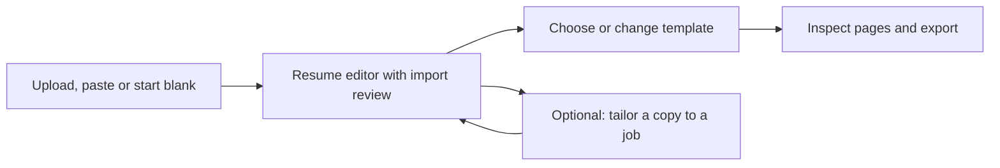

# Resume-first workspace rethink

Date: September 29, 2026. Approved design and implementation plan. The local build is complete; implementation and validation evidence are recorded in `resume-first-workspace-build.md`.

The user's latest direction supersedes the earlier instruction to give Experience and Resumes equal prominence. The primary outcome is creating, improving, maintaining and exporting a resume. Reusable career details support that outcome.

## What the current screen gets wrong

- The sidebar says “Your experience” while the page says “Your resume workspace.” The product's entry point and destination do not describe the same task.
- Two large equal destination buttons ask users to choose between Experience and Resumes before working on a document.
- An oversized upload panel consumes the first screen even when saved resumes already exist. The useful returning-user action is further down.
- Templates are only encountered later in the flow. Users cannot easily explore the document they want to produce.
- Import review and the document editor repeat parts of the editing experience. The user needs one continuous workspace.
- The visible upload button has weak contrast in the paper theme. Actions and library rows also need a width/overflow pass.
- Saved documents expose source-link metadata prominently, while the more useful details—visual preview, purpose, save status and next action—are less clear.
- Remembering the Experience destination can override the default resume landing page on an ordinary visit.

## Proposed information architecture

Sidebar label: **Resumes**. Page heading: **Your resumes**.

Primary navigation: **My resumes** and **Templates**. A smaller, clearly labeled **Career details** action opens reusable information. Existing `/suite/resume` links remain valid; explicit career-detail links and saved-document links continue to work.

Ordinary visits open the resume workspace. An explicit document link opens that document. Restoring an unfinished resume brings back its editing state and offers clear context. An old remembered career-details destination does not take over a fresh visit.

### First visit

Show a concise introduction, a visible upload dropzone and **Upload resume** action. **Create from scratch** is the secondary action; pasting text is an accessible alternative. A compact template shelf is visible immediately, followed by an honest empty library state.

No career-profile setup is needed to start a resume. A job description is optional.

### Returning visit

Show the current draft or recently edited resume first, with a preview and **Continue editing**. The saved-resume collection follows. A compact **New resume** action offers Upload, Start blank and Paste text; the large onboarding panel does not push existing work down the page.

Resume cards show name, general or targeted purpose, updated time, save state, and a thumbnail. **Open** is the main action. Rename, duplicate, archive and history sit in a secondary menu. A source that was never linked is not presented as an error badge.

Documents and their revisions should eventually be grouped: editing and saving one resume should not flood the library with indistinguishable cards. Grouping must use recorded lineage, with older unlinked records remaining available.

## One continuous document workspace

Desktop: section editor on the left and a readable page preview on the right. Keep the document name, save status, template selector and Export action in a compact toolbar. On mobile, use Edit/Preview controls while preserving the current section and draft.

The document has **Content**, **Design** and **Review** controls. Export stays available as an action; it does not require navigating an unrelated setup flow. Switching templates preserves content and uses the selected resume's actual text. Final PDF preview still checks real pagination.

Import review appears inside this workspace. Display extracted content, source comparison and specific warnings beside the affected sections. Users correct the actual draft instead of editing a temporary copy and then entering another editor. Preserve the original text and identify omissions/truncation. Keep explicit review decisions for AI-proposed changes before exporting those changes.

AI tools offer specific edits to a bullet, summary or selected section. Tailoring creates a copy and asks the user to review proposed changes. The base document and reusable career details retain their own save boundaries.

## Templates

Give Templates a visible entry point and real sample previews, plus filters that match useful document characteristics. Selecting a template can start a blank document or apply it to an existing resume. Upload remains available if the user explores templates first.

In the editor, show templates with the user's current content. Switching design must preserve edits, target, review decisions and palette state. Preserve existing access rules and template entitlements. Prefer coherent previews and reliable PDF/Word results over increasing template count.

## Career details

Keep roles, projects, education, skills and achievements in an optional supporting area. Users can add details directly or deliberately copy reviewed resume details into it. Importing or editing a resume does not silently replace shared career information.

Offer to reuse a saved achievement or suggest updates to selected resumes. Each document receives changes only when the user chooses them. Existing stored career records remain accessible; this rethink does not require deleting them or migrating user data for the first phase.

## Implementation order

1. **Entry and hierarchy:** align sidebar/header language, replace the equal destination cards, ensure default resume routing, and distinguish first-visit and returning-user layouts. Fix upload-button contrast and narrow-screen overflow.
2. **Continuous editor:** consolidate import review into the document editor, add a persistent preview and compact save/export toolbar, and preserve recovery through upload failure, cancellation and refresh.
3. **Templates and collection:** expose template browsing, add document thumbnails and useful library actions, and group recorded revisions without dropping legacy records.
4. **Supporting career details:** provide the secondary area and deliberate reuse/update actions once the core document flow is clear.

## Acceptance evidence

- A new user can upload, correct, design and export a general resume without completing career details or supplying a job description.
- A returning user can open the most recent document directly from the first screen.
- Template selection before or after import preserves the same document content.
- Loading, failed parsing, unreadable files, retry and manual-text recovery remain bounded and visible.
- Save failure does not claim account persistence; refresh and reopen restore the recorded document state.
- Career-detail edits do not silently rewrite existing resumes.
- Keyboard use and 390px layout keep upload, editing, save and export reachable, with readable actions and no horizontal page overflow.
- Actual exported PDF pages and Word reading order are inspected using representative resumes. Existing source-preservation and ownership checks remain release gates.

The next build should start with entry hierarchy and the continuous editor. A new database model or a larger template catalog is not a prerequisite for making the workflow clear.
