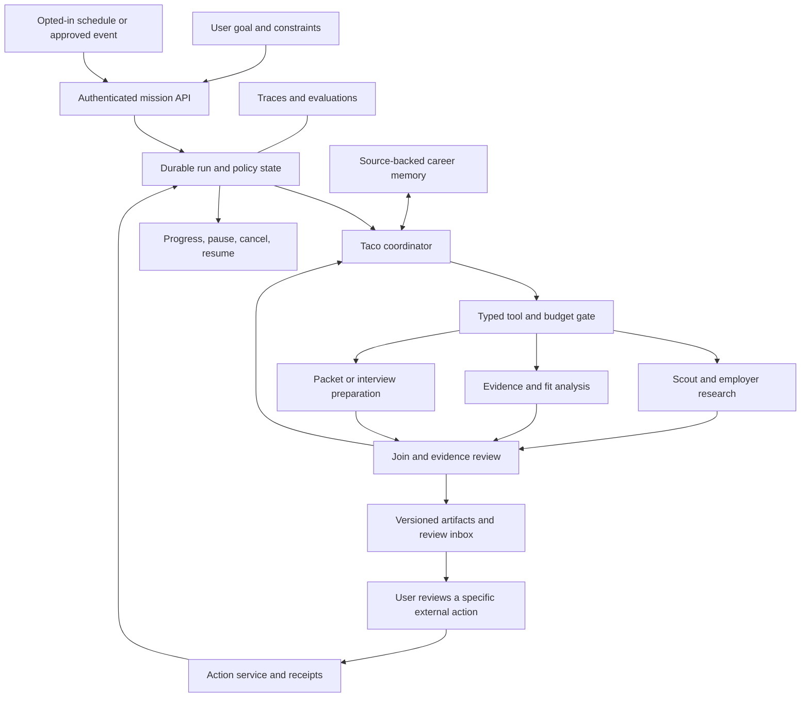

# Taco: an agentic career workspace

Research and architecture proposal, October 8, 2026. Prepared with three parallel GPT-6 Luna research agents and coordinator review. The current implementation was inspected in `/home/xwingace/Documents/Projects/Taco-upgrade`. This document proposes the next architecture; it does not claim that the runtime has been implemented or evaluated in production.

**Implementation companion, October 9:** use the [staged implementation plan](taco-agentic-implementation-plan.md) for P0–P6 dependencies, existing-code reuse, safe verification, ownership and release gates. Its P2a isolates the recovery pilot from artifact writes; P2b adds saved analysis only after that gate. This document remains the architectural rationale; neither document marks implementation complete.

## Decision

Build Taco around a persistent career mission. One coordinator interprets the goal, selects authorized tools, delegates independent analysis, assesses results, and revises its plan. Durable application state and deterministic services enforce permissions, budgets, evidence, and external effects. Specialists are invoked when their separate context or parallel work adds value; routine operations remain ordinary code.

The visible product becomes: **tell Taco the outcome, let it work, review decisions and finished artifacts**. Existing resume, search, application, interview, and tracking screens remain useful artifact editors and views into the same mission. They should no longer require users to manually transport context between tools.

**Founder clarification, October 8:** job-seeker freedom leads the experience. Users choose their career direction, stretch roles, wording, emphasis and presentation; fit analysis advises rather than vetoes a user-selected target. An uploaded resume is not the complete boundary of their experience: users can add or correct genuine facts with explicit confirmation and source/version history. User-confirmed claims are not independently verified claims. Agents must not invent schools, degrees, certificates or other factual achievements. Review should make editing and experimentation easy, with explanations available rather than unnecessary approval prompts for ordinary drafting. This is a design requirement for the proposed runtime, not a change to current rewrite caps, entitlements or external-action approval rules. See the [updated positioning](taco-competitive-strategy-2026-10-08.md#product-principle-freedom-with-factual-integrity).

**Expanded workspace exploration:** the founder subsequently requested curated job subscriptions, follow-up reminders, application status reports, learning progress and a comprehensive dashboard. [Internal blueprint section 15](internal-product-blueprint.md#15-career-workspace-curated-opportunities-progress-and-agency--october-8) maps these to existing code and proposes the user experience. Home, timelines and email summaries should derive from shared recorded events; scheduling and delivery remain deterministic services. Keep Taco's task state, application stage and information source separate. Job-email consent is not submission/outreach consent. Provider course completion and employer status require actual integration evidence. This adds product requirements without claiming the durable runtime is already implemented.

Recommended initial stack: existing Next.js/TypeScript and Firebase; the already-installed Vercel AI SDK as the provider abstraction and bounded reasoning loop; Firestore for mission/run/evidence records; authenticated Cloud Run workers and Cloud Tasks for dispatch. Time-box this pilot and compare Google Workflows before committing to substantial custom recovery infrastructure; a task queue alone is not a durable mission runtime. Hosted agent runtimes remain alternatives if they meet model, authority and data-handling requirements. Do not simultaneously add LangGraph, OpenAI Agents SDK, and Temporal.

**Deeper review, October 8:** a fresh Luna market researcher and code explorer plus a stronger architecture reviewer challenged the plan. The persistent unit is the career mission and its role records; execution is a series of short, version-pinned runs. The commercial first slice is a user-supplied target role, followed by continuity when there is a real next event. Source discovery and additional specialists must earn their cost. The selected Daily focus/notifications concept remains a prototype. No new runtime or production reliability is claimed by this review.

GPT-6 Luna ran the research workers in this Codex task. That does **not** configure Taco’s production models or establish API entitlement. Production model IDs, available providers, structured-output/tool support and cost must be verified separately. Route by capability and measured quality rather than scattering model names through routes.

## What current research changes

| Primary evidence | Relevant finding | Design consequence for Taco |
|---|---|---|
| [Google Research, January 28, 2026](https://research.google/blog/towards-a-science-of-scaling-agent-systems-when-and-why-agent-systems-work/) | Across 180 tested configurations, coordination helped decomposable work while every tested multi-agent configuration degraded performance on a strictly sequential planning benchmark. These results are task-specific. | Parallelize independent job/company investigations. Keep one owner for the user’s goal, final evidence adjudication, and action sequence. Benchmark fanout against a single-agent baseline. |
| [Anthropic, March 24, 2026](https://www.anthropic.com/engineering/harness-design-long-running-apps/) | Separating generation from evaluation improved their long-running application-building harness; self-assessment was a weakness. This is an engineering case study, not a career-product trial. | Separate packet creation from review; combine a reviewer model with deterministic evidence and export checks. A second model’s approval is not proof of truth. |
| [Anthropic, April 8, 2026](https://www.anthropic.com/engineering/managed-agents) | Durable session history, replaceable reasoning harnesses, and execution environments are separate interfaces. | A browser tab or model context must not own a career mission. Keep credentials and policy enforcement outside model-controlled execution. |
| [OpenAI hosted Agents API architecture, checked October 8, 2026](https://developers.openai.com/api/docs/guides/agents-api/architecture) | The documented OpenAI-hosted Codex harness maintains sessions and can use application function tools without requiring a sandbox. Progress can arrive through streams or webhooks. | Include it as a managed-runtime candidate, subject to product/model/terms validation for career work. Taco still owns its records, authorization and external-effect receipts. |
| [Memora, April 21, 2026, ACL Findings](https://arxiv.org/abs/2604.20006), and [STALE, May 7, 2026 preprint](https://arxiv.org/abs/2605.06527) | Memory benchmarks expose reuse of invalid facts and difficulty acting on implicit changes. Neither establishes a universal production failure rate. | Version candidate facts, preferences and job snapshots; explicitly supersede stale memories. Retrieval alone does not establish that a remembered fact remains applicable. |
| [OpenAI, March 11, 2026](https://openai.com/index/designing-agents-to-resist-prompt-injection/) | Untrusted content must be prevented from reaching consequential actions, including when a model follows a malicious instruction. | A job post may inform analysis but cannot authorize a tool, recipient, disclosure, or write. Enforce this at the execution boundary. |
| [Anthropic agent evaluation guidance, January 9, 2026](https://www.anthropic.com/engineering/demystifying-evals-for-ai-agents) | Evaluate the model and harness together, including actual outcomes and repeated trials. | Measure whether a valid packet exists, whether actions were authorized, and whether a crashed run recovers—not merely whether a response sounds helpful. |

The recommendations below are our engineering synthesis. Publication dates above distinguish dated studies from rolling documentation checked on the research date. Product success and operating cost still require Taco-specific measurements.

## Current code: reuse the foundation

The [code audit](research/2026-10-08-agentic-code-audit.md) provides file/line references. Coordinator spot-checks confirmed the chat loop, internal queue authorization, provider registry, SDK bridge and workload reservation behavior.

| Current capability | What to retain | Missing capability |
|---|---|---|
| `app/api/agent/chat/route.ts` chooses tools through a bounded model loop | Auth, request reservation/replay, conversation persistence | Common tool policy, streamed run events, model routing, cancellation and durable continuation |
| `lib/assistant/agent-harness.ts` performs fixed understand/search/prepare/notify stages | Verified-source retrieval, job supply checks, truth guardrails, queue contracts | Adaptive planning, durable branch/step state, selective retry and re-planning |
| `app/api/cron/agent-pipeline/route.ts` proactively prepares work | Scheduling preferences and entitlement gates | Dispatch the same mission runtime used by chat, instead of a second workflow implementation |
| `lib/assistant/activation-receipt.ts` binds and consumes activation receipts | Trusted user-start boundary | General scoped authority for tools, including approval bound to content and destination |
| `lib/career-twin.ts` and `lib/assistant/context.ts` collect career context | Existing profile/resume/story context | Explicit source lineage, revisions, conflict resolution and deletion propagation |
| Workload policy, reservations and economics modules | Plan enforcement and usage reconciliation | Per-branch token/tool/time budgets and total run accounting |

Two early corrections matter. `queue_application` currently accepts the model’s `args.userConfirmed` flag before writing an **internal review queue item**; it does not submit a job application. Replace this with trusted server authorization. Also, the chat endpoint’s streaming comment does not describe its buffered JSON behavior; add real progress events when the durable run interface is introduced.

The second read-only source pass found reusable boundaries, with important limits:

| Source inspected | What it establishes | What it does not establish |
| --- | --- | --- |
| `lib/assistant/agent-harness.ts:695–761,1145–1168` | Persisted run summaries and fixed stages | Restartable step checkpoints or an adaptive durable mission |
| `lib/assistant/activation-receipt.ts:67–167` | Signed, expiring, single-use scout-start authority | Approval for arbitrary future tools or external submissions |
| `lib/assistant/tools.ts:1005–1065` | Model-supplied confirmation guards an internal queue write | A trusted authenticated confirmation; this is a source-level concern, not a reproduced external-send exploit |
| `lib/assistant/chat-message-quota.ts:18–83` | Request reservation, fingerprinting and replay boundaries | End-to-end exactly-once effects |
| `lib/email/outbox.ts:46–245` | Deterministic message IDs, lease/retry logic, preference checks and provider idempotency | Safe blind replay after the provider's deduplication window expires |
| `app/api/applications/outcome/route.ts:17–19,193–235` | User/report-source application outcomes | Independently verified employer progress |
| `app/api/skill-bridge/plans/route.ts:6–36` | Saved plans and checkoffs with existing entitlement rules | Provider-confirmed course completion or certifications |

These are local-code observations; scheduled production configuration and live integrations were not checked. Keep current provider adapters and `lib/ai/models.ts` as the baseline rather than assuming the Codex research model is a product API dependency.

Use `lib/assistant/*` for new code. `lib/sona/*` contains compatibility aliases. Avoid a broad provider swap, database migration, branding change, or rewrite of functioning artifact tools.

## Proposed system

The model decides *what authorized work is useful next*. Code decides *whether an action is allowed and how it commits*. This permits adaptive work without giving model text authority over identity, billing or source facts.

### Separate authority, reasoning and the user's record

Keep a modular application initially, with separate deployment/service identities only where isolation or scaling justifies them. Three boundaries matter more than the number of services:

- **Control:** authenticated commands, policy, schedule grants, budgets, approvals and the effect dispatcher. Background workers authenticate with IAM and resolve current user authority server-side; do not retain a user's short-lived Firebase token as the workflow credential.
- **Execution:** bounded model/tool calls, queue delivery, attempts, leases and workflow history. Workers return typed proposals and evidence references. They cannot invent privileges or approve their own output.
- **User record:** versioned facts, preferences, opportunity records, artifacts and source-labeled events. The dashboard, chat and notifications project the same records instead of maintaining competing histories.

For each opportunity preserve the job snapshot, the user's reason for pursuing it, evidence references, preferred framing, artifact versions and the exact file the user says they submitted. A later edit creates a new version; interview preparation can still use the submitted one. Application stage, agent execution stage and evidence/source status are separate fields. Course progress recorded by the candidate is not a verified qualification.

The action inbox derives from meaningful domain events such as a packet ready for review or a user-recorded interview date. A deterministic notification policy groups duplicates and enforces opt-in category, cadence, quiet hours and pause. An LLM can draft a summary from permitted fields; it cannot choose new recipients or manufacture an employer update. Low-urgency events wait for the configured digest. Suppress stale reminders after their underlying task is resolved. Prototype notification counts are fictional examples, never production data.

### Agent roles and autonomy

| Role | Work it owns | Boundary |
|---|---|---|
| Taco coordinator | Clarify a material ambiguity, form/update a plan, choose tools, delegate and assemble a result | One mission owner; no unrestricted SQL, shell, secrets or provider credentials |
| Opportunity researcher | Search approved sources, investigate companies, assess posting freshness | Parallel research by independent source/company; returns cited observations |
| Evidence/fit specialist | Map job requirements to candidate evidence and identify gaps | Cannot turn a requirement or inference into a candidate fact |
| Application specialist | Tailor a supported resume and draft a cover letter or answers | Produces artifacts under existing truth and export rules |
| Interview/career specialist | Build practice from the role and approved stories; suggest next actions | No autonomous public profile changes or communications |
| Reviewer | Inspect completeness, source support and unresolved conflicts | Cannot override deterministic policy or truth failures |

These are logical capabilities, not six always-running agents or six new microservices. Begin with two independent analysis branches and a coordinator; enable additional specialists only after they outperform a simpler path. A routine database lookup, entitlement calculation, deduplication, export validation or notification dispatch does not need an LLM.

Initial autonomy should cover approved research, artifact preparation, internal organization and opt-in monitoring. A user who starts an authorized preparation mission should not approve every read or draft. External outreach, submission, publishing and spending require a separate explicit action approval; the current product promises review before anything leaves Taco. Optional external execution is a later product capability, not something enabled by this proposal.

### A concrete mission

“Find remote senior product-design roles matching this approved resume. Exclude staffing agencies and the companies I rejected. Prepare the three strongest applications and tell me where evidence is missing.”

Taco captures user-selected hard constraints, permissible sources, the resume revision, budget and stopping condition. It searches; if results are weak, it can try related search terms while preserving those constraints. It may ask to broaden a constraint but cannot silently change it. Independent employer/source research can run alongside evidence matching. It prioritizes drafts according to the user's goal, explains gaps and can prepare a user-selected stretch application without inventing qualifications; a low fit score alone is not a veto. It returns a review inbox with sources and completed artifacts. Closing the tab does not discard the mission. A scheduled repeat, if enabled, processes only new or changed opportunities and stops when the user pauses the mission or its authority expires.

## Runtime and state contracts

Separate durable objects with explicit ownership:

- **Mission:** user-owned goal, constraints, allowed autonomy, schedule consent, budget and current approved evidence references.
- **Run:** one attempt against pinned input versions, workflow/model/prompt/tool versions, deadline, cancellation revision, cost reservation and terminal outcome.
- **Task:** parent run, dependencies, typed inputs, attempt/lease identity, result reference and failure classification. Workers propose artifacts; they do not directly mutate the same resume or approval.
- **Evidence:** source ID/version/hash and exact locator, observation/expiry information, source-supported/user-asserted/inferred/unknown/conflicted status. Source support does not mean independent verification of a person’s claim.
- **Action intent:** canonical payload hash, recipient/destination, attachments, job and artifact revisions, approval grant, idempotency key and provider outcome.
- **Event:** ordered transition metadata and redacted evidence references. Store concise decision explanations, not hidden chain-of-thought or unrestricted prompt transcripts.

A mission can last months while runs last minutes. Freeze input hashes and workflow/model/prompt/tool versions per run. An edit changes the mission revision and schedules new work using still-valid cached branches; it does not silently rewrite a running task's inputs. Distinguish mission pause (no new scheduled runs), run cancellation (stop current work), and authority revocation (disable relevant current and future actions). Events carry an aggregate sequence plus causation/correlation IDs; projections dedupe event IDs and handle out-of-order arrival. Avoid a single global event counter.

Suggested run states: `queued`, `running`, `waiting_for_user`, `waiting_for_approval`, `retry_scheduled`, `paused`, `completed`, `failed`, `cancelled`. Individual action outcomes also need `unknown` for a timeout after a possible external commit. A model emitting “done” cannot mark a run completed unless its required artifacts and checks exist.

Use existing `users/{uid}/agent_runs` behind a versioned schema where compatible, with child tasks/events and additive mission/evidence/action records. New client permissions should be owner-readable only for sanitized projections, with authoritative transitions performed on the server. Firestore Admin SDK bypasses security rules: the tool/action service must re-check owner, run authority, current consent and limits itself.

Every tool definition owns a Zod input/output schema, effect class, data scopes, entitlement policy, timeout, cost estimate, evidence contract, idempotency strategy and executor. Identity and approval context come from the server, never tool arguments. Narrow the visible tool set to what the current run can use. MCP may wrap approved connectors; it is not the authorization policy. A2A is unnecessary for internal specialists and should wait for an actual separately operated agent integration.

### Recovery and cancellation

Persist task intent and an outbox event atomically in Firestore. A dispatcher creates the Cloud Task; a repair scan catches committed intents not yet dispatched. The queue carries record IDs, not resumes or credentials. An authenticated worker acquires a lease with a fencing token, runs a bounded step, and commits only if its lease, run revision and cancellation state are still current. Heartbeats must not allow an old worker to overwrite a successor.

Cloud Tasks delivery is at least once; Firestore transactions may rerun. Keep model and external calls outside transaction callbacks. Stable application idempotency keys and reconciliation remain required; neither queue deduplication nor a workflow engine proves exactly-once effects across independent services. [Cloud Tasks](https://docs.cloud.google.com/tasks/docs/dual-overview), [Firestore transactions](https://firebase.google.com/docs/firestore/manage-data/transactions).

On partial fanout failure, retain completed branch results and retry only the failed branch within budget. Block synthesis if a required evidence branch failed. Propagate deadline and cancellation to providers that support abort, and reject late results otherwise. Cancellation prevents new claims and stale local commits, but cannot fence an external call already issued. Expose cancellation as requested while such effects reconcile; do not promise recall after provider acceptance. For an uncertain external write, query provider status or request human reconciliation rather than blindly resend.

Approval pauses release workers. The approval endpoint authenticates the user, validates the action digest and expiry, and schedules continuation. Any change to recipient, payload, attachment, source artifact or permission invalidates the old grant. Resume must re-check permissions and evidence freshness.

Bind approval to the authenticated user, one effect ID, mission/authority revisions, destination, exact rendered message content, attachment hashes and artifact revisions. Specify canonicalization for structured fields; freeze content before review, including application-controlled links. Record the approval event and atomically consume a single-use grant while claiming dispatch. A signature proves integrity, not that a human approved: the authenticated event is essential. Optional signed grants need a dedicated rotated key and key ID. An opted-in reminder grant may authorize a defined category/cadence/destination; it never authorizes employer outreach.

The existing email provider retains idempotency keys for **24 hours**. An accepted request whose receipt was lost may be duplicated if blindly retried later. Track effect states such as prepared, dispatching, accepted, delivered, unknown and failed. Reconcile webhooks/provider receipts where possible, and require manual resolution when evidence is insufficient. Provider acceptance, delivery and an application outcome are distinct. [Resend idempotency contract](https://resend.com/docs/dashboard/emails/idempotency-keys)

Restore is part of the authorization design. Keep outbound dispatch disabled after restoring an older database until approval consumption, revocations, deletions and remote effects have been reconciled. A backup can resurrect a previously consumed grant. Retain a separately recoverable, access-controlled journal of minimal authority/deletion metadata with a defined retention policy; its location and recovery procedure are stage-0 decisions, not implemented infrastructure. If that journal is unavailable, keep effects disabled rather than infer consent from stale state.

### Memory and efficiency

Keep three stores conceptually distinct: approved career evidence, user preferences/consent, and temporary run scratch state. Career Twin becomes a derived, rebuildable view. Old job descriptions expire; withdrawn source claims invalidate dependent drafts. “Forget this” propagates to retrieval indexes, summaries, caches and unpublished artifacts under Taco’s control. Audit metadata should reference deletable payloads so an append-only operational log does not make private content permanent.

Inferred memory never becomes factual evidence merely through repeated retrieval. Authorize before retrieval and namespace caches by user and data/policy revision. On deletion, tombstone the scope and increment a deletion epoch before asynchronous cleanup so in-flight workers cannot recreate it. Propagate to derived indexes and provider sessions where supported; report provider/backup retention limits honestly. Parent-document removal does not erase Firestore subcollections. Include deletion tombstones in restore reconciliation. [Firestore deletion behavior](https://firebase.google.com/docs/firestore/solutions/delete-collections)

Retrieve the smallest relevant evidence slice for each worker. Pass IDs, structured findings and source excerpts; do not copy the full conversation/resume bundle to every specialist. Discover additional tools when needed instead of loading the entire catalogue. Cache only within authorized tenant and source/policy/model versions. Batch deterministic screening before expensive analysis, and reserve stronger models for ambiguous planning, conflicts or failed quality checks.

Suggested initial experimental bounds: two parallel analysis workers, one corrective synthesis pass, a configurable deadline and a total reserved spend ceiling covering all children and retries. These are tunable defaults, not evidence of optimal settings. Track billed tokens and tool costs, including failed and cancelled calls; a token estimate is not an invoice. Optimize cost per accepted, source-supported packet and latency, not raw token reduction alone.

Use a simple routing ladder: code for filtering/identity/deduplication; the cheapest model that passes task-specific checks for extraction and routine drafting; stronger reasoning for genuinely ambiguous goals, conflicts or a failed quality check. Escalation gets a typed failure reason and relevant evidence, not every conversation token. Permit one bounded repair before returning a useful question or partial result. A strong model is not exempt from truth/export checks.

The independent review offers an illustrative ceiling of 22k input plus 7.5k output tokens for planning, two analyzers, synthesis and one repair. It is **not a validated sizing result or dollar estimate**: provider reasoning tokens, tokenizer differences, tool payloads and per-call maxima also need accounting. Reserve conservative billable cost before fanout and release only unused reservations; cancelled/failed calls remain costs. Pin a price snapshot for reconciliation while leaving customer plan prices resolved from Stripe as today. Measure cost per accepted packet including unsuccessful attempts, infrastructure, support and acquisition separately.

## Technology choice and alternative

The [runtime memo](research/2026-10-08-agentic-runtime-research.md) compares nine options. Current AI SDK [loop controls](https://ai-sdk.dev/docs/agents/loop-control) provide useful bounded reasoning; they do not supply durable missions. Use a runtime adapter so the first implementation does not couple product records to one orchestration vendor.

First compare Firestore/Cloud Tasks/AI SDK with **Google Workflows plus Cloud Run workers** on the same synthetic mission and failure cases. Workflows supplies managed ordering, retries and callbacks; it is a plausible fit for the current GCP stack and relatively fixed preparation flow. Its workflow-language ergonomics and dynamic graph needs must be assessed. [Official Workflows overview](https://docs.cloud.google.com/workflows/docs/overview)

The hosted OpenAI Agents API and Claude Managed Agents remain candidates if supported models, account availability, retention and execution semantics fit. Evaluate one relevant hosted alternative rather than integrate every framework. A hosted harness can save maintenance work; provider independence alone is not a sufficient reason to build a workflow engine ourselves. ADK/Agent Engine may help composition and hosting, but session persistence alone does not establish correct side effects. A2A is reserved for separately operated agents, not internal module communication.

If restart/approval/versioning logic becomes substantial during the first slice, choose a managed durable runtime before extending custom recovery. Temporal is the candidate for complex long-lived coordination; LangGraph is a candidate for explicit graph checkpoints and human interrupts. Neither removes the need to reconcile external effects. Assign exactly one owner of workflow execution history; Firestore can remain the user-facing business record without becoming a competing orchestrator.

Proposed stop conditions for custom orchestration: more than ten engineering days for the bounded recovery pilot; more than four repair hours per week for two weeks; more than 0.5% of runs requiring manual recovery over a meaningful observed workload; or several independent human waits/compensations across deployments. These are review triggers, not proven industry thresholds. If they fire, prefer Workflows for fixed GCP flows or evaluate Temporal for richer coordination. Schedule pause/approval as state and events, not paid idle containers. Scale from queue age, provider quotas and transaction contention; user count alone is not a migration reason.

Avoid starting on OpenAI Agent Builder: its [current official documentation](https://developers.openai.com/api/docs/guides/agent-builder) schedules shutdown for November 30, 2026. The hosted Agents API and Agents SDK are different products.

## Implementation sequence and acceptance

| Stage | Concrete deliverable | Acceptance before expansion |
|---|---|---|
| 0 — Contracts and baseline | Trusted tool authorization; versioned run/evidence/action types; current single-agent benchmark; synthetic fixtures; provider data-handling review | Forged model confirmation cannot authorize a write; existing receipt/entitlement/truth tests remain valid; permitted data fields, retention, deletion and trace handling are verified before sending real resume/contact data to a new provider |
| 1 — Durable analysis pilot | “Analyze this supplied role” with a single-agent baseline and an optional two-branch comparator, source-backed join, pause/cancel/resume, run progress; compare managed runtime | Crash at each boundary; duplicates, late workers, one failed branch, changed resume and tab closure recover without false completion; only run/evaluation state writes, no career-artifact or external writes |
| 2 — First complete mission | Supplied role → one review-ready packet first; then approved resume → adaptive search → up to three explainable matches → one packet | Hard constraints preserved, claims trace to source, packet survives reload/retry and budget stays bounded; quantify improvement against baseline. Never invent matches to satisfy a count |
| 3 — Proactive work | Opt-in recurring missions; change detection; shared chat/cron runtime; useful notifications | Consent revocation stops future work; no duplicate drafts/digests; missing provider data is distinguishable from no results |
| 4 — Career continuity | Interview preparation, application feedback and user-correctable memory in the same mission | Updated preferences and withdrawn claims affect future decisions; independent review confirms memory corrections |
| 5 — Optional external execution | Narrow supported connectors, exact-action approval, action receipts and reconciliation | Scoped authorization, changed-content approval invalidation, zero duplicate effects in fault tests; deploy only after separately reviewed connector behavior |

Proposed code seams: `lib/assistant/runtime/{types,registry,orchestrator,store,policy}.ts`, `lib/ai/model-router.ts`, adapters around existing harness services, and additive mission/run APIs. Reuse existing auth and chat replay boundaries. New schema and API names are proposals until stage 0 finalizes contracts. Start behind a capability flag; route only one use case through it, and retain the existing path for rollback without duplicating side effects.

No calendar estimate is committed before the baseline and recovery pilot. The hard work is reliable state, evidence and authority—not creating more role prompts.

## Evaluation and release gates

Create versioned scenarios covering normal career missions, no suitable jobs, stale postings, contradictory resumes, revoked access, adversarial job text, unsupported claims, provider failures, crashes, duplicate deliveries and cancelled runs. Compare the current pipeline, a single bounded agent, and the proposed two-worker design with repeated trials and human-reviewed outputs. Report sample sizes and uncertainty; zero observed violations in a finite suite is not a universal guarantee.

Required gates: no unapproved external effects, no cross-user data access, no accepted invented claims in tested packets, complete resolvable provenance for required facts, approval invalidation when content changes, no duplicate committed effects under injected faults, and deterministic budget/cancellation enforcement. For semantic quality, measure reviewer acceptance, suitable-match precision, correction burden, factual omissions and stale-memory handling. Set numeric improvement thresholds after establishing the baseline.

Operational measures: successful missions and accepted packets, p50/p95 time to useful result, full cost per accepted packet, fanout’s incremental benefit, stuck-run age, recovered failures, duplicate effects, user interventions and notification usefulness. Trace model/tool versions, attempts, artifacts, policy decisions and provider receipts with private payloads redacted by default. Feed failures into offline evals and reviewed updates; do not let production agents rewrite their own permissions or deploy new prompts without evaluation.

### Failure drills and measurable expansion

| Injected failure | Required observed result |
| --- | --- |
| Crash after Firestore intent commit, before enqueue | Repair dispatches the pending task; duplicate delivery reuses the committed result |
| Lease expires while an old worker is still running | Only the current fencing token can commit; both attempts' incurred costs remain visible |
| Evidence or destination changes after approval | The old approval cannot dispatch the changed content; unaffected cached analysis may be reused |
| Cancellation races with a provider call | Stop new local work; reconcile an in-flight effect and accurately report whether it was accepted |
| Provider accepts email, response is lost, recovery occurs after 48 hours | No blind resend after the dedup window; reconcile or require operator resolution |
| Tenant deletion during fanout, then restore from older backup | No cross-user retrieval or late resurrection; effects remain quarantined until authority/deletion reconciliation |

Test all implemented boundaries with synthetic fixtures and repeated trials. Define any reliability target over an explicit population: eligible runs with valid inputs and available required providers, excluding user-wait time from compute latency but reporting it separately. Report queue wait, compute, review time and end-to-end time independently. The product north star remains three explainable matches plus one review-ready packet under ten minutes when suitable supply exists; the initial supplied-role pilot measures a narrower outcome. No-match/provider-unavailable results must remain honest, not be hidden to inflate success.

Before admitting fanout, preregister a task-specific acceptance/latency target and cost ceiling. The strategy proposes a 25% latency reduction or ten percentage-point human acceptance gain with at most 25% additional variable cost and no observed safety/control regression. Repeat on held-out cases with uncertainty estimates; initial ten-case screens cannot establish a reliable improvement. Prefer the simpler path when evidence is inconclusive. Task decomposition, rather than agent count, determines whether parallel work helps. [Google's agent-scaling study](https://research.google/blog/towards-a-science-of-scaling-agent-systems-when-and-why-agent-systems-work/)

Candidate recovery objectives such as RPO ≤15 minutes and RTO ≤4 hours require configured backups, a durable revocation/deletion journal, staffing and a restore drill before adoption. Do not market them as achieved. Start in read-only/shadow mode, canary one workflow, and keep outbound effects disabled during recovery tests. Rollback pins compatible workflow versions and cannot replay already-consumed actions.

## Deliverables and boundaries

- [Current-code audit](research/2026-10-08-agentic-code-audit.md).
- [Runtime, framework and durability comparison](research/2026-10-08-agentic-runtime-research.md).
- [Memory, safety, connectors and evaluation research](research/2026-10-08-agentic-memory-safety-research.md).
- [Independent durable-architecture review and alternative](research/2026-10-08-durable-career-architecture-review.md).
- [Second-pass market choices and validation](research/2026-10-08-career-market-deep-dive.md).

The original runtime and memory/safety agents reviewed the first synthesis. The second pass adds source-level boundaries, a Workflows comparator, opportunity continuity, attention policy, provider-window/restore failure cases and explicit experiment limits. Independent document review is recorded in the project checkpoint; it is not runtime validation.

This pass added research and architecture documents and updated the project checkpoint only. It did not install providers, change application code, run paid product-model benchmarks, enable scheduled jobs, submit applications, send messages, or deploy. Existing clone work is preserved. The next implementation unit is stage 0 followed by the durable read-only role-analysis pilot.
