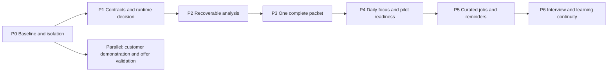

# Taco agentic implementation plan

**Prepared and reviewed October 9, 2026 · implementation authorized October 9.**

**Workspace:** `/home/xwingace/Documents/Projects/Taco-upgrade`. Preserve the original `/home/xwingace/Documents/Projects/Taco` and unrelated clone changes. The owner's subsequent “Ok let’s do it” authorizes implementation within this plan. Infrastructure provisioning, deployment and external actions retain their separate gates.

This is the execution companion to the [architecture](taco-agentic-architecture-2026-10-08.md) and [competitive strategy](taco-competitive-strategy-2026-10-08.md). It supersedes their broad sequencing where this document is more specific; it does not replace their authority, evidence or commercial constraints. Use the [checkpoint](../.codex/long-horizon/taco-upgrade.md) and [project map](../.project-map/index.html) for completion evidence. **Current: P0 baseline recorded; P1 chat containment deployed to staging and managed recovery comparison passed (40/40 cases). Google Workflows selected for the first pilot. Authority/journal integration remains unfinished; P2–P6 not started.**

## 1. The release we are building toward

**A signed-in candidate selects a confirmed resume and supplies a job posting. Taco explains the opportunity, prepares one truthful application packet, preserves review and edits across interruptions, and shows the next useful action in Daily focus.**

The candidate chooses voice, emphasis, presentation and stretch roles. They can add genuine experience absent from the uploaded resume through a new confirmed source revision. Unknown qualifications remain unknown; a fit score is neither a hiring probability nor permission to pursue a role. Preserve current entitlements, rewrite consent, immutable proofed resumes, export truth checks and runtime Stripe pricing.

First release includes one supplied posting, saved analysis, one packet, review/export/reopen, recovery controls and real dashboard actions. Require supplied posting text initially; a URL is provenance, not permission for arbitrary server fetching. Packet readiness must preserve the existing resume **and cover-letter** proof contract; a resume-only result is labeled accordingly. PDF/DOCX export scope is the tailored resume unless another document's export path has separately passed verification.

Later releases add preference-based discovery, opted-in reminders, interview/learning continuity and separately reviewed external connectors. A job board, mass auto-apply, mailbox import, coach administration, a new model provider and a broad design-system rewrite are outside the first release. The existing proposed assisted-service offer remains a separate commercial experiment.

## 2. Starting point and reuse

Local source inspected October 9; no tests or live integrations were run for this planning pass. HEAD is `806ac3c0`; the clone has extensive existing changes and no remote. Historical test counts and July recovery statements are not a fresh release baseline.

| Area | Reuse | Boundary to preserve or extend |
| --- | --- | --- |
| Analysis | `app/api/oracle/analyze/route.ts`, `lib/oracle-v2.ts`; versioned `fit_analyses` and source/input hashes | Current route combines model calls, save and Career Twin invalidation. Extract service boundaries before using it in a recovery pilot; do not call the whole mutating route from a supposedly read-only worker. Preserve standalone/pasted-input behavior |
| One packet | `app/api/agent/apply-pipeline/route.ts`, `lib/job-packet-state.ts`, `lib/job-packet-review.ts` | Reuse per-job identity, source binding, leases, review revision and proof checks. The scout harness's multi-packet behavior is not this single-role workflow |
| Exports | `lib/resume-export-truth.ts`, existing PDF/DOCX and linked-application export paths | Validate actual downloaded documents; never bypass truth checks to make an incomplete packet look ready |
| Authority/replay | `lib/api-auth.ts`, `lib/assistant/activation-receipt.ts`, `chat-message-quota.ts`, workload reservations | Scout authority is narrowly scoped. Model `userConfirmed` is not authenticated authority. Preserve idempotent requests and current plan/usage rules |
| Execution | `lib/assistant/agent-harness.ts`, existing `agent_runs` | Current run summaries are not restartable task checkpoints. Add a versioned contract; do not reinterpret old summaries as resumable workflows |
| Dashboard | `lib/dashboard-action-inbox.ts`, `components/dashboard/DashboardActionInbox.tsx`, `PhaseOneCommandCenter.tsx`, `app/suite/page.tsx` | Today already consumes real records with partial-error handling. `DashboardToolWorkbench.tsx` is a preview, not the durable data source |
| Reminders/learning | Existing email outbox, communication preferences, outcome APIs and Skill Bridge plans | Reuse later. User-reported application/course status is not employer/provider verification |

## 3. Critical path and milestone gates

P0–P4 constitute the first release candidate. P5–P6 are a subsequent roadmap, contingent on earlier evidence. Gate failures stop dependent work; unrelated documentation or isolated fixtures may continue. Calendar commitments follow P0 and the P1 recovery spike, not assumptions about the current dirty tree.

### P0 — Establish a safe, reproducible baseline

**Deliver:** a scoped change inventory, compatibility fixtures, isolated verification recipe and baseline evidence in the existing checkpoint. Capture branch/HEAD, affected-file hashes and unrelated edits before changes. Do not reset, bulk-stage or commit other people's work. Establish a reviewable commit/backup strategy; no remote is invented or pushed.

Trace one confirmed resume and supplied posting through analysis, packet generation, review, export and reopen. Record source/packet IDs, entitlement outcomes, time, defects and existing unsupported/legacy record behavior. Use synthetic data first. Inspect scripts before execution: copied configuration and localhost do not establish service isolation.

Mocked-provider timings and outputs establish functional behavior only. Mark live quality, model latency and billed cost unmeasured until an authorized synthetic/consented benchmark runs against the intended provider configuration; this does not block local contract work.

**Gate/demo:** reproducible fixture journey and an explicit pass/fail baseline; emulator-only writes and mocked external providers proven; original files untouched. Record pre-existing failures with reproducers and owners. A failure touching the first slice must be fixed or explicitly resolved before relying on that path; unrelated failures are not silently waived as passing.

**Owner:** coordinator. **Size:** small discovery milestone; unexpected baseline defects are separately scoped.

### P1 — Set contracts and choose execution ownership

**Deliver:** typed contracts and a thin compatibility adapter, followed by a bounded synthetic recovery spike. Freeze the minimum fields in section 4 before splitting implementation across workers. Repair the internal queue's model-supplied confirmation path with server-owned preparation authority, preserving existing legitimate entry points. One authenticated preparation command authorizes ordinary reads, drafting and internal saves within its scope; avoid new confirmation dialogs for each step.

Choose the location, access policy, retention and restore procedure for minimal authority/deletion metadata here. Its separately recoverable journal must survive restoring an older business database. If current revocations/tombstones cannot be recovered, restored data and workers remain quarantined; stale snapshots cannot supply fresh authority. Define deletion epochs and access checks before implementing persistent private run outputs.

Compare minimal Firestore/Cloud Tasks dispatch with Google Workflows for the **same** two-step synthetic flow. Decide before packet continuation or schedules are added. The decision record must include recovery evidence, setup/access requirements, operating cost categories, developer complexity and workflow-version handling. Use current primary documentation and isolated staging only when available and authorized; an offline simulation does not validate cloud behavior. If staging is unavailable, complete contracts/fixtures but leave the cloud-runtime decision explicitly provisional.

One runtime owns execution history; Firestore owns business records. Keep existing AI provider adapters. Consider Temporal only if evidence shows the two primary options cannot support required coordination. Do not install several frameworks speculatively. The existing ten-engineering-day ceiling on the overall custom recovery pilot is a review trigger, not a delivery estimate.

**Gate/demo:** forged confirmation, cross-user references, request-fingerprint conflicts and expired/revoked authority are rejected; ordinary authorized preparation works. Spike covers dispatch loss, duplicate delivery, lease takeover, late completion and version changes. Coordinator records the selected execution owner and why the alternative lost. No real career artifacts or outbound messages in the spike.

**Owner:** coordinator for policy/state/decision; Luna for isolated fixtures/adapters after interfaces settle. **Size:** medium, with a bounded comparison.

**October 9 implementation checkpoint:** strict preparation contracts and pure policy bind server-derived identity, source/posting hashes, epochs, expiry and budget. Replay preserves the original deadline and budget. The model-controlled `queue_application` writer has been removed: it returns explicit Job Search Prepare guidance regardless of `userConfirmed` or forged owner arguments. The existing Prepare action is preserved; 30 focused contract/queue/packet tests and the 331-check assistant harness pass. This containment repair is deployed to staging revision `taco-upgrade-staging-00003-f6p`; it is not a connected preparation issuer. Client writes to direct/nested `settings/accountLifecycle` are also denied in local rules, with 21/21 isolated emulator tests; that rules change is **not deployed**.

**Execution-owner decision — Google Workflows for P2–P4:** both alternatives passed the same deterministic A→B workload through a private Cloud Run worker and the separate `taco-agentic-spike` Firestore database in `talent-consulting-stg`. Two live rounds passed 20 cases each: normal v1/v2, dispatch loss before/after the provider call, duplicate delivery/start, automatic expired-lease retry, takeover, cancellation/input change during work, and mismatched versions. Each committed at most one result per step; late results were rejected. These finite experiments prove those observed cases, not universal exactly-once execution or AI quality/cost.

Workflows wins this bounded pilot because it owns the sequence, retry history and execution revision. The Tasks alternative also works, but Taco must own step dispatch, expired/exhausted task repair and operator history itself. Both still require a durable start intent, idempotent commit and current authority/fence checks. Ambiguous Workflows starts can create multiple executions for one logical run; business deduplication remains mandatory. No Temporal or second production runtime is introduced.

The additional live rollout drill kept in-flight and pending v1 work on its original revision while a separate v2 revision was deployed; v1 returned 15 and v2 returned 16. The v2 redeploy changed only a metadata environment value, so this does **not** prove compatibility across changed worker code.

The experiment uses separate **semantic version names** (`taco-agentic-spike-v1/v2`), a pinned worker image and recorded deployed revisions. Production release tooling must additionally enforce immutable versioned worker/workflow deployments and reconcile pending starts. The fixture's `/repair` only repairs initial dispatch ambiguity; it is not a complete dead-letter or exhausted-execution recovery service. Synthetic cancellation intentionally causes some workflow executions to fail while the business record remains safely cancelled; operator projections must distinguish these facts.

Setup: private Cloud Run worker (0–2 instances), named Firestore database, Tasks queue, two Workflows definitions, separate worker/executor identities. Worker database permission is conditional on the named database; the executor has only worker invocation. Anonymous worker requests return 403. No model providers, resumes, emails, payments or real accounts were used. Costs are Cloud Run request compute, Firestore operations/storage, Tasks requests and Workflows steps/retries; an actual billed-cost comparison has not been measured. Evidence and manifests: `.codex/releases/agentic-recovery-20261009/`; runnable drill: `scripts/agentic-recovery-staging.py`.

**Issuer service:** `preparation-issuer.ts` now implements deterministic, idempotent command creation against an injected atomic store contract, with explicit-source verification, trusted current access and original-expiry replay checks. It stores only references/hashes. The service has no production storage adapter or endpoint; in-memory tests do not establish Firestore/journal enforcement.

**P1 remaining:** connect an authenticated issuer and a proven transactional store; integrate trusted current access at claim/commit; specify/provision the separately recoverable authority/deletion journal; test restore quarantine. A business-database read followed by a journal write is not an atomic cross-database operation. Existing owner-mutable source records, subscription changes and account lifecycle must follow a fail-closed ordering/reconciliation protocol before real private work is admitted. Current `accountLifecycle` is a deny signal, not sufficient proof of current authority. Journal retention/restore policy and managed identity requirements remain open. P2 private outputs and the P4 dashboard must not bypass these gates.

Current primary references: [Workflows execution/revisions](https://docs.cloud.google.com/workflows/docs/access-execution-results), [Tasks duplicate execution](https://docs.cloud.google.com/tasks/docs/dual-overview), [database IAM conditions](https://cloud.google.com/firestore/docs/manage-databases), [Workflows HTTP retry predicate](https://docs.cloud.google.com/workflows/docs/reference/stdlib/http/default_retry_predicate). Managed compilation caught invalid expression operators and the retry function's argument name that generic YAML parsing missed; actual cloud checks are now part of this boundary.

### P2 — Make supplied-role analysis recoverable

**Deliver:** one mission type around a confirmed resume revision and a complete user-supplied posting snapshot. Start with a single bounded analysis path and deterministic checks. Extract reusable analysis logic from Oracle without changing its existing standalone contract; do not migrate all tools.

**P2a: recovery pilot.** Persist execution state and structured results in the versioned run store only. No `fit_analyses`, application, resume-version or email writes. Add authenticated start/read/pause/resume/cancel commands, monotonic events and reconnectable progress. Polling from persisted state is acceptable initially; streaming must not become a second source of truth.

**P2b: saved result.** After P2a passes, adapt accepted results into the existing `fit_analyses` contract with stable identity, evidence references and explicit analysis/workflow revisions. Keep immutable run outputs; a new model/run version must not silently overwrite a historical result because its source-input hash happens to match. Save and Career Twin invalidation are explicit, retry-safe steps. Missing JD or oversized input returns an actionable state, not an invented analysis.

**Gate/demo:** close/reopen the tab and restart a worker mid-step; recover the same logical operation without duplicate committed results or duplicate logical usage debits. Record all actual provider costs, including repeats. Pause, resume, cancellation, changed source, deletion, tenant isolation, quota exhaustion and partial provider failure behave as specified. Missing facts remain questions and the user can choose a stretch role.

**Owner:** coordinator owns state/persistence; a bounded Luna worker implements service adapters/fixtures. **Size:** largest initial uncertainty; pass its failure suite before expansion.

### P3 — Continue into one review-ready packet

**Deliver:** a bounded adapter around existing per-job preparation, retaining entitlement, source/currentness, packet identity, resume and cover-letter proofs, review receipts and export checks. Separate computation from guarded commits where needed; do not invoke a legacy route with hidden writes and call it a checkpoint. Reuse completed artifacts only when all existing bindings still match. A new source or job revision creates an explicit new generation; it never overwrites user edits or approval history.

Keep the opportunity tied to existing application/queue records through references, not a parallel application database. Legacy records without proof remain viewable with clear repair states; never infer approval, completion or a submitted version. Preserve the exact artifact version a user later records as submitted. Recording submission is separate from Taco submitting anything.

**Explicit edit service:** the current packet-review endpoint approves/dismisses/tracks; it is not a durable packet editor. Add an authenticated revision service around existing editor/draft machinery. Saving an edit supplies the expected packet revision and idempotent command ID; mismatches return a conflict with the saved draft intact. Persist editable drafts with their base revision. Revalidation creates a **new** proofed immutable resume/cover-letter revision and advances the current packet pointer conditionally; never edit an already proofed artifact. Preserve past review receipts and submitted-version references separately from the current approval, which becomes stale on change. Factual additions require a new confirmed source revision; stylistic edits do not invent source evidence. Reserve artifact identity in the run before creation so retry can reconcile an orphaned artifact rather than blindly allocate another. Name the concrete service/files during P3's handoff before assigning a builder.

Proofed packet revision snapshots are server-written and immutable to clients under explicit new rules; existing user-editable cover-letter records remain drafts and cannot serve as immutable proof by themselves. Keep each draft's permissions distinct from the proofed snapshot's permissions.

**Gate/demo:** confirmed source → analysis → resume plus cover-letter draft → material-change review → resume PDF/DOCX → reopen saved packet. Open the files and inspect content, wrapping and source support. Inject a failure between artifact creation and linking; recovery finds or reconciles the artifact without duplicating it. Changed source/drafts invalidate stale review, one failed component prevents full readiness, and retries preserve edits.

Exercise edit → save → interruption → retry/reopen → new proof → reapproval, plus two-tab edit conflicts. Confirm the old proofed artifact, approval receipt and submitted version remain unchanged and readable under current permissions.

**Owner:** Luna adapter implementation within assigned files; coordinator reviews persistence, truth/export and entitlement boundaries. **Size:** medium, dependent on P0 findings.

### P4 — Connect Daily focus and establish pilot readiness

**Deliver:** the selected Daily focus experience backed by real records. Extend the current action inbox and shell, preserving links, account access and partial-source errors. Use shared events for analysis saved, packet ready, review completed and user-recorded deadlines. The top notification panel opens the associated work, maintains per-user read state and avoids duplicate/stale actions. Nothing available, loading failure and no known update remain distinct.

Keep three separate concepts visible: Taco execution status, application stage, and source of that information. Learning/account sections use existing records and entitlements; unsupported integrations display an honest unavailable/connect state. No fictional statistics or prototype examples enter the signed-in product.

**Prerequisite:** reconcile the supplied production design rules with the accepted concept before visual implementation. The current instructions require recovered/committed/pushed source before broad design work; the clone is dirty with no remote, and July teal guidance conflicts with the later concept. Preserve the original blue mark and existing styles while planning; do not resolve this by silently changing palettes or pushing elsewhere. Data/service work can progress independently.

**Gate/demo:** one real packet yields one useful action; completing it removes the action after reload; rebuilding projections reproduces state. Type-check/build plus browser checks at 320/390/430/768/1024/1440, supported themes, keyboard/focus, empty/partial/error/result states, clean console and no horizontal overflow. Then observe a permitted pilot user prepare and approve usable work. Product readiness, customer willingness to pay and deployment approval are separate results.

Before admitting any real private candidate data to the new runtime, run an isolated restore drill using synthetic tenants: restore an older snapshot after deletion and authority revocation, reconcile current journal metadata, and prove stale workers cannot recreate or expose removed data. Quarantine restored reads, exports and work until reconciliation completes. This gate applies at the earliest real-data use, even if a benchmark occurs before P4; P5 adds separate outbound-provider reconciliation.

**Owner:** Luna UI worker; coordinator integration and real-browser review. **Size:** medium once data contracts and visual prerequisites are settled.

### P5 — Add curated opportunities and opted-in reminders

**Deliver later:** user-selected search preferences, allowed sources, freshness/exclusions and stable job deduplication, using the same runtime for interactive and scheduled work. Offer up to three useful matches without fabricating supply. Start with digest previews and simulated delivery. Apply deterministic category/cadence/timezone/quiet-hour/snooze/consent checks, and suppress reminders for resolved tasks.

**Gate/demo:** no-match differs from provider-unavailable; pause/revocation stops new work; retries do not duplicate drafts or notifications. Before any real email, verify sender readiness, specific consent, receipt reconciliation, the provider's limited deduplication window and restore quarantine. Existing owner-gated email setup remains a prerequisite. Application/employer outreach is outside reminder consent.

**Owner:** coordinator scheduling/effect boundaries; Luna adapters and presentation. **Size:** large integration milestone; demand and source access must justify it.

### P6 — Extend into interview and learning continuity

**Deliver later:** preparation tied to the actual submitted version, user corrections that propagate to future work, and learning/practice linked to chosen gaps and time budget. Reuse Interview, debrief and Skill Bridge; no course marketplace or invented provider verification.

**Gate/demo:** a corrected fact changes future preparation without rewriting past submissions; withdrawn evidence is not retrieved; user-reported course progress is clearly labeled. Verify deletion across derived memory and resumed workers. Continue only where returning users demonstrate value.

**Owner:** bounded feature workers with coordinator review. **Size:** medium per chosen continuity slice. External submission connectors require a separate plan after this roadmap.

## 4. Minimum implementation contracts

Names below are logical contracts, not a requirement to create a new service for each.

| Contract | Required contents and behavior |
| --- | --- |
| Preparation command | Server-derived user, capability, request ID/fingerprint, pinned source/posting, entitlement, deadline and budget. Same request replays; changed payload conflicts. Ordinary drafting authority is distinct from external-action approval |
| Mission | Goal/preferences, current revision, schedule grant if any, active/paused/closed. Pause blocks new scheduled runs; closing the browser does not pause it |
| Run/task | Workflow/input/policy versions, attempt, cancellation epoch, lease/fence, dependency/result references, reserved and incurred cost. Terminal completion requires committed artifacts/checks |
| Pause/resume/cancel | Run pause prevents new step claims at a safe checkpoint; an in-flight call may finish and checkpoint. Resume revalidates authority and versions. Cancel blocks future claims and stale commits; it cannot recall a remote effect. Revised inputs create a new run |
| Analysis/opportunity/artifact | References to existing records, exact source/posting hashes, provenance and generation/review revisions. No unknown-as-zero or silent rewrite of history |
| Domain event/projection | Per-aggregate sequence, event ID, causation/correlation and redacted payload references. Commit transition plus event atomically; dedupe and tolerate reordered delivery. No raw resumes in queue payloads/logs |
| Runtime ownership | Persist the selected execution owner/version on each run. New and legacy paths cannot both execute it. Changing a flag does not transfer in-flight ownership |

Prospective files: a small `lib/assistant/runtime/` boundary for contracts, store, policy, executor and registry; adapters around current analysis/packet services; minimal authenticated API routes. Final file ownership is assigned at P1. Reuse `lib/assistant`, not compatibility aliases under `lib/sona`. Include schema versions, indexes/rules, deletion paths and server ownership tests in the same milestone as each new record type. Firestore Admin access bypasses rules, so server checks remain mandatory.

## 5. Verification and rollout

**Verified Linux local isolation recipe:** `python3 scripts/agentic-sandbox.py self-check`, then `baseline --group=all --json=baseline.json` and `rules`. Bubblewrap isolates network and process namespaces, masks runtime `.env*` files and host credential directories, and uses scrubbed child environments. Only the validated public `.env.production` (plus its strict non-secret MFA boolean) and the non-loaded `.env.example` documentation remain readable, mounted read-only. Providers are replaced with fakes. The real config uses `FIRESTORE_EMULATOR_HOST=127.0.0.1:8290`, `FIREBASE_AUTH_EMULATOR_HOST=127.0.0.1:9309`, `firebase.workspace-emulator.json` and `demo-taco-workspace`. Java, bubblewrap, Firebase CLI and its matching cached emulator JAR are prerequisites; no fallback to a live project. These are trusted-repository test boundaries, not a sandbox for arbitrary hostile code.

`python3 scripts/agentic-sandbox.py verify --all` records the mechanical baseline. Font downloads and live advisory retrieval cannot run inside its network namespace. P0 separately retrieved the public npm advisory feed using only a temporary package/lockfile copy and a clean environment, and ran the public-site SEO audit read-only. Those results do not establish a successful isolated production build, local-branch SEO, provider quality, latency or billed cost. See checkpoint evidence and `test-results/agentic-p0/` (ignored local artifacts).

Existing verification commands to select by touched surface:

- Analysis: `npm run test:tool-hardening`.
- Authority/runtime compatibility: `npm run test:assistant-harness`, targeted request-replay tests and **new executable** recovery tests.
- Packet/review/export: `npm run test:workspace`, `npm run test:resume-guardrails` and affected document-export suites.
- Dashboard: `npm run test:mobile-action-inbox` plus the P4 browser matrix.
- Rules/auth: `npm run test:workspace:rules` only in verified isolation.
- Type/build: `npm run type-check`, `npm run build`; required for completed UI changes.
- Release: the repository-required release-safety, assistant, admin, email, observability, CVE and SEO checks, plus design audit for touched UI. Record actual results instead of copying historical counts.

Inspect commands first. Runnable `audit:*` provider canaries, `audit:morph-live`, `auth:preflight` and `email:release-check` are excluded from the local baseline; contract tests about those commands do not authorize running them. New tests must exercise state transitions and outputs, not merely search source text. For consequential fixes, deliberately break the relevant guard in an isolated test copy and demonstrate that its test fails.

Minimum failure matrix: lost dispatch; duplicate delivery; stale worker; changed inputs; expired/revoked authority; cross-user access; partial model output; exhausted budget; cancellation; deletion during work; crash between artifact/link commits; interrupted/concurrent editing; projection reordering; incompatible workflow version. Authority/deletion restore reconciliation gates the first real-data use of the new runtime. Outbound/provider-receipt drills additionally gate P5 live delivery, including a lost receipt beyond the provider deduplication window. Finite passing tests are evidence, not universal guarantees.

Release sequence: mock/emulator fixtures → separately configured staging → limited opted-in use → broader enablement after evidence. Feature flags are server-authoritative; public flags are presentation only. Rollback stops new runs, drains or quarantines compatible in-flight work, preserves view/export access to proven artifacts and never downgrades authority/truth checks or resubmits consumed actions. Backfills are dry-run, additive and scoped before any real writes. No wholesale legacy migration is needed for the first release.

## 6. Quality, economics and delivery discipline

Start with ten synthetic or specifically consented pairs as a defect screen, including stretch roles, missing facts, added experience, contradictory/stale inputs and prompt injection. Freeze a separate held-out set before selecting models. Compare current flow, single bounded analysis and optional two-branch analysis with equivalent inputs; record human acceptance, unsupported claims, correction minutes, end-to-end latency and full cost. No fanout by default. The architecture's proposed improvement thresholds are experiment decisions, not established performance.

Use code for deterministic work and the cheapest existing model that passes each task's checks; escalate only diagnosed ambiguity/quality failures. Charge one logical operation under existing usage rules while recording every incurred provider attempt. Reserve total cost before fanout/retries. Track support/founder minutes separately from the model bill.

Coordinator owns architecture, shared contracts, integration, acceptance and checkpoint. Default to one GPT-6 Luna builder on a bounded file set; add a second only for truly independent files. Workers do not certify their own completion. A fresh-context skeptic reviews consequential changes without the builder's success narrative; the coordinator adjudicates findings from source and personally runs the applicable gates. Save concise evidence after every milestone rather than carrying a growing chat transcript.

## 7. Decisions to resolve at the appropriate gate

| Decision | Default for planning | Resolve before |
| --- | --- | --- |
| First audience | Reachable active candidates with an urgent supplied role; engineers provisional | Publishing/testing the offer; not needed for contracts |
| Verification/staging environment | Local fakes/emulators; new Cloud Run `taco-upgrade-staging` in `talent-consulting-stg` deployed October 9 (see checkpoint/receipt) | Verified fixed upgrade snapshot at `https://taco-upgrade-staging-1016393231808.us-east1.run.app/`; 40/40 synthetic cloud recovery cases passed; authenticated/provider journeys remain unverified |
| Runtime | Google Workflows selected from the live comparison; Firestore retains business commits | Enforce immutable version routing and finish P1 authority boundaries before P2 |
| Restore authority/deletion metadata | Separately recoverable minimal journal; restored data/work quarantined until reconciliation | Design in P1; verify before first real-data use |
| Source-control and design prerequisites | Preserve dirty work and accepted concept; no silent palette/remote change | P4 visual implementation |
| Numeric quality/budget targets | Baseline first; existing thresholds remain provisional | Model/fanout selection and pilot enablement |
| Email readiness/consent | Preview/simulation only | P5 actual delivery |

Customer-demo preparation can proceed alongside engineering once the current path is verified. Outreach, payments, testimonials and publishing are distinct actions, not implied by this plan. The first commercial milestone is a person approving work they intend to use; paid demand, independent self-service and repeat purchase are measured separately.

**Implementation handoff:** read this plan, current system architecture and the latest checkpoint; compare the map with source before continuing P1. Preserve the recorded P0 limitations rather than relabeling the whole branch green. Do not jump ahead to a dashboard reskin or a new agent framework. Advance through milestones within the user's authorized scope after each gate passes and evidence/ownership are recorded.
