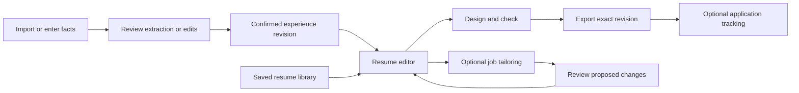

# Your Experience upgrade plan

> Historical plan. On September 29 the user changed the priority to Resume first. The equal-prominence navigation decision below is superseded by [the resume-first workspace plan](resume-first-workspace-plan.md). Retain the implemented ingestion, source-preservation and document-save foundations while revising the workflow hierarchy.

**Status:** reviewed proposal, ready to implement in phases. **Date:** 2026-09-28. **Workspace:** `Taco-upgrade`, branch `codex/taco-upgrade`, including existing uncommitted work. This review adds audit/plan artifacts only; application implementation has not started for this request.

**Owner decision: keep both prominent.** Maintaining career experience and creating/editing resumes are equally important. Neither becomes a hidden setup step for the other.

## 1. Product direction

Your Experience becomes one workspace with two persistent, equally weighted destinations:

| Experience | Resumes |
| --- | --- |
| Maintain a reusable career record: roles, achievements, projects, education, skills, credentials and supporting material. | Create and edit general or job-specific resumes; select content, review changes, design, export and track a chosen version. |
| Primary actions: **Add experience** and **Import**. | Primary action: **Create resume**; each existing document has a direct **Open** action. |
| Save confirmed facts and their source history. | Save independent document revisions linked to the facts they used. |

The first visit presents two equal cards under a visible Your Experience title. Within either destination, the two top-level tabs remain visible. Remember the last destination for returning users without hiding the other one. Keep the current sidebar entry and existing `/suite/resume` links working; proposed child routes are `/suite/resume/experience`, `/suite/resume/resumes`, and `/suite/resume/resumes/[id]`.

The core promise: **keep your experience once; use it to make the document you need.** A resume can be created, edited, designed and exported without a job description or AI generation. Tailoring is an optional action on a copy. Experience changes offer updates to affected resumes, rather than silently rewriting saved or submitted documents.

This is a data and workflow upgrade supported by a visual refinement. More templates alone will not fix the current friction.

## 2. What the review established

Evidence comes from source inspection, local fictional browser flows, existing offline tests, and controlled execution of real handlers with mocked services. Detailed evidence and limitations:

- [Browser and usability review](audits/your-experience-2026/ux-review.md).
- [Ingestion and source review](audits/your-experience-2026/ingestion-review.md).
- [Editor, persistence and tracking review](audits/your-experience-2026/editor-lifecycle-review.md).
- [Template and export review](audits/your-experience-2026/templates-export-review.md).

| Priority | Finding | Evidence / consequence |
| --- | --- | --- |
| P1 | Saved Open is a retargeting path and can retain another document's state. | Browser opens directly at Target; extracted-handler reproduction retains A's candidate/JD/score when opening B. This blocks simple reopening and creates an inconsistent source/candidate pair. |
| P1 | Parser output is not a validated, confirmed source boundary. | Mocked-provider execution of the real route accepts empty/malformed output and invented content. Parsed data is published to shared context before correction; confirmation does not republish the corrected snapshot. This proves missing checks, not a live hallucination rate. |
| P1 | Source identity changes depending on save path. | Auto-save and final-save envelopes classify differently; opening any saved version installs its content as an original. Tailored documents need explicit, persistent source linkage. |
| P1 | Intake can silently omit or alter content. | Extraction truncates at 50,000 characters without a warning; the canonical model lacks several career sections; a sanitizer alters ordinary “Operating system: Linux” text. |
| P1 | Race/retry protection is inconsistent. | The active upload component bypasses the stronger cancellable hook. An alternate tracking handler saves a fresh version on retry instead of reusing the hardened Save & Track command. |
| P1 | Template previews and exports lack a complete page/fidelity contract. | 20 formats exist; HTML uses fixed A4 overflow hiding, and HTML/PDF/DOCX use separate layouts. Actual clipping and Word pagination were not demonstrated in this review and require artifact tests. |
| P1/P2 | Accessibility and status language need correction. | Manual fields lack persistent accessible labels; mobile hides stage names. Presence checks are described as verified, while draft/save and readiness messages overstate what is known. |

Retain the valuable existing work: upload signature/size/worker limits; owner-bound guards; the intake correction form; change review ledger; export truth preparation; source classifiers; template catalog and palette gates; conservative Word companions; and the durable Save & Track recovery path. The plan extends these foundations instead of discarding them.

### Verification snapshot

| Area | Result | What it does not prove |
| --- | --- | --- |
| Intake / upload controller / source classification | 101 existing tests passed. Controlled parser reproductions additionally demonstrate missing output checks. | Active Dropzone race coverage, live model quality, deployed storage retention or real OCR. |
| Review / export truth / save-tracking / source classification | 31 existing tests passed; four synthetic handler/classifier reproductions confirmed lifecycle defects. | Production transactions, complete browser behavior or all outbound callers. |
| Template / palette / integration / PDF / DOCX / export truth | 42 of 43 tests passed. One stale gallery-copy assertion fails at `scripts/resume-template-integration.test.js:179`; the wording changed, the asserted commercial meaning remains. HTML was source-reviewed in this audit. | Visual parity, actual Word page breaks, screen-reader output or employer ATS compatibility. |
| Browser | Arrival, saved Open, change review, Design, Ship, manual first screen; desktop and mobile inspection. | Live imports, account persistence, real exported artifacts or a user study. |

These groups overlap, particularly in source classification; do not add their counts as unique coverage. Resolve the stale assertion during implementation without weakening behavioral checks.

## 3. Information architecture and primary journeys

### Experience

Show a compact overview and editable sections: Work; Projects and achievements; Education; Skills; Credentials; Additional sections; Sources and import history. Supporting stories can link to Story Bank. Keep profile facts, story narratives and resume wording distinct.

Every experience item has a stable identity, user-confirmation status, source reference where available and revision history. Use “Confirmed by you,” “Imported — needs review,” and “Added by you”; avoid implying independent credential verification. Do not label mere completeness as career quality.

Provide quick additions such as a new role, a promotion within an employer, a project or a new achievement. Let users save incomplete work. Ask for missing context near the affected field and support students, freelancers, returning workers and people without conventional employment histories.

### Resumes

The library shows name, general/targeted purpose, last edited time, source revision, account save state and latest export information. Provide search, target/status filters, rename, duplicate, revision history and archive/restore. Keep permanent deletion explicit and distinct from archive. Loading, empty, partial, failed and stale-refresh states must differ.

Opening a row restores that document's editor. The editor exposes **Content / Design / Checks**, with persistent save status and Export. **Tailor to a job** is a separate action. On mobile, use **Edit / Preview** with accessible names and retained section position. Avoid the current mandatory six-stage journey for every return visit.

### Required end-to-end paths

1. **Add experience:** Experience → Add achievement → attach to role/project → confirm → saved experience revision. Offer to update selected resumes; never apply those changes silently.
2. **Import:** choose file or paste → real processing stages → compare extracted facts against source → correct/resolve warnings → confirm exact revision → continue in Experience or create a resume. Preserve the user's starting destination.
3. **General resume:** Resumes → Create → choose confirmed experience, import, or start manually → select/edit content → choose template → inspect pages → export. No job description required.
4. **Existing resume:** Open → exact content and presentation restored → edit or export directly. Tailor creates a branch/copy linked to its original source.
5. **Targeted resume:** choose document and job → extract requirements → propose source-backed changes → accept/revert/edit → design/check/export. Missing qualifications become questions or disclosed gaps, not fabricated claims.
6. **Recovery:** interruption → recover draft or partial save receipt → retry the remaining operation once. Show what succeeded and what remains.

## 4. Intake and processing specification

### One ingestion contract

Use one owner-bound operation from file selection through confirmation, reused by upload and paste. Stage model:

`selected → transferring → extracting → structuring → needs_review → confirmed`

Any processing stage may move to `failed` or `cancelled`; retry resumes only from a reusable successful artifact. Replacement starts a new operation and invalidates the old one. A late callback must never replace the current input or clear its error/loading state. Keep operation identity separate from a content hash so retries and changed content are handled intentionally.

Reuse `startResumeUpload` / `useFileUpload`; move the active Dropzone away from a bare legacy promise. Show upload percentage only when measured; subsequent stages show meaningful text and elapsed state, with cancellation and a bounded deadline. Use structured errors with remedies: sign in, choose supported format, remove password protection, paste text, or retry structuring without uploading again.

### Extraction quality and supported formats

- First certify text PDF, DOCX and plain text against a synthetic fixture corpus. Legacy DOC must either get an isolated, tested converter or be removed from accepted formats; the current Mammoth path does not establish DOC support.
- Preserve exact extracted text, source hash, parser version, page/section boundaries, original character count and truncation/coverage warnings. Never silently drop the last pages to fit a limit.
- Preserve unsupported sections in an unmapped-content area before adding rich editors. Initial structured extensions: projects, certifications/licenses, languages, awards, volunteering and publications. Do not advertise specialist completeness until these sections survive rendering and export.
- Delimit resume text as untrusted data; do not destroy ordinary content with prompt-injection string replacement. Validate extraction claims against the original text. Security filtering must not become the stored factual source.
- Add OCR as a later, bounded fallback for scanned and mixed pages, with explicit user choice where it changes processing/provider cost. Show uncertain regions and original page context. Choose provider and languages after evaluating fixtures; do not advertise unsupported OCR in the meantime.

### Structuring and confirmation

Validate model output with a runtime schema: explicit classification, bounded arrays/strings, proper field types and meaningful output. An unconventional or sparse career record may be valid; validation should not require a corporate resume shape. Incomplete model responses, unknown dates and unsupported claims remain explicit failures/unknowns.

Pair each extracted field or achievement with a source span where possible. Source consistency checks must flag newly introduced employers, dates, credentials, metrics or changed negation. Schema validity alone does not establish truth, and a source span alone does not prove semantic fidelity. Uncertain mappings need user review.

Review layout: source text/page on one side, editable structured record on the other; mobile switches between Source and Fields. Surface high-impact issues first, then preserved/unmapped sections. Include contact links and credentials in the review. Confirmation publishes the exact edited revision atomically; cancel/replace publishes nothing. A user can add a fact absent from the source as an explicit user-authored fact, with separate origin.

### Privacy and recovery

Keep temporary upload bytes, extracted text, device recovery drafts and account records separately described and managed. Raw upload bytes should remain temporary; retain source excerpts/text only under an explicit account retention policy with deletion controls. Verify the documented storage lifecycle backstop with synthetic staging files before making deletion promises. Exclude resume text and personal fields from analytics/error logs.

## 5. Data and command architecture

Proposed contracts; exact database layout should be finalized in the first implementation slice against existing rules and consumers.

| Record | Minimum identity and contents |
| --- | --- |
| `SourceReceipt` | Owner, source ID/revision/hash, origin, extraction version, processing operation ID, warnings, retained source references and retention state. |
| `ExperienceRevision` | Owner, profile/revision/parent IDs, stable fact IDs, normalized facts, preserved additional content, per-fact source or user-authored origin, confirmation hash/time. |
| `ResumeRevision` | Document/revision/parent IDs, exact source revision(s), selected fact references, composed text, optional target revision, template/palette/page settings, review ledger binding and save receipt. |
| `ReviewRecord` | Source and candidate content hashes, stable change IDs, decision per change, unresolved items and check versions. A content change invalidates affected decisions/checks. |
| `ExportReceipt` | Exact resume revision/hash, format, renderer/template version, page size/count where measurable, warnings and artifact checksum. Do not claim a file was submitted merely because it was downloaded. |
| `OperationReceipt` | Owner, operation ID, payload hash, stage, completed side effects and retry status. Reuse the existing durable tracking-recovery pattern. |

Separate **saved**, **reviewed**, **exported**, **tracked** and **submitted** states. They are not synonymous and not a single linear completion percentage. Tracking a role can succeed without a download; exporting a file is not evidence of application submission.

All commands receive explicit snapshot inputs rather than reading mutable React closure state: `confirmIntake`, `openResume`, `saveRevision`, `proposeTailoring`, `exportRevision`, `trackResume`. Capture owner, revision and payload identity at start; guard each asynchronous result and each subsequent side effect. One save/tracking command serves every button. Starting or superseding work owns loading cleanup independently of whether its result may still apply.

### Integration boundaries

Extend `lib/resume-intake.ts`, `ResumeIntakeReview`, the upload controller, `lib/server-resume.ts`, `lib/resume-review-ledger.ts` and `lib/resume-export-truth.ts` rather than introducing parallel implementations. `lib/database-suite.ts` needs the version adapter; `lib/application-kit.ts` and `hooks/useApplicationKitContext.ts` must carry one consistent ID/hash/snapshot together. `lib/career-source-records.ts`, Career Intelligence/Career Twin, job-source selection, Story Bank and writing handoffs should consume that same explicit source contract. Do not create another implicit “latest resume” store.

The existing `/api/profile` and `lib/profile-draft.ts` are account-profile utilities for fields such as phone/bio/display name, not a complete career record. Keep that distinction explicit and define reconciliation of shared contact fields during schema design. Resume creation must not overwrite account identity without an intentional user edit.

Persist versioned recovery drafts with the page target, selected template/palette, source/candidate pair and review state. Existing tab-scoped draft reporting must stay truthful. Proposed improvement: account-scoped durable device recovery for signed-in users, clearly labeled and cleared on sign-out/deletion; anonymous recovery remains explicitly tab-scoped until a deliberate device-retention choice is designed. Never retire recovery state until a reloadable account revision and receipt exist. Handle multi-tab revision conflicts without silently overwriting newer work.

### Migration and compatibility

- Preserve existing resume IDs, template IDs/aliases, application references and source classifiers. Do not rewrite the existing large working tree or perform a blanket database migration.
- Introduce a versioned envelope and read adapter. Old records with missing source lineage remain usable as documents with “Original source unavailable”; do not manufacture source provenance or mark them newly verified.
- Existing generated records stay generated. User confirmation of wording does not retroactively turn generated output into historical evidence. Adding a genuinely new fact to Experience is a separate attributable edit.
- Use additive writes with revision preconditions, bounded paginated library reads and owner rules. Backfill only after a dry-run inventory and rollback fixture prove content and references survive.
- Feature-flag the new UI. Rollback may restore the old UI while continuing to read new envelopes through the compatibility layer; test this path before release.

## 6. Editor, AI review and checks

Unify manual creation and imported-document editing around the same section editor. Include add/reorder/hide sections, move bullets, undo/redo, clear save state, revision comparison and optional rich section types. Keyboard controls must accompany drag-and-drop. Hiding content in one resume does not delete it from Experience.

Users may edit freely. Wording edits stay in the document; changes to facts show an explicit choice to update Experience, retain a documented document-only assertion, or revise the wording. Do not silently reconcile conflicts. Keep all assertions attributable, including user-authored material.

AI acts on the selected passage/section or an optional target. Lead with understandable actions: **Improve clarity**, **Shorten**, **Emphasize relevant experience**. Advanced strength controls must never imply a weaker factual boundary. Proposed changes include before/after, reason, source references and any unresolved factual question. Never generate numerical achievements merely to fill a template.

Retain the current conservative review ledger and truth-preserving export checks. Bind review decisions to exact source/candidate content; do not let old acceptance carry across an unrelated saved version. Manual content does not need a pointless AI-review step when no AI changes exist.

Replace the large Proof Engine with a compact Checks drawer:

- **Content:** missing contact details, incomplete entries, duplicate bullets and date inconsistencies; distinguish blockers from optional advice.
- **Source consistency:** specific claims checked, unsupported changes and unavailable source evidence. Use “matches your confirmed source,” not credential verification.
- **Layout:** actual pages, overflow, awkward splits, contrast and reading-order observations.
- **Role coverage (optional):** stated requirements covered by existing facts, gaps and evidence; no fabricated match precision or hiring-probability claims.

Do not block a student because there is no employment section, require a summary for every template, or require a degree for every user. Export blockers should be specific: unresolved unsupported generated claims, actual truncation, malformed output or entitlement failures. Incomplete user-authored fields should usually offer clear corrections or removal of the incomplete item. Account saving requirements are a separate capability from document quality.

## 7. Templates and export

### Selection

Keep the 20 selectable templates (3 Free foundational designs and 17 Standard designs) and existing saved-document compatibility. Start with three explained recommendations based on content length, section needs and presentation preference; allow browsing all. Recommendations are suitability heuristics, not claims of better hiring outcomes.

Each card should show a preview of the user's content, column structure, density, suitable content types, available file formats, parsing limitations and entitlement. Add comparison of two templates. A public `?template=` link should open Design when a document exists; otherwise retain the selected template through intake with a clear next action. Template changes never mutate the career facts or silently discard unsupported sections.

Make template access and palette access distinct before selection. Preserve the existing commercial tiers; do not redesign pricing as part of this upgrade. If access changes, retain document content and explain available export options instead of silently changing its appearance.

### Pagination and artifact fidelity

The existing Auto / 1 Page / 2 Pages control is a generation preference; the missing contract is enforced layout behavior and actual output page count. Treat requested page length as a preference until the rendered artifact proves it.

Define a renderer-independent document content tree and shared presentation tokens, then adapt it to HTML, PDF and Word. PDF geometry should be authoritative for the PDF preview: preferably display the generated export artifact, with a faster editing preview clearly distinguished until refreshed. Word is intentionally a linear companion and needs its own preview/description. Do not promise pixel identity between formats.

Support A4 and US Letter as explicit document settings. Display actual PDF pages, overflow and section splits. For a requested one-page output that cannot fit, offer shortening suggestions or another page; never silently drop facts or force unreadably small text. Preserve selected settings through reload and save.

Certify every selectable template with sparse, ordinary, long and Unicode fixtures. Compare field inventories, order, links, text extraction, screenshots and continuation-page behavior across browser preview and PDF. Validate representative Word-to-PDF results in supported office runtimes before making page-count claims for Word. Include specialty sections in the corpus as they are introduced.

Protect symbols, names, diacritics, links and meaningful punctuation. Make any parser-normalized text transformation intentional, documented and tested. Maintain scoped ATS language: extraction checks are not certification against every employer's system.

### Export interaction

One Export action opens **Designed PDF** and **Editable Word** with a concise explanation, actual preview where supported, page information, filename and specific warnings. The exported bytes must correspond to the displayed reviewed revision. Save-to-account and Track application remain adjacent optional actions using the same command/revision contract.

## 8. Design language and accessibility

Carry the approved landing identity into the application shell: warm paper, restrained grid, ink typography, coral emphasis, firm rules and the folded A. Keep headers compact and spacing purposeful; use the same tokens/components across both destinations. Use uppercase/monospace sparingly for metadata, not long instructions.

The brand belongs in workspace navigation and controls. Employer-facing resume templates retain their own professional typography and composition; do not force a coral grid or Taco watermark onto exported documents.

Maintain visible field labels, meaningful headings, accessible names for stages and actions, focus restoration after dialogs, status announcements, keyboard section movement and comfortable touch targets. At mobile widths, keep both primary destinations accessible and use task-focused Edit/Preview switching. Avoid decorative motion indicators. Any functional motion should be brief and respect reduced-motion preferences.

## 9. Implementation sequence and release gates

| Phase | Scope and main seams | Depends on | Exit criteria |
| --- | --- | --- | --- |
| 0 — Contain current integrity defects | Parser runtime contract; commit corrected intake only on confirmation; reset/rebind saved Open; explicit generated/source metadata; route all tracking through durable command; active upload operation ownership; accessible labels/status corrections. Files: parse route, Resume page, Dropzone/upload hook, provenance/classifiers, recovery helpers. | Current baseline/reproductions. | Malformed output fails safely; rejected imports never publish; A→B never mixes state; retry creates one version/application pair; invalidated requests return to usable idle. |
| 1 — Deliver the first complete user journey | Versioned experience/document contracts and compatibility adapter; equal Experience/Resumes shell; shared editor; direct saved Open; general resume → Design → Export without JD; accurate recovery/save states. Incrementally extract controllers from the ~4,500-line Resume page. | Phase 0 invariants. | Import/manual → confirm → general resume → select template → save/reopen/export works, with both destinations prominent. Existing IDs/application links still resolve. |
| 2 — Preserve and maintain full experience | Source receipts, source-vs-fields review, unmapped content, stable fact IDs, initial additional section types, import history, duplicate/conflict review and resume update proposals. | Versioned contracts in Phase 1. Preserve unmapped content from the first slice; richer editors follow here. | Long/multicolumn and specialty fixtures report omissions; confirmed edits propagate intentionally; a profile update never changes a saved/submitted document silently. |
| 3 — Refine editing and optional tailoring | Shared section controls, undo/redo, optional target, bounded AI proposals, content-bound review and compact Checks. Consolidate create/morph paths, Application Kit identity and cross-tool handoffs. | Source identity from Phases 1–2. | Both general and targeted paths complete; source edits invalidate affected reviews; stale responses and reloads preserve intended work. |
| 4 — Certify templates and exports | Content tree/adapters, public deep links, selection/entitlement clarity, A4/Letter, artifact preview, page/overflow contract, linear Word description and fidelity suite. | Shared document model; template work can run in parallel after that contract stabilizes. | All 20 selectable formats retain supported content; no unreported clipping; exact-revision export receipts; visual and office-runtime checks documented. |
| 5 — Finish the integrated experience | Library search/archive/history, cross-tool revision handoffs, keyboard/screen-reader/mobile checks, error/empty/offline states, controlled rollout and retention verification. | Earlier vertical slices. Basic a11y/recovery is required throughout, not postponed to this phase. | Acceptance journeys and fault cases pass; migration/rollback pass; usability baseline and operational evidence recorded. |
| Follow-on — OCR and advanced specialist support | Bounded OCR, wider languages, richer academic/project sections after fixture evaluation. | Extraction baselines, provider/retention decision and export support. | Measured page/field coverage with explicit unsupported cases; no unsupported capability claims. |

Do not begin by adding another template or fully rewriting the page. The first build should repair the source/document boundary and ship the **general resume without a job description** path. That produces a useful, reviewable improvement while preserving the existing tailoring capabilities.

## 10. Acceptance and test strategy

Use behavioral tests around real contracts and loaded handlers, plus browser and exported-artifact checks. Do not substitute string assertions for actual lifecycle behavior. Existing safety tests remain mandatory.

| Scenario | Required result |
| --- | --- |
| Malformed, empty or truncated model output; invented company/date/metric; changed negation | Recoverable error or flagged draft; never silently confirmed/shared. |
| Source correction, reject, replace; upload A resolves after B; owner/reset/unmount during processing | Only the active owner's intended confirmed revision commits; UI settles correctly. |
| Unicode names, links, final-page credentials, columns/tables, long CV, sparse first-job record | Content survives or omissions are explicit; unsupported sections remain recoverable. |
| Scanned/mixed/rotated/password PDF; legacy DOC; malformed archive | Accurate support/error message; bounded work; no generic success with most content missing. OCR cases remain rejected/recoverable until OCR ships. |
| General resume without JD; saved Open; A→B switch; direct template deep link | No forced generation or retargeting; exact document/revision and intended design restored. |
| Draft → save → reload; custom page target; source/candidate ledger; multi-tab conflict; account switch | Correct recovery context, honest status, no cross-account display/write or silent overwrite. |
| Save response lost; create response lost; double click; reload/retry tracking | One stable save/application pair, visible partial success and resumable command. |
| All template formats with sparse/normal/long/Unicode content; A4/Letter | Text inventory, reading order, overflow and actual PDF pages verified; allowed Word differences explicit. |
| Source update after review; saved tailored record reopened; cross-tool handoff/return | Generated content never becomes source implicitly; proposal returns to the intended revision; stale checks invalidated. |
| Keyboard/mobile/screen reader; denied storage; failed library read; changed entitlement | Named controls/stages, recoverable error, retained content and clear available actions. |

For provider and cloud integration, use a synthetic staging account and bounded calls only when implementation reaches that phase. Production authentication/rules, quota charging, provider retention and bucket lifecycle were not proved by this local review.

## 11. Measuring improvement

No user-study or production funnel baseline was measured here. Instrument low-content events only: entry destination, intake stage/result, correction count, first usable resume, design change, export success and recovery outcome. Do not send resume/JD text, names, contact details or source excerpts to analytics.

Before rollout, measure the same tasks on old/new flows: find a saved resume and export it; create a general resume; add a new achievement; correct an import; recover an interrupted save. Track completion, time, wrong turns and perceived clarity. Use consented sessions spanning early-career, experienced, career-change and long-CV needs.

Proposed release targets: every scripted core journey completes; zero unexpected lost/invented facts in the fixed regression corpus; zero mixed-revision or duplicate-operation results in fault tests; saved resume is exportable without retargeting; both destinations are discoverable without opening a secondary menu. Set quantitative usability/latency targets after collecting baseline data rather than inventing improvement percentages.

## 12. Decisions and scope boundaries

**Settled:** equal prominence; one shared confirmed experience record with independently versioned resumes; optional targeting; preserve approved visual identity; preserve existing template investment; fix source and save integrity before cosmetic expansion.

**Proposed defaults:** two peer tabs; last destination remembered; general resume creation is immediately available; profile changes produce reviewable update proposals; PDF preview reflects the export artifact; Word is explicitly a linear editable companion; old unlinked resumes remain usable with honest lineage status.

**Implementation decisions still to resolve through evidence:** database/rules shape for versioned records; source-text retention and deletion policy; supported office runtimes; OCR provider/languages/cost bounds; specialist section rollout and template support. These do not block the initial integrity fixes and direct-edit slice.

**Outside this upgrade's first release:** pricing changes, extra template volume, automatic applications/publication, universal ATS guarantees, replacing unrelated career tools, or silently promoting AI-written claims into the career record.
